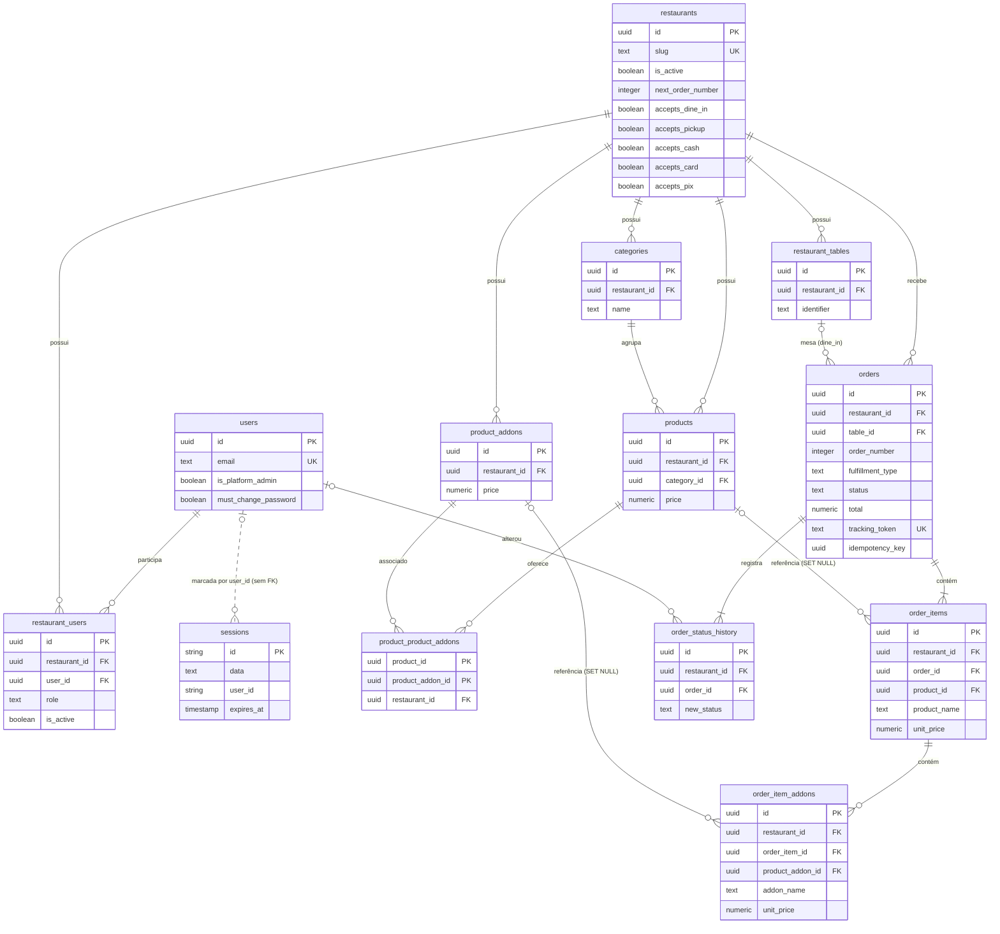

# ROADMAP — MVP do Cardápio Digital

> Status: **decisões de produto aprovadas em 2026-11-15**; **Fases 0 a 6 concluídas** e **reorganização das Fases 6, 7 e 8 aprovada em 2026-11-16** (seção 10) e **direção visual da Fase 7 aprovada em 2026-11-16** ([ADR 0008](decisions/0008-direcao-visual-papel-e-tinta.md), F7-T4a). Questões em aberto na seção 11.2: validação jurídica da retenção de dados, infraestrutura e armazenamento de imagens, parâmetros do hash de senha e demais itens de produção.
> Documento de planejamento e acompanhamento das fases. Referências a F6-T4 a F6-T8 em ADRs e em outros documentos devem ser lidas pela tabela de equivalência ao fim da Fase 8 (seção 10).
> Referência principal: [`CLAUDE.md`](../CLAUDE.md). Em caso de conflito, o `CLAUDE.md` prevalece.

## Sumário

1. Visão e controle de escopo
2. Perfis e funcionalidades
3. Arquitetura
4. Modelo de dados
5. Regras de negócio
6. Segurança e isolamento
7. Dados pessoais
8. API
9. Frontend
10. Fases e tarefas
11. Decisões registradas e questões em aberto

---

## 1. Visão e controle de escopo

Sistema multi-tenant de cardápio digital e pedidos simples para restaurantes de pequeno porte. Princípios do `CLAUDE.md`: só o necessário, menor solução que preserve segurança e manutenção, evolução incremental, uma fase validada antes da próxima.

**Fora do MVP** (só com necessidade funcional comprovada, decisão explícita do usuário e ADR curto): pagamento online e gateways, planos, assinaturas e cobrança, recuperação de senha por e-mail, Redis, filas e workers, Outbox, RLS, microsserviços, GraphQL, Kubernetes, relatórios avançados, fidelidade, integrações externas de delivery, notificações externas. **Alteração de escopo (PEND-47, 2026-11-17):** a entrega (delivery) foi retirada desta lista e passou a fazer parte do MVP, ainda sem especificação (ABERTO-10). Planos e cobrança continuam fora; o campo de plano e as capacidades por plano são evolução arquitetural, **não implementada** (PEND-46 e PEND-50). A entrega está no escopo técnico, mas **não é oferta comercial** até ser implementada e homologada (PEND-50).

**Regra de dependências:** antes de adicionar dependência, camada ou tecnologia, verificar se a stack existente resolve. Cada dependência nova exige justificativa em ADR curto (`docs/decisions/`). Dependências já aprovadas além da stack base: `big.js` (cálculo monetário no backend) e `qrcode` (QR Code no frontend), além do driver S3 para imagens em produção e dos pacotes oficiais do AdonisJS `@adonisjs/auth` e `@adonisjs/session` (driver `database`), instalados na Fase 2 (F2-T1 e F2-T3).

## 2. Perfis e funcionalidades

| Perfil | Funcionalidades |
| --- | --- |
| Administrador da plataforma (`platform_admin`) | Autenticar-se; cadastrar, editar, consultar e ativar/desativar restaurantes; criar o `owner` inicial ou vincular um usuário existente como `owner`. Sem planos, assinaturas ou cobrança. **Sem acesso a pedidos nem a dados pessoais dos clientes.** |
| Dono do restaurante (`owner`) | Tudo que o `staff` faz, mais: editar dados e configurações do restaurante; criar e desativar `staff`; gerenciar mesas e QR Codes; excluir ou desativar categorias, produtos e adicionais. |
| Equipe (`staff`) | Consultar cardápio e pedidos; atualizar o status dos pedidos; criar e editar categorias, produtos e adicionais (sem excluir nem desativar). |
| Cliente (sem conta) | Acessar o cardápio por URL; ver categorias, produtos, imagens, descrições e preços; escolher produtos, adicionais e quantidade; montar o carrinho e ver o total cotado pelo backend (seção 5.9); informar nome e, quando exigido, telefone; escolher modalidade e forma de pagamento habilitadas; enviar o pedido; acompanhar o próprio pedido pelo token. Não cancela pedido. Não acessa pedidos de terceiros. |

## 3. Arquitetura

- Stack do `CLAUDE.md`: TypeScript, pnpm workspaces, Next.js (App Router), Tailwind, shadcn/ui, AdonisJS, Lucid, PostgreSQL, Japa, Playwright, Docker Compose.
- O frontend consome a API diretamente. Não há BFF com regras de negócio. Toda regra e persistência ficam na API.
- Módulos da API: `auth`, `restaurants`, `menu`, `orders`. Nenhum outro módulo sem funcionalidade prevista.
- Estrutura: `apps/web`, `apps/api`, `docs/decisions`, `docker-compose.yml`. `packages/` só se duas apps compartilharem código.
- **Mesma origem (decidido):** em produção, Nginx serve a web e encaminha `/api` ao AdonisJS no mesmo domínio. Em desenvolvimento, o Next.js usa proxy/rewrite para `/api`. Sem CORS no fluxo normal.
- **PostgreSQL 15 ou superior (decidido)**, padronizado em Docker Compose, desenvolvimento, testes, produção e documentação de implantação (necessário para `ON DELETE SET NULL (coluna)`).
- **Imagens (decidido):** disco local em desenvolvimento e object storage compatível com S3 em produção. O banco guarda somente a chave ou o caminho relativo. A integração com o storage só é criada na Fase 3.
- **Rate limit (decidido):** em memória do processo, com uma única instância da API na primeira implantação. O contador reinicia com o processo. Se houver mais de uma instância, a estratégia deve ser revista antes de escalar. O Nginx aplica limites de conexão e requisição como defesa complementar, sem substituir a aplicação.

---

## 4. Modelo de dados

### 4.1 Convenções

- PK `uuid` (`gen_random_uuid()`), exceto a tabela de junção `product_product_addons` e a tabela de infraestrutura `sessions` (PK `string` gerada pelo `@adonisjs/session`).
- Datas `timestamptz`; `created_at` e `updated_at` com `default now()` (`order_status_history`, `order_items` e `order_item_addons` só têm `created_at`).
- Dinheiro: `NUMERIC(10,2)` e `CHECK (>= 0)`. No backend, **`big.js`** para todos os cálculos. Valores trafegam como string decimal. Nunca `float` nem `number` em cálculos.
- Domínios fechados (`role`, `status`, modalidades, métodos) usam `text` + `CHECK`, mais simples de evoluir que enum nativo.
- Toda tabela de dados de restaurante tem `restaurant_id NOT NULL`. Tabelas que são alvo de FK composta têm `UNIQUE (id, restaurant_id)`. **Exceção explícita:** `users` e `sessions` são tabelas de identidade e infraestrutura de autenticação, não guardam dados de restaurante e não têm `restaurant_id`.
- Sem `deleted_at`: usa-se `is_active` ou `is_available`, onde há histórico a preservar.
- Limites de tamanho de texto: seção 4.5, aplicados por `varchar(n)` ou `CHECK (char_length(...) <= n)` e pela validação da API.

### 4.2 Diagrama ER

### 4.3 Fichas das tabelas

Legenda: **NN** = `NOT NULL`. Toda FK "composta" inclui `restaurant_id`. Sem `ON UPDATE` explícito (chaves são imutáveis; `NO ACTION`).

#### `users` — identidade de quem administra (plataforma ou restaurante)

| Campo | Tipo | Regra |
| --- | --- | --- |
| id | uuid | PK |
| name | text | NN |
| email | text | NN; índice único em `lower(email)` |
| password | text | NN; somente hash (padrão do AdonisJS) |
| is_platform_admin | boolean | NN, default `false` |
| must_change_password | boolean | NN, default `false`; `true` para usuários criados com senha temporária |
| created_at, updated_at | timestamptz | NN |

O papel `platform_admin` não pertence a restaurante, então fica em `users` e evita `restaurant_id` nulo em `restaurant_users`. Não há tabela de papéis nem de permissões: os papéis são fixos.

#### `sessions` — sessões de login (infraestrutura; sem `restaurant_id`)

Tabela do driver `database` oficial do `@adonisjs/session`, criada **com a migration gerada pelo próprio AdonisJS** (`node ace make:session-table`), sem armazenamento paralelo. A migration versionada em `apps/api` deve ser idêntica à gerada, salvo ajuste explícito registrado em ADR. Esquema verificado no código-fonte do pacote (v8.3.0, AdonisJS 7; ver a nota de versão abaixo):

| Campo | Tipo | Regra |
| --- | --- | --- |
| id | string | PK; identificador da sessão (UUID v4 gerado pelo pacote), o mesmo valor do cookie |
| data | text | NN; dados da sessão assinados pelo pacote (opcionalmente criptografados). Contém a identidade do usuário e `login_at` (ver abaixo) |
| user_id | string | nulo; índice. Etiqueta de *session tagging*: guarda a **representação textual do UUID de `users.id`** (`String(user.id)`), formato exigido pelo pacote (o tipo `string` da coluna não casa com `uuid`). **Sem FK** para `users`, e usuários não são excluídos fisicamente |
| expires_at | timestamp | NN; índice. Validade por inatividade, **deslizante** |

Não há `created_at`, `last_activity_at` nem `restaurant_id`. **Estratégia real de expiração** (o driver não grava criação nem última atividade):

- **Inatividade (2 horas, padrão):** o driver grava `expires_at = agora + age` em toda escrita ou `touch` ao fim de cada requisição que carrega a sessão. `read` recusa e apaga a sessão com `expires_at` vencido. O padrão de `age` do pacote já é 2 horas.
- **Limite absoluto (12 horas):** o driver **não** o oferece. É validado no servidor por um middleware próprio e pequeno, que roda após a sessão e a autenticação: compara `agora − login_at` com o limite absoluto, sendo `login_at` gravado nos dados (assinados) da sessão no login e **nunca atualizado** por atividade nem pela rotação do identificador. Sessão sem `login_at`, ou vencida, é destruída e responde `401`.
- **Limpeza:** leitura de sessão vencida a apaga, e o pacote faz coleta probabilística (padrão 2% das escritas). Sem job agendado.
- **Revogação de outras sessões:** *session tagging* confirmado no driver `database` (`session.tag`, `session.untag`, `SessionCollection.tagged`, `SessionCollection.destroy`). Após o login, a sessão é etiquetada com o id do usuário (o login regenera o id, então a etiqueta vem depois).
- Sem *remember me*: não há tokens de longa duração que reabram sessões revogadas.

Nota de versão: a verificação foi feita contra `@adonisjs/session` 8.3.0 (peer: `@adonisjs/core` 7 e `@adonisjs/lucid` 22). Em F1-T2, conferir a versão do AdonisJS gerada pelo scaffold; se for outra, repetir esta verificação antes de F2-T1.

#### `restaurants` — tenant

| Campo | Tipo | Regra |
| --- | --- | --- |
| id | uuid | PK |
| name | text | NN |
| slug | text | NN; `UNIQUE`; `CHECK (slug ~ '^[a-z0-9]+(-[a-z0-9]+)*$')`, de 3 a 60 caracteres; lista de slugs reservados validada na API |
| description | text | nulo |
| phone | text | nulo |
| logo | text | nulo; chave ou caminho relativo no storage |
| is_active | boolean | NN, default `true` |
| accepts_dine_in | boolean | NN, default `true`; modalidade `dine_in` habilitada |
| accepts_pickup | boolean | NN, default `true`; modalidade `pickup` habilitada |
| accepts_cash | boolean | NN, default `true`; pagamento em dinheiro habilitado |
| accepts_card | boolean | NN, default `true`; pagamento em cartão habilitado |
| accepts_pix | boolean | NN, default `true`; Pix presencial habilitado |
| next_order_number | integer | NN, default `1001`; **próximo número de pedido disponível** |
| created_at, updated_at | timestamptz | NN |

Restrições: `CHECK (accepts_dine_in OR accepts_pickup)` e `CHECK (accepts_cash OR accepts_card OR accepts_pix)`. As configurações ficam em colunas booleanas (sem tabela de configuração). Restaurante não é excluído fisicamente no MVP: usa-se `is_active`.

#### `restaurant_users` — vínculo entre usuário e restaurante

| Campo | Tipo | Regra |
| --- | --- | --- |
| id | uuid | PK |
| restaurant_id | uuid | NN; FK → `restaurants(id)` `ON DELETE RESTRICT` |
| user_id | uuid | NN; FK → `users(id)` `ON DELETE RESTRICT` |
| role | text | NN; `CHECK (role IN ('owner','staff'))` |
| is_active | boolean | NN, default `true`; desativa o vínculo sem excluir o registro |
| created_at, updated_at | timestamptz | NN |

Restrições: `UNIQUE (restaurant_id, user_id)`; índice em `user_id`. Um usuário pode ter vínculo com vários restaurantes. Vínculo inativo não concede nenhum acesso.

#### `categories`

| Campo | Tipo | Regra |
| --- | --- | --- |
| id | uuid | PK |
| restaurant_id | uuid | NN; FK → `restaurants(id)` `RESTRICT` |
| name | varchar(80) | NN |
| description | text | nulo |
| sort_order | integer | NN, default 0 |
| is_active | boolean | NN, default `true` |
| created_at, updated_at | timestamptz | NN |

Restrições: `UNIQUE (id, restaurant_id)`; `UNIQUE (restaurant_id, name)`. Exclusão física só sem produtos (FK de `products` é `RESTRICT`); caso contrário, desativar. Excluir e desativar são ações do `owner`.

#### `products`

| Campo | Tipo | Regra |
| --- | --- | --- |
| id | uuid | PK |
| restaurant_id | uuid | NN; FK → `restaurants(id)` `RESTRICT` |
| category_id | uuid | NN; FK **composta** `(category_id, restaurant_id)` → `categories(id, restaurant_id)` `RESTRICT` |
| name | varchar(120) | NN |
| description | varchar(1000) | nulo |
| price | numeric(10,2) | NN; `CHECK (price >= 0)` |
| image | text | nulo; chave ou caminho relativo gerado pelo servidor |
| is_available | boolean | NN, default `true` |
| sort_order | integer | NN, default 0 |
| created_at, updated_at | timestamptz | NN |

Restrições: `UNIQUE (id, restaurant_id)`; índice `(restaurant_id, category_id, sort_order)`. Produto indisponível não aparece no cardápio público nem entra em novos pedidos. Alterar `is_available` é ação do `owner`.

#### `product_addons` — adicionais simples e opcionais

| Campo | Tipo | Regra |
| --- | --- | --- |
| id | uuid | PK |
| restaurant_id | uuid | NN; FK → `restaurants(id)` `RESTRICT` |
| name | varchar(80) | NN |
| description | varchar(500) | nulo |
| price | numeric(10,2) | NN; `CHECK (price >= 0)` |
| is_available | boolean | NN, default `true` |
| created_at, updated_at | timestamptz | NN |

Restrições: `UNIQUE (id, restaurant_id)`; `UNIQUE (restaurant_id, name)`.

**Decisão de modelagem:** só adicionais **opcionais e simples**. O cliente marca ou não cada adicional, e cada adicional marcado vale **para cada unidade** do item. Não há quantidade mínima ou máxima, grupos, escolhas obrigatórias nem quantidade por adicional.

#### `product_product_addons` — quais adicionais cada produto oferece

| Campo | Tipo | Regra |
| --- | --- | --- |
| product_id | uuid | NN; parte da PK |
| product_addon_id | uuid | NN; parte da PK |
| restaurant_id | uuid | NN |
| created_at | timestamptz | NN |

PK `(product_id, product_addon_id)`, sem `id` próprio. FKs **compostas**: `(product_id, restaurant_id)` → `products(id, restaurant_id)` e `(product_addon_id, restaurant_id)` → `product_addons(id, restaurant_id)`, ambas `ON DELETE CASCADE` (a associação é só configuração; o histórico está nos snapshots). Índice em `product_addon_id`. Limite de 10 adicionais por produto (validado na API).

#### `restaurant_tables` — mesas (modalidade `dine_in`)

| Campo | Tipo | Regra |
| --- | --- | --- |
| id | uuid | PK |
| restaurant_id | uuid | NN; FK → `restaurants(id)` `RESTRICT` |
| name | varchar(60) | NN (ex.: "Mesa 5") |
| identifier | text | NN; código curto aleatório, não sequencial, usado no QR Code |
| is_active | boolean | NN, default `true` |
| created_at, updated_at | timestamptz | NN |

Restrições: `UNIQUE (id, restaurant_id)`; `UNIQUE (restaurant_id, identifier)`. Gerenciada pelo `owner`. **O identificador não é autenticação**: só dá contexto ao pedido.

#### `orders`

| Campo | Tipo | Regra |
| --- | --- | --- |
| id | uuid | PK |
| restaurant_id | uuid | NN; FK → `restaurants(id)` `RESTRICT` |
| order_number | integer | NN; número sequencial por restaurante, atribuído na criação |
| table_id | uuid | nulo; FK **composta** `(table_id, restaurant_id)` → `restaurant_tables(id, restaurant_id)` `ON DELETE SET NULL (table_id)` |
| table_name | varchar(60) | nulo; snapshot do nome da mesa (`dine_in`) |
| customer_name | varchar(120) | NN |
| customer_phone | varchar(20) | nulo; obrigatório em `pickup` |
| fulfillment_type | text | NN; `CHECK (fulfillment_type IN ('dine_in','pickup'))` |
| payment_method | text | NN; `CHECK (payment_method IN ('cash','card','pix'))` |
| status | text | NN, default `'pending'`; `CHECK` com os estados da seção 5.3 |
| total | numeric(10,2) | NN; `CHECK (total >= 0)`; soma de `order_items.subtotal`, calculada no backend com `big.js` |
| notes | varchar(500) | nulo; observação do cliente |
| tracking_token | text | NN; `UNIQUE`; aleatório, não previsível |
| idempotency_key | uuid | NN; chave enviada pelo cliente no header `Idempotency-Key` |
| idempotency_hash | text | NN; SHA-256 do payload normalizado recebido do cliente |
| created_at, updated_at | timestamptz | NN |

Restrições:
- `UNIQUE (id, restaurant_id)`; `UNIQUE (restaurant_id, order_number)`; `UNIQUE (restaurant_id, idempotency_key)`.
- `CHECK (fulfillment_type = 'dine_in' OR customer_phone IS NOT NULL)`: telefone obrigatório em `pickup`.
- `CHECK ((fulfillment_type = 'dine_in' AND table_name IS NOT NULL) OR (fulfillment_type = 'pickup' AND table_id IS NULL AND table_name IS NULL))`: `pickup` não pode ter mesa e `dine_in` precisa do snapshot da mesa. `table_id` de `dine_in` é obrigatório na criação (validado pela API) e pode virar nulo depois por `SET NULL`; por isso o `CHECK` não exige `table_id` em `dine_in`.
- Índice `(restaurant_id, status, created_at DESC)`.

Não há `subtotal`, `delivery_address`, taxa nem desconto no MVP: `total` é a soma dos itens. `table_name` é um acréscimo ao rascunho, necessário para o snapshot sobreviver à exclusão da mesa (seção 5.6).

#### `order_items` — snapshot dos itens

| Campo | Tipo | Regra |
| --- | --- | --- |
| id | uuid | PK |
| restaurant_id | uuid | NN |
| order_id | uuid | NN; FK **composta** `(order_id, restaurant_id)` → `orders(id, restaurant_id)` `ON DELETE RESTRICT` |
| product_id | uuid | nulo; FK **composta** `(product_id, restaurant_id)` → `products(id, restaurant_id)` `ON DELETE SET NULL (product_id)` |
| product_name | varchar(120) | NN; cópia do nome no momento do pedido |
| unit_price | numeric(10,2) | NN; cópia do preço unitário do produto |
| quantity | integer | NN; `CHECK (quantity BETWEEN 1 AND 20)` |
| subtotal | numeric(10,2) | NN; **(unit_price + soma dos preços dos adicionais) × quantity** |
| created_at | timestamptz | NN |

Restrições: `UNIQUE (id, restaurant_id)`; índice em `order_id`.

#### `order_item_addons` — snapshot dos adicionais

| Campo | Tipo | Regra |
| --- | --- | --- |
| id | uuid | PK |
| restaurant_id | uuid | NN |
| order_item_id | uuid | NN; FK **composta** `(order_item_id, restaurant_id)` → `order_items(id, restaurant_id)` `RESTRICT` |
| product_addon_id | uuid | nulo; FK **composta** `(product_addon_id, restaurant_id)` → `product_addons(id, restaurant_id)` `ON DELETE SET NULL (product_addon_id)` |
| addon_name | varchar(80) | NN; cópia do nome |
| unit_price | numeric(10,2) | NN; cópia do preço do adicional, por unidade do item |
| subtotal | numeric(10,2) | NN; `unit_price` × `quantity` do item pai |
| created_at | timestamptz | NN |

Não há `quantity` nesta tabela: o cálculo usa a quantidade de `order_items`. Exemplo: 3 unidades de um produto com um adicional de R$ 2,00 geram R$ 6,00 em adicionais. Restrição: `UNIQUE (order_item_id, product_addon_id)`.

#### `order_status_history` — histórico de status

| Campo | Tipo | Regra |
| --- | --- | --- |
| id | uuid | PK |
| restaurant_id | uuid | NN |
| order_id | uuid | NN; FK **composta** `(order_id, restaurant_id)` → `orders(id, restaurant_id)` `RESTRICT` |
| previous_status | text | nulo no registro de criação |
| new_status | text | NN; mesmo `CHECK` de `orders.status` |
| changed_by_user_id | uuid | nulo; FK → `users(id)` `ON DELETE SET NULL`; nulo na criação feita pelo cliente |
| created_at | timestamptz | NN |

Índice `(order_id, created_at)`. O campo `changed_by_user_id` é a auditoria mínima de quem alterou o pedido.

### 4.4 Matriz de FKs compostas (integridade por restaurante)

Cada relação exige um teste de integração que **tenta criar ou atualizar** a linha apontando para um registro de outro restaurante e espera falha por violação de FK. Os testes são independentes da API (defesa em profundidade).

| ID | Relação | Teste esperado |
| --- | --- | --- |
| FK-01 | `products` → `categories` | Produto do restaurante A com categoria do B é rejeitado |
| FK-02 | `product_product_addons` → `products` | Associação com produto de outro restaurante é rejeitada |
| FK-03 | `product_product_addons` → `product_addons` | Associação com adicional de outro restaurante é rejeitada |
| FK-04 | `orders` → `restaurant_tables` | Pedido do restaurante A com mesa do B é rejeitado |
| FK-05 | `order_items` → `orders` | Item com `restaurant_id` diferente do pedido é rejeitado |
| FK-06 | `order_items` → `products` | Item referenciando produto de outro restaurante é rejeitado |
| FK-07 | `order_item_addons` → `order_items` | Adicional de item com `restaurant_id` diferente é rejeitado |
| FK-08 | `order_item_addons` → `product_addons` | Referência a adicional de outro restaurante é rejeitada |
| FK-09 | `order_status_history` → `orders` | Histórico com `restaurant_id` diferente do pedido é rejeitado |

Testes de `SET NULL`: excluir produto, adicional ou mesa anula somente a coluna de referência, preserva `restaurant_id` e mantém os snapshots.

Testes de restrições (CT):

| ID | Restrição | Teste esperado |
| --- | --- | --- |
| CT-01 | `UNIQUE (restaurant_id, order_number)` | Número repetido no mesmo restaurante é rejeitado; mesmo número em restaurantes diferentes é aceito |
| CT-02 | `UNIQUE (restaurant_id, idempotency_key)` | Chave repetida no mesmo restaurante é rejeitada; em restaurantes diferentes é aceita |
| CT-03 | `CHECK` de telefone | `pickup` sem telefone é rejeitado; `dine_in` sem telefone é aceito |
| CT-04 | `CHECK` de mesa | `pickup` com mesa é rejeitado; `dine_in` sem `table_name` é rejeitado |
| CT-05 | `CHECK` de configuração | Restaurante sem nenhuma modalidade ou sem nenhum método de pagamento é rejeitado |
| CT-06 | `CHECK` de quantidade e preços | Quantidade fora de 1 a 20 e valores negativos são rejeitados |

### 4.5 Limites de tamanho (decididos)

| Campo | Limite |
| --- | --- |
| Produtos distintos por pedido | 30 |
| Quantidade por produto | 1 a 20 |
| Adicionais por produto | 10 |
| Nome do cliente | 120 caracteres |
| Telefone | 20 caracteres |
| Observação do pedido | 500 caracteres |
| Nome de categoria | 80 caracteres |
| Nome de produto | 120 caracteres |
| Descrição de produto | 1.000 caracteres |
| Nome de adicional | 80 caracteres |
| Descrição de adicional | 500 caracteres |
| Imagem | 5 MB; JPEG, PNG e WebP |

Os limites de itens por pedido e de adicionais por produto são validados na API (e testados). Nome de mesa (60) e dos demais campos não listados seguem o mesmo critério e valem como proposta de implementação.

---

## 5. Regras de negócio

### 5.1 Restaurantes, usuários e permissões

- Cada restaurante tem `slug` único. O slug do cardápio público é a única identificação pública.
- Restaurante inativo: o cardápio público responde `404` e novos pedidos são rejeitados. Pedidos já existentes continuam consultáveis e atualizáveis pelo painel.
- O usuário só administra restaurantes aos quais tem vínculo **ativo**. Um usuário pode participar de mais de um restaurante.
- Papéis: `platform_admin` (campo em `users`), `owner` e `staff` (em `restaurant_users`).

| Operação | owner | staff |
| --- | :-: | :-: |
| Consultar pedidos | sim | sim |
| Alterar status dos pedidos | sim | sim |
| Consultar o cardápio | sim | sim |
| Criar e editar categorias | sim | sim |
| Criar e editar produtos | sim | sim |
| Criar e editar adicionais | sim | sim |
| Excluir ou desativar categorias, produtos e adicionais (`DELETE`, `is_active`, `is_available`) | sim | **não** |
| Gerenciar usuários (`staff`) | sim | não |
| Editar dados e configurações do restaurante | sim | não |
| Gerenciar mesas e QR Code | sim | não |
| Alterar a própria senha | sim | sim |

Consequência registrada: como a alteração de `is_available` é restrita ao `owner`, o `staff` **não consegue marcar um produto como esgotado** durante o atendimento. Se isso for necessário, a matriz deve ser alterada por decisão explícita.

O `platform_admin` administra restaurantes (cadastro, edição, ativação), mas **não consulta pedidos nem dados pessoais dos clientes**.

### 5.2 Senhas e primeiro acesso

- **Primeiro `platform_admin`:** criado por comando CLI (Ace) executado no ambiente da API, de forma interativa; a senha é solicitada sem eco, gravada somente como hash e nunca registrada em log. Não há senha padrão no repositório.
- **`owner` inicial:** criado junto com o restaurante pelo `platform_admin`. A API gera uma **senha temporária** aleatória (fonte criptográfica), grava só o hash, define `must_change_password = true` e devolve a senha **uma única vez** na resposta da criação (`Cache-Control: no-store`). A senha nunca aparece em log, nunca é reexibida e nunca é enviada por e-mail.
- **`staff`:** criado pelo `owner` pelo mesmo mecanismo (senha temporária exibida uma única vez, `must_change_password = true`). O `owner` pode gerar nova senha temporária para o `staff`, pelo mesmo procedimento. O `owner` pode desativar o vínculo (`is_active = false`).
- **Troca obrigatória:** enquanto `must_change_password = true`, toda rota autenticada, exceto troca de senha e logout, responde `403 PASSWORD_CHANGE_REQUIRED`. A troca (`PATCH /auth/password`) exige a senha atual e valida a política mínima de senha; ao concluir, a flag vira `false`.
- **E-mail já existente:** a API **não cria outro usuário nem redefine a senha**. Ao cadastrar um restaurante, o `platform_admin` autenticado pode vincular o usuário existente como `owner`, enviando `confirm_link_existing_user: true`. A flag só tem efeito dentro de uma requisição de `platform_admin` autenticado e autorizado, nunca altera senha nem dados do usuário e gera log de auditoria. Sem a flag, a API responde `409 EMAIL_TAKEN`.
- **`owner` criando `staff` com e-mail existente:** responde `409 EMAIL_TAKEN` (o `owner` não vincula usuários existentes, para não revelar contas de outros restaurantes). Vínculo de usuário existente é operação exclusiva do `platform_admin`.
- **Recuperação de senha por e-mail:** fora da v1. A única forma de recuperar acesso é o `owner` gerar nova senha temporária para o `staff` ou o `platform_admin` fazer o mesmo para o `owner` (mecanismo equivalente, mesmo procedimento seguro).

### 5.3 Pedidos: estados e transições

Estados: `pending`, `confirmed`, `preparing`, `ready`, `completed`, `cancelled`.

| De | Para | Quem |
| --- | --- | --- |
| `pending` | `confirmed` | restaurante (`owner` ou `staff`) |
| `confirmed` | `preparing` | restaurante |
| `preparing` | `ready` | restaurante |
| `ready` | `completed` | restaurante |
| `pending`, `confirmed`, `preparing` | `cancelled` | restaurante |

- `completed` e `cancelled` são finais. Qualquer outra transição responde `409 INVALID_TRANSITION`.
- **Cancelamento:** somente pelo restaurante, em `pending`, `confirmed` ou `preparing`. Pedidos `ready` não podem ser cancelados. O cliente **não cancela** na v1: não existe rota pública que altere o pedido. O cliente só consulta o status pelo token.
- Não há reembolso, pois não há pagamento online.
- As transições ficam em uma única tabela no módulo `orders`, sem máquina de estados genérica.
- Cada mudança grava uma linha em `order_status_history` na mesma transação da atualização. A criação grava a linha inicial (`previous_status` nulo, `new_status = 'pending'`, `changed_by_user_id` nulo).

### 5.4 Modalidades, pagamento e configuração por restaurante

| Modalidade | Nome | Telefone | Mesa |
| --- | --- | --- | --- |
| `dine_in` (consumo no local) | obrigatório | opcional | obrigatória: `table_identifier` de uma mesa **ativa do mesmo restaurante** |
| `pickup` (retirada) | obrigatório | obrigatório | proibida |

- **Sem entrega na v1.** Não existe endereço, taxa, zona nem logística de entrega. `delivery` não é aceito em `fulfillment_type`. Incluir entrega no futuro exige alteração explícita do escopo. **Revisado em 2026-11-17 (PEND-47): a entrega foi incluída no MVP e ainda não está especificada (ABERTO-10); o texto acima continua descrevendo o comportamento implementado até a especificação ser aprovada.**
- **Pagamento presencial:** `cash`, `card` ou `pix`, informado pelo cliente. É só um registro da preferência: não há processamento, confirmação financeira, integração com gateway nem estado de pagamento.
- **Configuração por restaurante:** o `owner` habilita ou desabilita cada modalidade e cada método (colunas `accepts_*` de `restaurants`). A API rejeita (`422`) pedido com modalidade ou método desabilitado, e o cardápio público informa apenas as opções habilitadas. Pelo menos uma modalidade e um método devem permanecer habilitados.
- Modalidade `dine_in` desabilitada: restaurantes que não atendem no salão não precisam cadastrar mesas.

### 5.5 Criação do pedido (transação única, idempotente)

O cliente envia o header `Idempotency-Key` (UUID gerado pelo frontend para cada tentativa lógica de checkout, reutilizado em reenvios da mesma tentativa; nova tentativa intencional usa nova chave).

1. Resolver o restaurante pelo `slug` (ativo) e validar o formato do payload, os limites (seção 4.5), a modalidade e o método habilitados, e os dados obrigatórios da modalidade.
2. **Normalizar o payload recebido** (textos aparados, itens ordenados por `product_id`, adicionais ordenados, campos em ordem canônica, sem a chave) e calcular `idempotency_hash` = SHA-256 desse conteúdo, **antes de consultar preços**. Assim, uma repetição idêntica não vira "diferente" porque o preço do catálogo mudou.
3. Procurar pedido existente por `(restaurant_id, idempotency_key)`. Se existir: hash igual devolve o pedido já criado, com o mesmo `tracking_token` e sem criar outro; hash diferente responde `409 CONFLICT`.
4. Iniciar **uma transação**.
5. Atribuir o número: `UPDATE restaurants SET next_order_number = next_order_number + 1 WHERE id = :id RETURNING next_order_number - 1`, de forma atômica. O valor lido é o `order_number` do pedido. Se a transação falhar, o rollback desfaz o incremento. `UNIQUE (restaurant_id, order_number)` é proteção adicional.
6. Ler produtos, adicionais e (se `dine_in`) a mesa **filtrando por `restaurant_id`** e travando as linhas (`FOR SHARE`) até o commit.
7. **Revalidar disponibilidade:** produto e adicional existem, pertencem ao restaurante, estão disponíveis, o adicional está associado ao produto, e a mesa está ativa. Falhou: rollback e `422`.
8. Recalcular, com `big.js`, o subtotal de cada item = (preço do produto + soma dos adicionais) × quantidade, e `total` = soma dos subtotais. Qualquer valor monetário vindo do cliente é ignorado, **inclusive o total mostrado pela cotação (seção 5.9)**. O cálculo é o mesmo da cotação, em uma única função do módulo `orders`.
9. Gravar `orders` (com `idempotency_key`, `idempotency_hash`, `order_number`, `table_name`), `order_items`, `order_item_addons` (snapshots de nome e preço) e a primeira linha de `order_status_history`.
10. **Commit.** Somente depois do commit a API responde `201` com o `tracking_token`.
11. **Corrida de requisições idênticas:** se duas requisições com a mesma chave chegarem juntas, a restrição `UNIQUE (restaurant_id, idempotency_key)` faz uma delas falhar no insert; ela reverte, relê o pedido vencedor, compara o hash e responde conforme o passo 3.
12. Qualquer erro antes do commit faz rollback completo: nunca existe pedido sem itens, nem itens sem pedido, nem token entregue sem pedido gravado.

Sem filas, jobs, Outbox, Redis ou notificações externas: o restaurante vê o pedido ao consultar o painel.

### 5.6 Snapshots e histórico

- Nome, preço unitário, quantidade, adicionais e nome da mesa são copiados no momento do pedido. Alterar o preço, renomear, desativar ou excluir produto, adicional ou mesa **nunca** altera pedidos existentes, independentemente do estado do registro original.
- As referências (`product_id`, `product_addon_id`, `table_id`) são opcionais e usam `ON DELETE SET NULL (coluna)`: o vínculo se perde, o snapshot permanece e `restaurant_id` não é anulado.
- Pedidos e histórico não têm exclusão física pela aplicação.
- O painel exibe pedido antigo apenas com os dados do snapshot.

### 5.7 Acompanhamento do pedido

- O `tracking_token` identifica o pedido para o cliente que o criou: 32 bytes aleatórios de fonte criptográfica, em base64url (`crypto.randomBytes`). Não deriva de ID, data ou dados do cliente.
- Dá acesso de leitura somente a dados mínimos (seção 8.4). Não permite alterar o pedido nem acessar o painel.
- Token inexistente ou inválido responde `404`, sem diferenciar.

### 5.8 Cardápio, categorias, produtos e adicionais

- Categoria e produto pertencem a um restaurante; produto pertence a uma categoria do mesmo restaurante (FK composta e validação na API).
- Produtos indisponíveis não entram em novos pedidos nem aparecem no cardápio público. Categorias inativas somem do cardápio público.
- Preços e adicionais são validados no backend (decimal, não negativo, até duas casas). Adicional só se associa a produto do mesmo restaurante.
- Excluir categoria com produtos é bloqueado (`409 CATEGORY_HAS_PRODUCTS`). Excluir produto, adicional ou mesa é permitido ao `owner`; pedidos antigos preservam o snapshot.
- O `staff` não pode excluir nem alterar `is_active` ou `is_available`: a API responde `403`.

### 5.9 Cotação do carrinho (sem pedido)

O frontend não faz aritmética monetária (ADR 0001): o total do carrinho vem de uma cotação calculada pelo backend.

- A cotação recebe os itens do carrinho e devolve, para cada item, nome, preço unitário, adicionais, subtotal e o total, todos calculados com `big.js` e devolvidos como **strings decimais** com duas casas.
- A cotação **não cria pedido**, não consome `next_order_number`, não grava nada, não usa `Idempotency-Key`, não trava linhas (`FOR SHARE`) e **não reserva produto**. Também não emite token.
- Ela é informativa e **sem garantia**: preço ou disponibilidade podem mudar antes do envio. O pedido **recalcula tudo na criação** (seção 5.5) e o total do pedido criado é o único oficial. Se o total do pedido diferir do cotado, a tela de confirmação mostra o valor devolvido pela criação.
- Usa a mesma validação de produto, adicional e restaurante ativo da criação do pedido (seção 5.5, passos 1 e 7). Item indisponível, adicional não associado ou produto de outro restaurante responde `422 ITEM_UNAVAILABLE` com os ids afetados. A cotação não valida modalidade, pagamento, mesa nem dados do cliente.
- Rota pública, sem cookie de sessão. Rate limit próprio (seção 6) e `Cache-Control: no-store`.

---

## 6. Segurança e isolamento

| Controle | Implementação no MVP |
| --- | --- |
| Autenticação | Sessão por cookie (guard de sessão do AdonisJS). Login, logout e expiração. Senha com hash forte padrão do AdonisJS. Troca obrigatória no primeiro acesso (seção 5.2). |
| Persistência da sessão | Sessão no servidor, na tabela `sessions` do driver `database` oficial do `@adonisjs/session` (seção 4.3). O cookie carrega só o identificador (UUID v4, gerado pelo pacote). Vínculo e perfil são consultados no banco a cada requisição. |
| Expiração da sessão | Inatividade de 2 horas, deslizante, via `expires_at` do driver. Limite absoluto de 12 horas desde o login, **validado no servidor** por middleware próprio com `login_at` nos dados assinados da sessão (o driver não oferece esse limite). Valores configuráveis por ambiente. Detalhes na seção 4.3 e no ADR 0002. |
| Rotação e revogação da sessão | O login regenera o identificador (o guard de sessão faz isso) e etiqueta a sessão com o id do usuário. A troca de senha rotaciona o identificador, **preserva `login_at`** (o limite absoluto de 12 horas não reinicia) e destrói as outras sessões do usuário (*session tagging*: `tagged` e `destroy`). Reset de senha e desativação de `staff` destroem todas as sessões do usuário afetado. O logout remove a etiqueta e destrói a sessão no servidor: o cookie copiado deixa de valer. |
| Sessão, CORS e CSRF | Mesma origem (Nginx em produção, proxy em desenvolvimento): sem CORS no fluxo normal. Cookie `HttpOnly`, `Secure`, `SameSite`. `HttpOnly` não substitui CSRF: rotas com cookie que alteram estado exigem proteção CSRF (token e/ou validação de `Origin`). ADR na tarefa F0-T6. |
| Autorização por perfil | Verificada no backend em toda rota (`platform_admin`, `owner`, `staff`), com vínculo ativo. Esconder botão não é autorização. |
| Isolamento por restaurante | Em cada operação (leitura, criação, alteração, exclusão) a API valida o vínculo ativo do usuário com o restaurante e aplica explicitamente `restaurant_id` na consulta. Um helper simples pode reduzir repetição, mas não substitui a validação. FKs compostas reforçam no banco. O `:restaurantId` da URL indica o contexto pedido, mas **não concede autorização**. |
| IDOR | Todo recurso é buscado por `id` **e** `restaurant_id` validado. Recurso de outro restaurante responde `404`. |
| Slug público | Dá acesso somente ao cardápio público do restaurante ativo. |
| Identificador da mesa | Não é autenticação. Só contexto do pedido. |
| Rate limit | Em memória do processo (uma instância da API), limites configuráveis por ambiente. Valores iniciais: **login** 5 tentativas por minuto por IP e identificador de usuário; **criação de pedido** 5 pedidos por minuto por IP e restaurante; **acompanhamento** 30 consultas por minuto por IP (compatível com a recarga periódica da tela); **cotação do carrinho** 30 por minuto por IP e restaurante (valor inicial, configurável). Nginx aplica limites complementares. |
| Validação de entrada | VineJS (validator do AdonisJS) em toda rota; rejeita campos desconhecidos; limites da seção 4.5. |
| Idempotência | `Idempotency-Key` + `idempotency_hash` (seção 5.5). A chave não substitui validação do payload nem a transação. |
| Upload de imagem | Tipo detectado pelo conteúdo (JPEG, PNG, WebP), extensão coerente, máximo 5 MB, nome gerado pelo servidor, caminho isolado por restaurante, nunca executável. |
| Token de acompanhamento | Seção 7.3 e 5.7. |
| Senhas temporárias | Exibidas uma única vez, nunca em log, texto puro persistido ou e-mail. |
| Logs | Estruturados, sem senha, cookie, token, telefone, nome ou corpo de requisição de pedido. |
| Auditoria | Log estruturado de ações administrativas relevantes (criar, editar, ativar ou desativar restaurante; criar ou vincular usuário; criar, desativar ou redefinir senha de `staff`; alterar configurações do restaurante; alterar status de pedido), com usuário, ação e recurso, **sem** tokens, senhas, telefones, endereços ou payloads pessoais. Sem tabela genérica de auditoria. |
| Segredos | Variáveis de ambiente; `.env.example` sem valores reais. |
| Erros | Mensagens sem detalhes internos. |

**Testes de isolamento obrigatórios (Japa):** para cada recurso do restaurante (restaurante, categoria, produto, adicional, associação, mesa, staff, pedido), um usuário do restaurante A **consulta (GET), edita (PATCH/PUT) e exclui (DELETE)** o recurso do restaurante B conhecendo o ID, e recebe `404` ou `403` sem alterar dados. Incluem-se: usuário com vínculo em dois restaurantes (acessa só o informado e autorizado), usuário sem vínculo, vínculo inativo e `platform_admin` tentando acessar pedidos.

---

## 7. Dados pessoais

Dados pessoais tratados: nome e telefone do cliente, observações livres, e nome, e-mail e senha (hash) dos usuários administrativos. Esta seção é um requisito técnico de boas práticas; a adequação jurídica deve ser validada pelo responsável legal e do negócio.

### 7.1 Coleta mínima

- Nome do cliente sempre; telefone obrigatório em `pickup` e opcional em `dine_in`. **Sem endereço**, pois entrega não faz parte da v1. **Revisão pendente (PEND-47): a entrega exige endereço, novo dado pessoal; esta seção, a retenção e a anonimização (F8-T4) e a redação de logs precisam ser atualizadas na especificação (ABERTO-10).**
- Sem cadastro de cliente, CPF, e-mail do cliente, localização ou dados de pagamento ou cartão.
- Campo de observações limitado a 500 caracteres, com aviso para não incluir dados sensíveis.

### 7.2 Acesso restrito

- Dados do pedido: somente usuários com vínculo ativo ao restaurante dono do pedido e, de forma limitada, o cliente via token.
- O `platform_admin` **não** acessa dados pessoais dos pedidos (não há endpoint para isso).
- Em produção, o acesso direto ao banco e aos backups é restrito a quem administra o servidor.

### 7.3 Proteção

- HTTPS obrigatório em produção (Nginx); cookies `Secure`.
- Dados pessoais nunca em URL, em logs ou em mensagens de erro. O `tracking_token` na URL (`/r/:slug/pedido/:token`, `/public/orders/:token`) é tratado como segredo:
  - o Nginx e a aplicação **não registram** esse caminho em log de acesso (caminho redigido); **com a arquitetura B (PEND-52), a Cloudflare processa a URL completa e esse requisito não é controlável do nosso lado; decisão pendente em ABERTO-19**;
  - páginas e respostas com o token usam `Cache-Control: no-store` e `Referrer-Policy: no-referrer`;
  - a consulta é por igualdade exata na coluna única, sem listagem nem busca parcial;
  - o frontend não envia o token a terceiros (sem analytics ou scripts externos nessas páginas).
- O endpoint público devolve só o necessário (seção 8.4): **sem** telefone, observações, IDs internos nem dados de outros pedidos.
- Backups com acesso restrito, fora de pasta pública; restauração testada (F8-T3, antiga F6-T5).

### 7.4 Retenção e anonimização (proposta, sujeita à validação jurídica)

- **Proposta:** reter nome e telefone por **180 dias** após a conclusão (`completed`) ou o cancelamento (`cancelled`) do pedido; depois, anonimizar nome e telefone (e as observações, que podem conter dados pessoais), preservando os dados comerciais (itens, valores, status, datas).
- **O prazo de 180 dias e o procedimento de anonimização precisam ser validados pelo responsável jurídico e do negócio, inclusive quanto a obrigações legais ou fiscais de retenção, antes da produção.**
- **Até essa validação, é proibido implementar exclusão ou anonimização, manual ou automática.** A tarefa F8-T4 (antiga F6-T6) só é executada depois dela.
- Depois da validação, começar por procedimento manual documentado. Rotina agendada só com necessidade comprovada e aprovação.
- Solicitações de titulares (acesso, correção, exclusão): procedimento a definir junto com a validação jurídica.

---

## 8. API

Prefixo `/api/v1`. Sucesso: `{ "data": ..., "meta"?: ... }`. Erro: `{ "code", "message", "details"? }`.

**Códigos de erro comuns:**

| HTTP | code | Quando |
| --- | --- | --- |
| 401 | `UNAUTHENTICATED` | Sem sessão válida |
| 403 | `FORBIDDEN` | Perfil sem permissão ou falha de CSRF |
| 403 | `PASSWORD_CHANGE_REQUIRED` | `must_change_password = true` e rota diferente de troca de senha ou logout |
| 404 | `NOT_FOUND` | Recurso inexistente ou de outro restaurante |
| 409 | `CONFLICT` | Duplicidade, exclusão bloqueada, transição inválida, chave de idempotência com conteúdo diferente |
| 422 | `VALIDATION_ERROR` | Entrada inválida, item indisponível, modalidade ou método desabilitado |
| 429 | `RATE_LIMITED` | Limite excedido |

"Erros" lista apenas os específicos, além dos comuns aplicáveis. As rotas do painel usam `:restaurantId`; a API valida o vínculo ativo e o perfil do usuário em cada chamada. O ID da URL **nunca** é aceito sem essa validação.

### 8.1 Autenticação e senha

| Endpoint | Detalhes |
| --- | --- |
| `POST /auth/login` | Inicia a sessão. **Auth:** não. **Entrada:** `{ email, password }`. **Resposta:** `200 { data: { user: { id, name, email, is_platform_admin, must_change_password }, restaurants: [{ id, name, slug, role }] } }` (somente vínculos ativos). **Erros:** `401 INVALID_CREDENTIALS` (mensagem única), `429`. Rate limit: 5/min por IP e identificador. |
| `POST /auth/logout` | Encerra e invalida a sessão. **Auth:** sessão. `204`. |
| `GET /auth/me` | Usuário e restaurantes vinculados. **Auth:** sessão. |
| `PATCH /auth/password` | Troca a própria senha (também no primeiro acesso). **Auth:** sessão (permitido com `must_change_password`). **Entrada:** `{ current_password, new_password }`. **Validações:** senha atual correta; nova senha atende à política mínima e difere da atual. **Resposta:** `204`; zera `must_change_password`, rotaciona o identificador da sessão atual e destrói as outras sessões do usuário. **Erros:** `422`, `429`. |

### 8.2 Administração da plataforma (`is_platform_admin`)

| Endpoint | Detalhes |
| --- | --- |
| `GET /platform/restaurants` | Lista. **Parâmetros:** `page`, `per_page`, `search`, `is_active`. **Resposta:** `200 { data: [{ id, name, slug, is_active, created_at }], meta: { page, per_page, total } }`. Sem dados de pedidos nem de clientes. |
| `POST /platform/restaurants` | Cadastra restaurante e seu `owner`. **Entrada:** `{ name, slug, description?, phone?, owner: { name, email }, confirm_link_existing_user?: boolean }`. **Comportamento:** e-mail novo cria usuário com senha temporária e `must_change_password = true`; e-mail existente só vincula se `confirm_link_existing_user = true`, sem alterar senha nem dados do usuário. Tudo em uma transação. **Resposta:** `201 { data: { restaurant, owner: { id, name, email, temporary_password? } } }`; `temporary_password` só existe para usuário novo, aparece **somente nesta resposta** e com `Cache-Control: no-store`. **Erros:** `409 SLUG_TAKEN`, `409 EMAIL_TAKEN` (e-mail existente sem confirmação), `422`. Gera log de auditoria sem a senha. |
| `GET /platform/restaurants/:id` | Detalhe do restaurante (`id, name, slug, description, phone, is_active, ...`), sem dados pessoais de usuários (APR-04). **Erros:** `404`. |
| `PATCH /platform/restaurants/:id` | Edita nome, slug, descrição e telefone. Alterar o slug invalida links e QR Codes já impressos: exige `confirm_slug_change: true`. **Erros:** `409 SLUG_TAKEN`. |
| `PATCH /platform/restaurants/:id/status` | Ativa ou desativa. **Entrada:** `{ is_active: boolean }`. `200`. |
| `POST /platform/restaurants/:id/owner/reset-password` | Gera nova senha temporária para o `owner` do restaurante, pelo mesmo mecanismo da seção 5.2 (`must_change_password = true`, exibição única). **Entrada:** nenhuma; o backend identifica o `owner` e a plataforma não recebe seus dados pessoais (APR-04). **Resposta:** `200 { data: { temporary_password } }` com `Cache-Control: no-store`. Revoga todas as sessões do usuário (D11). **Erros:** `404` (sem owner), `409 MULTIPLE_OWNERS`. Não há recuperação de senha por e-mail. |

### 8.3 Administração do restaurante (`/tenant/:restaurantId`)

Perfis: **O** = `owner`; **S** = `staff` (e `owner`). Em endpoints de edição, o `staff` não pode enviar `is_active` nem `is_available` (`403`).

| Endpoint | Perfil | Detalhes |
| --- | --- | --- |
| `GET /tenant/:restaurantId/restaurant` | S | Dados e configurações do restaurante. |
| `PATCH /tenant/:restaurantId/restaurant` | O | Edita `name`, `description`, `phone`. Não altera `slug` nem `is_active`. |
| `PATCH /tenant/:restaurantId/restaurant/settings` | O | Habilita ou desabilita modalidades e métodos. **Entrada:** `{ accepts_dine_in?, accepts_pickup?, accepts_cash?, accepts_card?, accepts_pix? }`. **Validação:** ao menos uma modalidade e um método habilitados. **Erros:** `422`. Log de auditoria. |
| `PUT /tenant/:restaurantId/restaurant/logo` | O | Upload (`multipart/form-data`, campo `file`). Validação da seção 6. **Erros:** `422 INVALID_IMAGE`. |
| `GET /tenant/:restaurantId/staff` | O | Lista usuários do restaurante com `role` e `is_active` (sem hash nem senha). |
| `POST /tenant/:restaurantId/staff` | O | Cria `staff`. **Entrada:** `{ name, email }`. **Resposta:** `201` com `temporary_password` exibida só nesta resposta (`no-store`). **Erros:** `409 EMAIL_TAKEN`. Log de auditoria sem a senha. |
| `PATCH /tenant/:restaurantId/staff/:userId` | O | Ativa ou desativa o vínculo (`{ is_active }`). Não altera `owner`. |
| `POST /tenant/:restaurantId/staff/:userId/reset-password` | O | Gera nova senha temporária para o `staff`. |
| `GET /tenant/:restaurantId/categories` | S | Lista ordenada por `sort_order`. |
| `POST /tenant/:restaurantId/categories` | S | **Entrada:** `{ name, description?, sort_order? }`. **Erros:** `409` nome duplicado. |
| `PATCH /tenant/:restaurantId/categories/:id` | S (`is_active`: O) | Campos parciais. |
| `DELETE /tenant/:restaurantId/categories/:id` | O | **Erros:** `409 CATEGORY_HAS_PRODUCTS`. |
| `GET /tenant/:restaurantId/products` | S | **Parâmetros:** `category_id?`, `page`, `per_page`. Inclui adicionais associados. |
| `POST /tenant/:restaurantId/products` | S | **Entrada:** `{ category_id, name, description?, price, sort_order? }`. Nasce disponível. **Validações:** `price` string decimal, até 2 casas, `>= 0`; categoria do mesmo restaurante; limites de tamanho. |
| `PATCH /tenant/:restaurantId/products/:id` | S (`is_available`: O) | Campos parciais. |
| `DELETE /tenant/:restaurantId/products/:id` | O | `204`; pedidos antigos preservam o snapshot. |
| `PUT /tenant/:restaurantId/products/:id/image` | S | Upload (campo `file`). `DELETE` no mesmo caminho: O. |
| `PUT /tenant/:restaurantId/products/:id/addons` | S | Substitui os adicionais associados. **Entrada:** `{ addon_ids: [uuid] }`. **Validações:** máximo 10, do mesmo restaurante, sem repetição. |
| `GET /tenant/:restaurantId/addons` | S | Lista. |
| `POST /tenant/:restaurantId/addons` | S | **Entrada:** `{ name, description?, price }`. |
| `PATCH /tenant/:restaurantId/addons/:id` | S (`is_available`: O) | Campos parciais. |
| `DELETE /tenant/:restaurantId/addons/:id` | O | `204`. |
| `GET /tenant/:restaurantId/tables` | O | Lista mesas. |
| `POST /tenant/:restaurantId/tables` | O | **Entrada:** `{ name }`; o `identifier` é gerado pelo servidor. |
| `PATCH /tenant/:restaurantId/tables/:id` | O | Edita `name` e `is_active`. |
| `DELETE /tenant/:restaurantId/tables/:id` | O | Exclui; pedidos antigos preservam `table_name`. |

O QR Code é gerado no frontend (`qrcode`) a partir da URL pública (`/r/:slug` ou `/r/:slug?mesa=:identifier`). Não há endpoint de QR Code.

### 8.4 Cardápio e pedidos públicos (sem autenticação)

| Endpoint | Detalhes |
| --- | --- |
| `GET /public/restaurants/:slug` | Cardápio completo em uma resposta, sem endpoint de produto isolado. **Parâmetros:** `mesa?` (identificador; se válido, ativo e de modalidade habilitada, devolve o nome da mesa). **Resposta:** `200 { data: { restaurant: { name, slug, description, phone, logo_url }, fulfillment_types: ["dine_in"?, "pickup"?], payment_methods: ["cash"?, "card"?, "pix"?], table?: { name }, categories: [{ id, name, description, products: [{ id, name, description, price, image_url, addons: [{ id, name, description, price }] }] }] } }`. Só categorias ativas, produtos e adicionais disponíveis, opções habilitadas. **Erros:** `404` slug inexistente ou restaurante inativo. Sem `restaurant_id`, e-mails ou vínculos. |
| `POST /public/restaurants/:slug/cart/quote` | Cota o carrinho (seção 5.9). **Não cria pedido, não reserva produto e não grava nada.** Sem `Idempotency-Key`. **Entrada:** `{ items: [{ product_id, quantity, addon_ids: [uuid] }] }`; mesmos limites do pedido (até 30 itens distintos, quantidade de 1 a 20, `addon_ids` sem repetição); qualquer campo monetário é rejeitado. **Resposta:** `200 { data: { items: [{ product_id, name, quantity, unit_price, addons: [{ id, name, unit_price }], subtotal }], total } }`, todos os valores como **string decimal** com duas casas, `Cache-Control: no-store`. **Erros:** `404` restaurante inativo ou inexistente; `422 ITEM_UNAVAILABLE` (com os ids afetados); `422 VALIDATION_ERROR`; `429` (30/min por IP e restaurante). Sem cookie de sessão (grupo `/public`, ADR 0002). |
| `POST /public/restaurants/:slug/orders` | Cria o pedido. **Header obrigatório:** `Idempotency-Key` (UUID). **Entrada:** `{ customer: { name, phone? }, fulfillment_type, payment_method, table_identifier?, notes?, items: [{ product_id, quantity, addon_ids: [uuid] }] }`. Qualquer campo de valor monetário é rejeitado. **Resposta:** `201 { data: { order_number, tracking_token, status, total, items: [...] } }` somente após o commit; repetição idêntica devolve `200` com o mesmo corpo e o mesmo token. **Validações:** modalidade e método habilitados; `table_identifier` obrigatório em `dine_in` e proibido em `pickup`; telefone obrigatório em `pickup`; até 30 itens distintos, quantidade de 1 a 20, `addon_ids` sem repetição e associados ao produto; textos dentro dos limites. **Erros:** `404` restaurante inativo ou inexistente; `409 CONFLICT` chave de idempotência reutilizada com conteúdo diferente; `422 ITEM_UNAVAILABLE` (com os ids afetados); `422 VALIDATION_ERROR`; `429` (5/min por IP e restaurante). |
| `GET /public/orders/:trackingToken` | Acompanhamento. **Resposta mínima:** `200 { data: { restaurant_name, order_number, status, fulfillment_type, created_at, updated_at, items: [{ name, quantity, addons: [name], subtotal }], total } }`. **Nunca** devolve telefone, nome do cliente, observações, IDs internos, `restaurant_id` nem o token. Cabeçalhos `Cache-Control: no-store`, `Referrer-Policy: no-referrer`. **Erros:** `404` uniforme, `429` (30/min por IP). |

Não existe rota pública de cancelamento nem de listagem de pedidos.

### 8.5 Pedidos no painel do restaurante

| Endpoint | Detalhes |
| --- | --- |
| `GET /tenant/:restaurantId/orders` | **Perfil:** S. **Parâmetros:** `status?`, `date?`, `page`, `per_page`. **Resposta:** lista com `{ id, order_number, status, customer_name, fulfillment_type, total, created_at }`, mais recentes primeiro. |
| `GET /tenant/:restaurantId/orders/:id` | **Perfil:** S. Detalhe completo: número, dados do cliente, mesa, forma de pagamento, itens e adicionais (snapshot), histórico de status. Não devolve o `tracking_token`. **Erros:** `404`. |
| `PATCH /tenant/:restaurantId/orders/:id/status` | **Perfil:** S. **Entrada:** `{ status }`. **Validações:** transição da seção 5.3. Atualiza `orders` e grava `order_status_history` na mesma transação. **Erros:** `409 INVALID_TRANSITION`, `404`. |

---

## 9. Frontend

### 9.1 Área pública (mobile-first)

| Página | Conteúdo e fluxo |
| --- | --- |
| `/r/:slug` | Cabeçalho do restaurante, navegação por categorias, lista de produtos com imagem, descrição e preço. Aceita `?mesa=`. Restaurante inativo ou inexistente: página 404. |
| Detalhe do produto (modal) | Descrição, adicionais opcionais, quantidade, botão de adicionar ao carrinho. |
| Carrinho | Estado local (sem conta). Mostra itens, adicionais, quantidade e total **apenas informativo** (o oficial vem do backend). Edição e remoção de itens. O total e os subtotais vêm da **cotação do backend** (`POST /public/restaurants/:slug/cart/quote`), pedida a cada alteração do carrinho (com pequeno atraso para agrupar cliques) e exibidos como strings. O frontend **não soma valores**. Enquanto a cotação carrega ou falha, o total aparece como indisponível e o envio do pedido continua possível, pois o pedido recalcula tudo. |
| Checkout | Nome; telefone (obrigatório em retirada); modalidade e forma de pagamento entre as **habilitadas**; mesa (preenchida pelo QR, em `dine_in`); observações. Gera um `Idempotency-Key` por tentativa de checkout, reutiliza-o em reenvios da mesma tentativa e usa nova chave apenas em nova tentativa intencional. O botão de envio fica desabilitado durante a requisição (reduz cliques duplos, não substitui a chave). |
| Confirmação e acompanhamento `/r/:slug/pedido/:token` | Mostra número do pedido, status, itens e total devolvidos pela API (o total do pedido criado prevalece sobre o cotado). Atualização manual por botão e recarga periódica simples (compatível com 30 consultas/min). Orienta o cliente a guardar o link. Sem scripts de terceiros. Sem botão de cancelar. |

### 9.2 Painel do restaurante

| Página | Perfil | Conteúdo |
| --- | --- | --- |
| Login e troca obrigatória de senha | todos | E-mail e senha; seleção de restaurante, se houver mais de um; tela de troca de senha no primeiro acesso. |
| Visão geral | S | Contagem simples de pedidos por status e atalho para novos pedidos. Sem gráficos. |
| Categorias, Produtos, Adicionais | S (ações de excluir/desativar/disponibilidade: O) | Listas e formulários; upload de imagem; associação de adicionais; controles de exclusão e disponibilidade visíveis só ao `owner`. |
| Pedidos | S | Lista por status, detalhe com itens e dados do cliente, botões das transições permitidas e do cancelamento (até `preparing`); recarga manual e periódica simples. |
| Equipe | O | Cadastro de `staff` (senha temporária exibida uma vez), ativar/desativar, nova senha temporária. |
| Mesas e QR Codes | O | Cadastro de mesas e exibição do QR Code para impressão (só se `dine_in` habilitada). |
| Configurações | O | Dados do restaurante, logo, habilitação de modalidades e formas de pagamento, link público e QR Code do restaurante. |
| Minha conta | todos | Troca da própria senha. |

### 9.3 Painel da plataforma

Login administrativo, lista de restaurantes (busca e filtro por situação), cadastro (com criação do `owner` ou vínculo de usuário existente após confirmação explícita), edição, ativação ou desativação e geração de nova senha temporária do `owner`. Sem indicadores nem gráficos e sem acesso a pedidos.

---

## 10. Fases e tarefas

**Regras de execução:** uma fase só começa depois de a anterior ser validada. Cada tarefa tem testes e critérios objetivos; sem estimativas de prazo. "Dep." indica tarefas que precisam estar concluídas antes.

### Fase 0 — Planejamento e decisões

**Entregas:** modelo de dados revisado, diagrama ER, regras de negócio, fluxos principais, contrato inicial da API, decisões técnicas indispensáveis.
**Critério de conclusão:** modelo e escopo aprovados; decisões registradas (seção 11.1); as duas questões em aberto (seção 11.2) têm responsável e a fase em que bloqueiam.

| ID | Objetivo | Dep. | Módulos | Implementação | Regras | Testes | Aceite |
| --- | --- | --- | --- | --- | --- | --- | --- |
| F0-T1 | Aprovar escopo e este roadmap | — | `docs/ROADMAP.md` | Revisão pelo usuário | `CLAUDE.md` prevalece | — | Aprovação registrada |
| F0-T2 | Registrar as decisões de produto | F0-T1 | `docs/ROADMAP.md` | Seção 11.1 preenchida e coerente com modelo, API e telas | Sem entrega, sem pagamento online | — | Nenhuma pendência de produto além da seção 11.2 |
| F0-T3 | Fechar o modelo de dados | F0-T2 | seção 4 | Revisar tabelas, constraints e ER | Isolamento por FK composta; snapshots | — | ER e fichas coerentes; todo campo justificado |
| F0-T4 | Fechar o contrato da API | F0-T3 | seção 8 | Revisar endpoints, entradas, saídas e erros | Sem endpoint especulativo | — | Cada tela tem endpoints; cada endpoint tem tela ou teste |
| F0-T5 | ADR da biblioteca decimal | F0-T2 | `docs/decisions` | Registrar `big.js`, `NUMERIC(10,2)`, valores como string decimal | Nunca `number` em dinheiro | — | ADR aprovado |
| F0-T6 | ADR de sessão, CORS e CSRF | F0-T2 | `docs/decisions` | Mesma origem, cookie, CSRF, `Origin`, rate limit em memória e seus limites | `HttpOnly` não resolve CSRF | — | ADR aprovado antes de F2-T3 |
| F0-T7 | ADR de imagens e QR Code | F0-T2 | `docs/decisions` | Driver local em dev e S3 em produção; `qrcode` no frontend | Sem integração antes da Fase 3 | — | ADR aprovado antes de F3-T5 |

### Fase 1 — Fundação

**Entregas:** monorepo pnpm, aplicação Next.js, aplicação AdonisJS, PostgreSQL 15+, Docker Compose, configuração de ambiente, conexão API ↔ banco.
**Critério de conclusão:** web e API iniciam localmente; a API consulta o banco; TypeScript e lint funcionam; o ambiente sobe conforme instruções documentadas.

| ID | Objetivo | Dep. | Módulos | Implementação | Regras | Testes | Aceite |
| --- | --- | --- | --- | --- | --- | --- | --- |
| F1-T1 | Criar o monorepo | F0 | raiz, `pnpm-workspace.yaml` | Workspaces `apps/*`, scripts comuns | Sem Turborepo e sem `packages/` | — | `pnpm install` na raiz funciona |
| F1-T2 | Criar `apps/api` | F1-T1 | `apps/api` | AdonisJS com TypeScript; módulos só quando houver código | Só o que for usado | Teste Japa de exemplo | API inicia e responde |
| F1-T3 | Criar `apps/web` | F1-T1 | `apps/web` | Next.js App Router, Tailwind, shadcn/ui, rewrite `/api` para a API | Sem BFF com regras; sem CORS | Build da web | Web inicia e acessa a API pelo mesmo caminho |
| F1-T4 | Banco e Docker Compose | F1-T2 | `docker-compose.yml` | PostgreSQL **15+** fixado na imagem; containers de web e API opcionais | Sem Redis, fila ou worker; versão mínima igual em dev e testes | Verificar `SHOW server_version` | `docker compose up` sobe o banco na versão 15+ |
| F1-T5 | Configuração de ambiente | F1-T2, F1-T3 | `.env.example` | Variáveis documentadas, sem segredos reais; `.env` ignorado no git | Segredos só em variáveis | — | Copiar o `.env.example` basta para rodar |
| F1-T6 | Lint, formatação e typecheck | F1-T2, F1-T3 | raiz | Scripts `lint` e `typecheck` por app e na raiz | — | Execução dos scripts | Scripts passam sem erros |
| F1-T7 | Rota de saúde com banco | F1-T4 | `apps/api` | `GET /api/v1/health` consulta o banco | Sem expor detalhes internos | Teste Japa | `200` com banco ativo e `503` sem banco |
| F1-T8 | Instruções de execução | F1-T7 | `README.md` | Instalação e execução; comandos registrados no `CLAUDE.md` | Documento curto | — | Pessoa nova sobe o ambiente seguindo o texto |

### Fase 2 — Autenticação e restaurantes

**Entregas:** usuários administrativos, login e logout, sessão segura, troca de senha, cadastro e administração de restaurantes, vínculos, perfis `platform_admin`, `owner` e `staff`, gestão de `staff`, isolamento entre restaurantes.
**Critério de conclusão:** usuário autentica e encerra a sessão; a plataforma administra restaurantes; `owner` gerencia `staff`; usuário só acessa restaurantes com vínculo ativo; testes de isolamento passam.

| ID | Objetivo | Dep. | Módulos | Implementação | Regras | Testes | Aceite |
| --- | --- | --- | --- | --- | --- | --- | --- |
| F2-T1 | Migrations de identidade e sessões | F1 | `database`, `auth` | `users` (com `must_change_password`), `restaurants` (com `accepts_*` e `next_order_number`), `restaurant_users` (com `is_active`); instalar `@adonisjs/auth` e `@adonisjs/session`; configurar o driver `database` (`age` de 2 horas, nome da tabela `sessions`) e gerar a migration de sessões com `node ace make:session-table` (seção 4.3) | Índice único em `lower(email)`; slug com `CHECK`; `CHECK` de configuração; migration de sessões idêntica à gerada pelo pacote, sem armazenamento paralelo e sem `restaurant_id`; conferir a versão do pacote (nota da seção 4.3) | Migration sobe e desfaz; CT-05; tabela `sessions` com as colunas `id`, `data`, `user_id`, `expires_at` e seus índices | Constraints verificadas em teste; sessões persistem no PostgreSQL |
| F2-T2 | Comando do primeiro `platform_admin` | F2-T1 | `auth` | Comando Ace interativo, senha sem eco, hash | Sem senha padrão; nada em log | Executa o comando em banco de teste | Administrador criado fora do código versionado, senha só como hash |
| F2-T3 | Login, logout, `me` e troca de senha | F2-T1, F0-T6 | `auth` | Sessão por cookie no driver `database`; `session.tag` após o login e `untag` no logout; `login_at` nos dados da sessão e middleware do limite absoluto de 12 horas; revogação de outras sessões por `tagged` e `destroy`; **middleware de `Origin` do ADR 0002 registrado no grupo de rotas antes de qualquer rota que altere estado**; `PATCH /auth/password`; bloqueio `PASSWORD_CHANGE_REQUIRED`; rate limit de login | Mensagem única de credencial inválida; vínculo inativo não loga no restaurante; limites de sessão validados no servidor; sem *remember me* | **Os 17 testes obrigatórios do ADR 0002** (sessão, CSRF e origem, rate limit); além deles: login válido e inválido, bloqueio com `must_change_password` e troca libera as rotas | Sessão encerrada não acessa rotas protegidas; limites de inatividade e absoluto, rotação e revogação comprovados por teste |
| F2-T4 | Proteção CSRF e origem | F2-T3 | `auth`, middleware | CSRF em rotas autenticadas por cookie; validação de `Origin` | Todo método que altera estado | Sem token ou origem errada falha | Requisições legítimas passam |
| F2-T5 | Contexto de restaurante e autorização | F2-T3 | `restaurants`, `auth` | Validação de vínculo ativo e perfil em toda rota `/tenant/:restaurantId`; helper simples de filtro por `restaurant_id` | Validar a cada operação; recurso alheio responde `404`; `:restaurantId` não concede acesso | Sem vínculo, vínculo inativo, perfil insuficiente, usuário em dois restaurantes | Usuário só acessa restaurante com vínculo ativo |
| F2-T6 | Restaurantes pela plataforma | F2-T3, F2-T5 | `restaurants` | `/platform/restaurants`: listar, criar com `owner`, detalhar, editar, ativar/desativar, nova senha temporária do `owner` | Slug único e reservado; transação na criação; senha temporária exibida uma vez, sem log; vínculo de e-mail existente só com `confirm_link_existing_user` e `platform_admin` autenticado; log de auditoria | CRUD; slug e e-mail duplicados; vínculo com e confirmação, sem alterar senha; senha ausente de logs; acesso por não administrador | Plataforma gerencia restaurantes; `owner` não acessa a plataforma |
| F2-T7 | Dados e configurações do restaurante | F2-T5 | `restaurants` | `GET/PATCH /restaurant` e `PATCH /restaurant/settings` | `slug` e `is_active` só pela plataforma; `staff` sem acesso de escrita; ao menos uma modalidade e um método | Edição por `owner`; `staff` recusado; desabilitar tudo falha | Configurações salvas e isoladas |
| F2-T8 | Gestão de `staff` | F2-T5, F2-T3 | `restaurants`, `auth` | `/staff`: listar, criar, ativar/desativar, nova senha temporária | Apenas `owner`; senha temporária exibida uma vez e `must_change_password`; e-mail existente responde `409`; log sem senha | Criação, desativação (acesso negado em seguida), troca obrigatória, `staff` tentando gerenciar equipe, isolamento A × B | `owner` opera a equipe sem expor senhas |
| F2-T9 | Telas de login, conta e plataforma | F2-T3, F2-T6, F2-T8 | `apps/web` | Login, troca de senha, lista/cadastro/edição de restaurantes, equipe, configurações | Sem lógica de negócio no front | Fluxo manual e teste de fluxo de login | Administrador cadastra restaurante e `owner` troca a senha pela interface |
| F2-T10 | Testes de isolamento da fase | F2-T5, F2-T7, F2-T8 | `apps/api/tests` | Suíte A × B de leitura, alteração e exclusão | Seção 6 | A suíte | Todos os cenários passam |

### Fase 3 — Gestão do cardápio

**Entregas:** categorias, produtos e adicionais com CRUD; upload de imagens; disponibilidade; associação de adicionais aos produtos; permissões de `owner` e `staff`.
**Critério de conclusão:** o restaurante monta e administra o cardápio; dados de restaurantes diferentes permanecem isolados; produtos e adicionais têm validação no backend; `staff` não exclui nem desativa.

| ID | Objetivo | Dep. | Módulos | Implementação | Regras | Testes | Aceite |
| --- | --- | --- | --- | --- | --- | --- | --- |
| F3-T1 | Migrations do cardápio | F2, F0-T5 | `database` | `categories`, `products`, `product_addons`, `product_product_addons`, FKs compostas, limites de tamanho | `NUMERIC(10,2)`; `UNIQUE (id, restaurant_id)` | FK-01 a FK-03; CT-06 | Violações cruzadas rejeitadas pelo banco |
| F3-T2 | Categorias | F3-T1 | `menu` | CRUD `/categories` | Nome único por restaurante; exclusão bloqueada com produtos; `is_active` e `DELETE` só `owner` | CRUD; duplicidade; exclusão bloqueada; `staff` recusado em `DELETE` e `is_active`; isolamento (GET, PATCH, DELETE) | Cada operação restrita ao restaurante e ao perfil |
| F3-T3 | Produtos | F3-T2 | `menu` | CRUD `/products` | Categoria do mesmo restaurante; preço decimal com `big.js`; `is_available` e `DELETE` só `owner` | Criação válida; preço inválido; categoria de outro restaurante; `staff` recusado em `DELETE` e `is_available`; isolamento | Valores preservados com precisão decimal |
| F3-T4 | Adicionais e associação | F3-T3 | `menu` | CRUD `/addons` e `PUT /products/:id/addons` | Só do mesmo restaurante; até 10 por produto; apenas opcionais simples | Associação válida e cruzada; limite de 10; isolamento | Produto lista seus adicionais |
| F3-T5 | Upload de imagens | F3-T3, F0-T7 | `menu`, `restaurants` | Imagem de produto e logo; disco local em dev e S3 em produção (provedor da seção 11.2) | JPEG/PNG/WebP, até 5 MB; validação por conteúdo; nome gerado; caminho por restaurante; banco guarda só a chave | Arquivo inválido, grande demais, extensão falsa; `staff` pode enviar imagem de produto, mas não o logo | Imagem válida salva e servida; inválida rejeitada |
| F3-T6 | Disponibilidade | F3-T3, F3-T4 | `menu` | `is_available` de produtos e adicionais (`owner`) | Indisponível fora de novos pedidos | Alterar e consultar; `staff` recusado | Estado refletido nas listagens |
| F3-T7 | Telas de cardápio | F3-T2 a F3-T6 | `apps/web` | Categorias, produtos, adicionais, upload | Controles de excluir e disponibilidade só para `owner`; sem lógica de preço no front | Fluxo manual e teste de fluxo | Restaurante monta cardápio completo |
| F3-T8 | Testes de isolamento do cardápio | F3-T2 a F3-T4 | `tests` | Suíte A × B por recurso | Seção 6 | A suíte | Todos os cenários passam |

### Fase 4 — Cardápio público

**Entregas:** página pública por slug, categorias, produtos, adicionais, layout mobile-first, mesas e QR Code.
**Critério de conclusão:** o cliente acessa o cardápio sem login; só itens disponíveis são oferecidos, com as modalidades e métodos habilitados; o QR Code leva ao restaurante ou à mesa correta.

| ID | Objetivo | Dep. | Módulos | Implementação | Regras | Testes | Aceite |
| --- | --- | --- | --- | --- | --- | --- | --- |
| F4-T1 | Endpoint público do cardápio | F3 | `menu` | `GET /public/restaurants/:slug` com modalidades e métodos habilitados | Só ativo e disponível; sem dados internos | Slug válido, inexistente, restaurante inativo, itens indisponíveis ocultos, opções desabilitadas ausentes, ausência de campos internos | Resposta apenas com dados públicos |
| F4-T2 | Página `/r/:slug` | F4-T1 | `apps/web` | Categorias, produtos, detalhe com adicionais, mobile-first | Preço vem da API | Teste de fluxo: abrir cardápio; verificação manual em celular | Navegação por categorias sem login |
| F4-T3 | Mesas | F3 | `restaurants` | Migration de `restaurant_tables`; CRUD `/tables` (`owner`) | `identifier` aleatório e não sequencial; mesa não é autenticação | Isolamento A × B; `staff` recusado; identificador não sequencial | Mesas isoladas por restaurante |
| F4-T4 | QR Code | F4-T2, F4-T3, F0-T7 | `apps/web` | Gerar QR (`qrcode`) do restaurante e da mesa no painel | QR só contém a URL pública | Leitura do QR leva à URL correta | QR imprimível aponta para o restaurante ou mesa |
| F4-T5 | Metadados e SEO básico | F4-T2 | `apps/web` | Título, descrição e metadados do restaurante | Sem dados pessoais | Verificar as tags | Página com metadados corretos |

### Fase 5 — Pedidos

**Entregas:** carrinho com cotação calculada pelo backend, identificação do cliente, modalidade e forma de pagamento, envio do pedido com idempotência, número do pedido, cálculo no backend, snapshot, token de acompanhamento, painel de pedidos, atualização e histórico de status.
**Critério de conclusão:** cliente vê o total cotado pelo backend, envia pedido completo, sem duplicidade em reenvios; restaurante recebe e atualiza; valores persistidos calculados no backend; a cotação não cria pedido nem reserva produto; o cliente acompanha só o próprio pedido; pedidos de restaurantes diferentes isolados.

| ID | Objetivo | Dep. | Módulos | Implementação | Regras | Testes | Aceite |
| --- | --- | --- | --- | --- | --- | --- | --- |
| F5-T1 | Migrations de pedidos | F4 | `database` | `orders` (com `order_number`, `table_name`, `idempotency_key`, `idempotency_hash`), `order_items`, `order_item_addons`, `order_status_history` | FKs compostas; `SET NULL (coluna)`; snapshots; sem `subtotal` em `orders` | FK-04 a FK-09; CT-01 a CT-04, CT-06; `SET NULL` preserva `restaurant_id` | Constraints verificadas em teste |
| F5-T2 | Criação do pedido | F5-T1 | `orders` | `POST /public/restaurants/:slug/orders` conforme a seção 5.5 | Transação única; número atômico; `FOR SHARE`; recálculo com `big.js`; resposta só após commit; idempotência | Totais corretos (inclusive adicional por unidade); total do cliente ignorado; item indisponível; adicional não associado; produto de outro restaurante; modalidade/método desabilitado; telefone por modalidade; mesa por modalidade (`pickup` com mesa, `dine_in` sem mesa, mesa inativa ou de outro restaurante); restaurante inativo; limites; rollback em falha; produto tornado indisponível durante o pedido | Nunca existe pedido parcial; valores iguais aos calculados no backend |
| F5-T2a | Cotação do carrinho | F5-T2 | `orders` | `POST /public/restaurants/:slug/cart/quote` (seções 5.9 e 8.4), reutilizando a função de cálculo do pedido; rate limit próprio | Backend como única fonte de cálculo (`big.js`); valores como string decimal; **não cria pedido, não consome `next_order_number`, não grava, não trava linhas e não reserva produto**; sem `Idempotency-Key`; `no-store`; sem cookie de sessão | Totais idênticos aos do pedido para o mesmo carrinho (inclusive adicional por unidade); valores devolvidos como string com duas casas; campo monetário enviado pelo cliente rejeitado; item indisponível, adicional não associado e produto de outro restaurante respondem `422`; restaurante inativo `404`; limites de itens e quantidade; rate limit; **após a cotação, `orders`, `order_items`, `order_status_history` e `next_order_number` permanecem inalterados**; cotação seguida de mudança de preço no catálogo: o pedido criado usa o preço novo | Cotação não deixa rastro no banco; total da cotação igual ao do pedido quando o catálogo não muda |
| F5-T3 | Idempotência e numeração sob concorrência | F5-T2 | `orders` | Comparação de hash e tratamento de corrida (seção 5.5, passos 2, 3 e 11) | Hash sobre payload normalizado antes dos preços; mesma chave e mesmo conteúdo devolve o mesmo token | Repetição idêntica (mesmo pedido, mesmo token); conteúdo diferente (`409`); repetição após mudança de preço do catálogo (continua igual); requisições idênticas simultâneas (um pedido); pedidos simultâneos em um restaurante (números únicos e sem lacunas por sucesso); numeração independente entre restaurantes | Sem pedido duplicado e sem número repetido |
| F5-T4 | Token de acompanhamento | F5-T2 | `orders` | `crypto.randomBytes`; `GET /public/orders/:trackingToken` | Dados mínimos; `no-store` e `no-referrer`; `404` uniforme; rate limit | Token válido e inválido; resposta sem telefone, nome, observações, IDs ou outros pedidos; rate limit | Cliente só vê o próprio pedido |
| F5-T5 | Logs sem token e sem dados pessoais | F5-T4 | `apps/api`, Nginx | Redação do caminho e do corpo nos logs | Seção 7.3 | Requisições de pedido e de token não gravam os dados | Nenhum token, nome ou telefone nos logs |
| F5-T6 | Painel: listar e detalhar | F5-T2, F2-T5 | `orders` | `GET /orders` e `/orders/:id` | Filtro por restaurante em cada consulta; sem token no detalhe; `platform_admin` sem acesso | Isolamento (GET) A × B; `platform_admin` recusado | Restaurante vê só seus pedidos |
| F5-T7 | Painel: atualizar status | F5-T6 | `orders` | `PATCH /orders/:id/status` com tabela de transições | Seção 5.3; histórico na mesma transação; cancelamento só até `preparing`; `staff` pode alterar status | Todas as transições válidas e inválidas; cancelamento em cada estado; histórico gravado; isolamento (PATCH); inexistência de rota pública de cancelamento | Estados finais bloqueados; histórico completo |
| F5-T8 | Carrinho, checkout e acompanhamento | F5-T2, F5-T2a, F5-T4 | `apps/web` | Telas públicas da seção 9.1; total do carrinho obtido da cotação | Frontend sem aritmética monetária (ADR 0001): exibe e envia strings; total da cotação informativo; `Idempotency-Key` por tentativa; sem scripts de terceiros; sem botão de cancelar | Teste de fluxo (Playwright) até a confirmação: carrinho exibe o total cotado, cotação falha sem impedir o envio, total do pedido criado prevalece, reenvio | Cliente vê o total cotado, envia pedido e acompanha |
| F5-T9 | Telas de pedidos | F5-T6, F5-T7 | `apps/web` | Lista, detalhe e transições | Sem lógica de negócio no front | Teste de fluxo: restaurante atualiza status | Mudança de status aparece no acompanhamento |
| F5-T10 | Testes de isolamento de pedidos | F5-T6, F5-T7 | `tests` | Suíte A × B: leitura, alteração e exclusão (exclusão inexistente: `404` ou `405`) | Seção 6 | A suíte | Todos os cenários passam |

### Fase 6 — Qualidade e segurança local

> **Reorganizada em 2026-11-16.** A Fase 6 passou a cobrir só o que se executa e valida em ambiente local. As tarefas F6-T4 a F6-T8 (infraestrutura de produção) foram **transferidas para a Fase 8** sem perder requisitos, decisões ou dependências. Os identificadores F6-T4 a F6-T8 ficam reservados e **não são reutilizados**; a tabela de equivalência está no fim da Fase 8. Nenhuma tarefa concluída foi renumerada.

**Entregas:** suíte de testes fechada, fluxo E2E principal validado em ambiente limpo e revisão de segurança estática, com achados classificados.
**Critério de conclusão (atingido):** testes obrigatórios passando; E2E em clone limpo; relatório de segurança registrado, com os itens que dependem de infraestrutura transferidos à Fase 8.
**Situação:** **concluída** em 2026-11-16 (F6-T1 a F6-T3).

| ID | Objetivo | Dep. | Módulos | Implementação | Regras | Testes | Aceite |
| --- | --- | --- | --- | --- | --- | --- | --- |
| F6-T1 | Fechar a suíte de testes | F5 | `tests` | Conferir cobertura: isolamento, FKs compostas e constraints, cálculo, transações, snapshots, transições, idempotência, permissões `owner`/`staff`, autenticação | `CLAUDE.md` seção 12 | Execução completa | Todos passam |
| F6-T2 | Fluxo E2E principal | F5-T8, F5-T9 | `apps/web` | Playwright: abrir cardápio, montar carrinho, enviar pedido, restaurante atualiza status, cliente vê o status | Só o fluxo principal | O próprio teste | Passa em ambiente limpo |
| F6-T3 | Revisão de segurança | F6-T1 | todos | Checklist das seções 6 e 7: cookies, CSRF, uploads, headers, logs (sem token, senha, telefone), segredos, dependências | — | Itens verificados um a um | Checklist sem pendências abertas |

**Resultado das tarefas concluídas:**

| ID | Resultado | Registro |
| --- | --- | --- |
| F6-T1 | Matriz de cobertura requisito × teste; 5 lacunas fechadas com 7 testes; suíte da API com 334 testes (com o `?mesa=`) | [`F6-T1-matriz-de-cobertura.md`](F6-T1-matriz-de-cobertura.md); commits `f450c71` e `953271e` |
| F6-T2 | E2E validado em clone isolado a partir do HEAD, com `pnpm install --frozen-lockfile`, Chromium e PostgreSQL isolado; hoje 14 testes | [matriz de cobertura, seção 1](F6-T1-matriz-de-cobertura.md); execução de 2026-11-16, com 13 testes na ocasião |
| F6-T3 | Revisão de segurança estática: S-01 a S-09, controles sem achados, itens dependentes de infraestrutura | [`F6-T3-relatorio-de-seguranca.md`](F6-T3-relatorio-de-seguranca.md); commit `c4e4fa1` |

**Entregas adicionais da fase:**
- `GET /public/restaurants/:slug?mesa=` (contrato da seção 8.4), commits `3bad00c` e `2838ad0`.
- Pacote A da revisão de segurança (`poweredByHeader: false` no Next e `Content-Security-Policy` em `/uploads`), commit `68c6a23`.
- Formatação do `schema.ts` e sua exclusão do Prettier, commits `8fb322f` e `d130f34`.

**Achados da revisão (F6-T3) e destino:**

| Achado | Situação | Destino |
| --- | --- | --- |
| S-01 `trustProxy` ausente | bloqueio para produção atrás de proxy | F8-T2 |
| S-02 headers de segurança | `X-Powered-By` resolvido; demais headers pendentes | F8-T2 |
| S-03 custo do hash (scrypt) | decisão técnica registrada, sem implementação | F8-T2 |
| S-04 upload | CSP em `/uploads` resolvido; limites de corpo pendentes | F8-T2 |
| S-05 dependências (`minimatch`, `deepmerge`) | sem `pnpm override`; acompanhar upstream | contínuo, reavaliar com `pnpm audit` (F8-T5) |
| S-06 senha temporária ao `platform_admin` | **risco não aceito**, aberto | solução futura (ver [evoluções futuras da API](evolucoes-futuras-da-api.md)) |
| S-07 skills de terceiros versionadas | pendente | F8-T2 (`.dockerignore`) |
| S-08 `NODE_ENV` e `APP_URL` em https | pendente | F8-T2 e F8-T5 |
| S-09 enumeração de e-mail | aceito provisoriamente (seção 5.2) | — |

### Fase 7 — UX e experiência do produto

**Objetivo:** interface clara, consistente, responsiva e eficiente para os quatro perfis (cliente, `owner`, `staff` e `platform_admin`), com prioridade para a facilidade de uso e a velocidade operacional em restaurantes de pequeno porte. Sem complexidade visual, indicadores sem utilidade ou recursos fora do escopo.
**Entregas:** fundação de UI compartilhada, operação de pedidos mais rápida, cardápio e acompanhamento do cliente refinados, cadastros e administração mais simples, auditoria de acessibilidade e responsividade, regressão do fluxo principal (E2E).
**Critério de conclusão:** F7-T1 a F7-T8, incluindo a F7-T4a, aceitas; suítes completas passando; nenhuma pendência de severidade alta na auditoria final; contratos de API, permissões, transições de status, segurança e privacidade inalterados.
**Dependência da fase:** Fase 6 concluída. Diagnóstico base: leitura do código do frontend em 2026-11-16 (18 telas e 13 componentes próprios), a ser confirmada visualmente na F7-T1.

**Princípios (valem para todas as tarefas):**

- Preservar contratos de API, permissões (inclusive a restrição de disponibilidade para o `staff`), transições de status, segurança e privacidade. A página do token do pedido continua sem scripts, fontes ou imagens de terceiros, com `Cache-Control: no-store` e `Referrer-Policy: no-referrer`.
- Mudanças de negócio ou de backend são propostas à parte, em [`evolucoes-futuras-da-api.md`](evolucoes-futuras-da-api.md), e **não** entram na F7.
- Identidade visual: **Papel e tinta** (neutro quente com um único acento oliva), comum às três áreas, conforme o [ADR 0008](decisions/0008-direcao-visual-papel-e-tinta.md), aplicada na F7-T4a. Até a F7-T4a ser aceita, as tarefas F7-T1 a F7-T4 seguem a identidade neutra original. Novos tokens de cor só para os estados de pedido, e somente se as variantes existentes forem insuficientes (PEND-25). O status do pedido se distingue por texto, ícone e diferenciação visual, nunca só por cor. Tema escuro, fonte nova e remoção de tokens existentes ficam fora da fase.
- **Sem dependência npm nova.** O toast é o do shadcn para Base UI (o `@base-ui/react` 1.9.0 já inclui `@base-ui/react/toast`). Antes de executar o CLI, conferir o registro e os arquivos existentes; se qualquer dependência npm for necessária, interromper e pedir aprovação; não substituir componentes existentes sem verificar a compatibilidade com Base UI.
- ESLint e a formatação atual; **sem Prettier no frontend**. Preservar o fim de linha de cada arquivo e conferir o diff ignorando CR antes de commitar.
- Abstração nova só com repetição real: pelo menos 3 telas com código idêntico (CLAUDE.md seção 11).
- A skill `web-design-guidelines` é usada somente na F7-T1 e na F7-T7, sem instalar dependências.
- O E2E permanente (Playwright) fica restrito ao fluxo principal e às suas variantes (CLAUDE.md seções 3 e 12; ADR 0005). Verificações de tamanho de tela, acessibilidade e fluxos auxiliares (cadastros, plataforma, login, impressão, indicador de pedido novo) usam scripts locais fora do repositório ou roteiro manual, sem ampliar o E2E permanente.
- Erros de formulário continuam **inline e persistentes**; o toast é só para confirmação de sucesso.
- **Tabelas e listas em telas estreitas (320 a 390 px):** indicador visual quando houver rolagem horizontal; ações essenciais acessíveis sem depender da rolagem; apresentação empilhada quando preservar a clareza; nenhuma ação ou informação operacional essencial oculta; sem componente genérico sem repetição real. Aprovado na F7-T1 ([relatório da F7-T1](F7-T1-linha-de-base.md), seção 8).
- **Alvos de toque (B-01, prioridade transversal):** 44 px nos controles primários, sem aumentar indiscriminadamente elementos que não precisam dessa dimensão.
- **Linha de base:** a seção 4 do [relatório da F7-T1](F7-T1-linha-de-base.md) é a referência comparativa da F7-T7 e da F7-T8, com os mesmos critérios e larguras. O contraste da linha de base é indicativo; a auditoria definitiva é a F7-T7.

**Definição de pronto comum:** `pnpm lint`, `pnpm typecheck`, `pnpm test`, `pnpm build` e `pnpm e2e` passando; commits pequenos e focados; sem push sem autorização.

**Critérios de acessibilidade (aceite de todas as tarefas):**

| ID | Critério |
| --- | --- |
| A1 | Fluxos principais completos só por teclado, com foco visível e ordem lógica |
| A2 | Todo campo tem rótulo, e o erro fica associado ao campo (`aria-describedby`, `aria-invalid`) |
| A3 | Botão só com ícone tem nome acessível |
| A4 | Mudanças dinâmicas são anunciadas (`role="status"`, `role="alert"` ou `aria-live`), inclusive o toast |
| A5 | Nada depende só de cor: status e erros têm texto ou ícone |
| A6 | Alvo de toque de pelo menos 44 px nas ações principais no celular e de pelo menos 24 px nas demais |
| A7 | Sem rolagem horizontal em 320, 390, 768 e 1280 px; tabelas podem usar rolagem horizontal controlada, conforme a regra de tabelas e listas em telas estreitas dos princípios da fase |
| A8 | Contraste AA (4,5:1 para texto e 3:1 para componentes) |
| A9 | `<title>` próprio por tela e hierarquia de títulos |
| A10 | Erros de formulário persistentes e inline |

Verificação sem dependência nova: scripts locais com o Playwright já instalado, fora do repositório (quatro tamanhos de tela e `ariaSnapshot`), e roteiro manual de teclado. O E2E permanente segue restrito ao fluxo principal.

| ID | Objetivo | Dep. | Módulos | Implementação | Regras | Testes | Aceite |
| --- | --- | --- | --- | --- | --- | --- | --- |
| F7-T1 | Diagnóstico e linha de base | F6 | `apps/web` (somente leitura), `docs` | Capturas das 18 telas em 320, 390, 768 e 1280 px (script local fora do repositório); auditoria com `web-design-guidelines` nas telas principais; inventário dos seletores do E2E que não podem quebrar (hoje 63); conferência do registro do toast e dos arquivos existentes; confirmação visual dos achados do diagnóstico | Nenhuma alteração de código; nenhuma dependência | Execução das capturas e da auditoria | Relatório de linha de base com evidências; lista de seletores protegidos; toast confirmado sem pacote npm novo, ou o motivo contrário |
| F7-T2 | Fundação de UI | F7-T1 | `apps/web` | Toast do shadcn para Base UI com `Toaster` no layout raiz, **somente depois da leitura completa do código do componente gerado** (imports, API, acessibilidade e compatibilidade com Base UI; se exigir qualquer pacote npm novo, interromper e solicitar autorização; o `button` existente não é sobrescrito); hook `usePageTitle` e título por tela; `ui/select` no lugar do `select` nativo e componentes de radio, textarea e checkbox no mesmo padrão; `Field` associando o erro ao campo; `loading.tsx`, `error.tsx` e `not-found` por segmento (raiz, painel, plataforma, carrinho) e padrão único de carregando, vazio e erro; estrutura do painel com navegação responsiva (`aria-label`, `aria-current`) e **cabeçalho reorganizado para não quebrar em três linhas de navegação em 390 px, mantendo os controles acessíveis** (F7-T1, B-05), salto para o conteúdo, nome do restaurante no cabeçalho e largura útil nas telas largas; variante `lg` do botão em 44 px nas ações principais (controles primários, sem aumentar indiscriminadamente os demais; F7-T1, B-01) | Sem mudança de comportamento ou de contrato; sem extração de lógica de listas (vai para a F7-T5); critérios A1 a A9 | E2E permanente atual inalterado; teclado e anúncio do toast por roteiro manual ou script local | Os 14 testes E2E passam sem alteração de comportamento; nenhum controle nativo restante nas telas migradas; toast anunciado por tecnologia assistiva; código do toast inspecionado integralmente antes da integração, sem pacote npm novo; cabeçalho e navegação sem quebra em três linhas em 390 px |
| F7-T3 | Operação de pedidos | F7-T2 | `apps/web` | Lista em visões, uma consulta por vez: **"Novos" (pendente, padrão)**, andamento por status e "Todos", com botões alternáveis (`aria-pressed`); **avanço de status direto da lista** (mesmo `PATCH`, mesmas validações, sem confirmação adicional), com o número do pedido no nome do botão, alvo mínimo de 44 px, toast com o resultado e tratamento do conflito 409 já existente; cancelamento só no detalhe, com confirmação; **indicador de pedido novo** (destaque do item, contagem no título da aba, anúncio em região `aria-live`, sem som), com atualização só enquanto a aba estiver visível e atualização imediata ao voltar a ela; tempo decorrido no cartão; status por texto, ícone e variantes existentes; detalhe com `tel:` e layout aproveitando a largura | Contrato inalterado; sem contadores agregados, sem consultas extras periódicas e sem polling em segundo plano (ADR 0002, adendo 5); transições idênticas; cartão sem mesa nem quantidade de itens (dependem do contrato, ver evoluções futuras) | E2E permanente: avanço de status pela lista (variante do fluxo principal "restaurante atualiza o status"); indicador de pedido novo, conflito, cancelamento no detalhe, teclado e 320 px por roteiro manual ou script local | Staff avança um pedido sem sair da lista; indicador funciona com a aba visível; critérios A1 a A10, com atenção a A6 e A7 em 320 px |
| F7-T4 | Experiência do cliente | F7-T2 | `apps/web` | Cardápio: botão de adicionar rápido para produto sem adicionais (1 toque) e destaque da categoria atual na rolagem; `loading.tsx`; barra do carrinho com `safe-area`; **nome da mesa** a partir de `?mesa=` (a API já devolve `table.name`) e aviso de mesa inválida antes do envio; checkout com os controles padronizados; acompanhamento com progresso visual por etapas (texto e `aria-current="step"`), "atualizado há…" e botão de copiar o link | Sem scripts, fontes ou imagens de terceiros na página do token; `no-store` e `no-referrer` mantidos; total vindo da cotação (ADR 0001) | E2E permanente do fluxo de pedido e acompanhamento, com a variante da mesa pelo QR; aviso de mesa inválida, 320 px e teclado por roteiro manual ou script local; **script local de capturas com produto e logo com imagem**, para medir o deslocamento de layout das imagens (não medido na F7-T1) | Fluxo de pedido completo nos quatro tamanhos de tela; cabeçalhos do token inalterados; deslocamento de layout das imagens medido com produto e logo com imagem; critérios A1 a A10 |
| F7-T4a | Direção visual e acabamento | F7-T4; [ADR 0008](decisions/0008-direcao-visual-papel-e-tinta.md) e aprovação visual de 2026-11-16 | `apps/web` | (1) Tokens da direção **Papel e tinta**: papel, superfície, tinta, texto secundário, bordas e **acento oliva** (valores de partida no ADR 0008), reaproveitando os nomes dos tokens atuais, sem cores soltas e sem remover os tokens existentes (`.dark`, gráfico, barra lateral); (2) hierarquia tipográfica (Geist mantida, sem fonte nova) e de superfícies (cartão um degrau acima do papel, escala única de espaçamento e de raio), igual nas três áreas; (3) **estados de pedido** com texto, ícone e diferenciação visual, usando primeiro as variantes existentes e criando tokens semânticos de status apenas se forem insuficientes (no máximo um par por status, justificado com capturas, sem reutilizar o oliva); (4) cardápio público, painel e plataforma com a identidade comum; (5) correção da sobreposição do botão `+` sobre a foto e a descrição do produto; (6) botão de fechar do diálogo de produto visível sobre foto escura; (7) **padrão visual compartilhado de tabelas e listas em telas estreitas**, pela regra de tabelas e listas da fase (superfície, tipografia, indicador de rolagem e apresentação empilhada), aplicado à identidade visual das telas de **Equipe** e da **plataforma** sem reformulá-las: a correção completa do B-02 nessas telas (todas as ações e a situação acessíveis em 320 e 390 px) e as demais tabelas e listas **permanecem na F7-T5 e na F7-T6**, que aplicam e validam o padrão; (8) navegação do painel sem quebra em várias linhas em telas estreitas; (9) redução das repetições na página de produtos (como o texto de upload e a caixa "Sem imagem" em cada item), sem perder função; (10) barra do carrinho e avisos alinhados à coluna de conteúdo, sem cobrir controles; (11) filtros duplicados da lista de pedidos simplificados, sem alterar a consulta nem o contrato; (12) formulários consistentes (mesmo critério de largura do botão, altura dos campos constante entre larguras) e largura máxima em telas largas; (13) página inicial e seleção de restaurante com hierarquia e marca. Princípios de composição, tipografia, cores, espaçamento e hierarquia da `taste-skill` como referência (PEND-36) | Sem mudança de contrato da API, de permissões ou de transições de pedido; sem dependência npm; sem fonte nova nem tema escuro; seletores protegidos do E2E ([F7-T1, seção 6](F7-T1-linha-de-base.md)) preservados; regra B-01 (44 px nos controles primários, sem aumentar indiscriminadamente os demais); abstração nova só com repetição real (3 telas); novos tokens de cor somente os de status previstos no ADR 0008; sem o hook Stop/gate da `taste-skill` e sem a skill `web-design-guidelines` (PEND-26) | Scripts locais fora do repositório: capturas **antes e depois** em 320, 390, 768, 1024 e 1280 px, dos mesmos estados e com os mesmos dados fictícios (a referência de 2026-11-16 é o "antes"; a largura de 1024 px é capturada antes de alterar); contraste calculado a partir dos tokens; roteiro manual de teclado e foco; E2E permanente existente, sem ampliar | Capturas antes e depois dos mesmos estados e dados, **inspecionadas individualmente**; nenhuma ação essencial cortada nas telas alteradas e nenhuma sobreposição de controles (o B-02 de Equipe e da plataforma é fechado na F7-T5 e na F7-T6); contraste WCAG AA calculado (4,5:1 para texto e 3:1 para componentes); teclado e foco verificados; seletores E2E preservados; `pnpm lint`, `typecheck`, `test`, `build` e `e2e` passando; sem regressão funcional nem de acessibilidade; a densidade é avaliada pela remoção de repetições e pela melhoria de leitura sem perda de função, **sem limite absoluto de altura de página**; critérios A1 a A10 |
| F7-T5 | Catálogo e configuração do restaurante | F7-T2, F7-T4a | `apps/web` | Categorias, produtos, adicionais e mesas com formulário "Novo…" recolhido (aberto quando a lista está vazia) e texto de ajuda no campo de ordem; **extração de código somente se a comparação por diff mostrar trecho idêntico em pelo menos 3 telas**; folha de QR Codes imprimível, com o nome da mesa, por CSS de impressão e sem dependência; configurações com o link público e a indicação do QR do restaurante; equipe e demais tabelas e listas operacionais em telas estreitas (320 a 390 px) pela regra de tabelas e listas dos princípios da fase: indicador visual de rolagem quando houver, ações essenciais acessíveis sem depender dela, apresentação empilhada quando preservar a clareza e nenhuma ação ou informação operacional oculta (**correção do B-02**: a coluna "Ações" da equipe fica fora da tela em 390 px; não basta acrescentar `overflow-x-auto`) | Permissões `owner` e `staff` inalteradas; sem reordenação por botões (mantém o campo numérico); sem mudança de contrato; a regra de tabelas não cria componente genérico sem repetição real (CLAUDE.md seção 11) | Sem E2E permanente novo (fluxo auxiliar); as permissões seguem cobertas pelos testes da API; cadastros, impressão e 320 px por roteiro manual ou script local | Cadastros sem regressão; extração, se feita, com comparação documentada; todas as ações da equipe acessíveis em 320 e 390 px sem depender da rolagem horizontal; critérios A1 a A10 |
| F7-T6 | Plataforma, acesso e estrutura da aplicação | F7-T2 | `apps/web` | Confirmação ao desativar restaurante; checkboxes padronizados; página `/` sem o "API disponível" de desenvolvimento; login e troca de senha com mostrar e ocultar senha e foco no primeiro erro; `/painel` leva direto a Pedidos quando há um único restaurante e inclui os links de Pedidos e QR Codes; lista de restaurantes da plataforma com a situação de cada restaurante visível e acessível em 320 e 390 px, pela regra de tabelas e listas dos princípios da fase (**correção do B-02**: a coluna "Situação" fica fora da tela em 390 px; não basta acrescentar `overflow-x-auto`) | Regras de plataforma e de senha inalteradas; a confirmação da desativação de restaurante é exclusiva desta tarefa (não antecipar para a F7-T2) | Sem E2E permanente novo (fluxos auxiliares); o login segue coberto como pré-condição do fluxo principal; confirmação de desativar, plataforma e 320 px por roteiro manual ou script local | Desativar exige confirmação; situação de cada restaurante visível em 320 e 390 px sem depender da rolagem horizontal; critérios A1 a A10 |
| F7-T7 | Auditoria final de acessibilidade e responsividade | F7-T3 a F7-T6 | `apps/web` | Auditoria com `web-design-guidelines` em todas as telas; capturas e verificação em 320, 390, 768 e 1280 px; roteiro de teclado dos fluxos principais; contraste calculado a partir dos tokens por script local fora do repositório; zoom de 200% e movimento reduzido; correção das pendências encontradas; comparação com a linha de base da seção 4 do [relatório da F7-T1](F7-T1-linha-de-base.md), com os mesmos critérios e larguras | Sem funcionalidade nova; sem dependência | Scripts locais com o Playwright, fora do repositório (quatro tamanhos de tela e `ariaSnapshot`); roteiro manual de teclado | Nenhuma pendência de severidade alta; pendências baixas registradas e aprovadas; sem rolagem horizontal fora das tabelas e listas tratadas pela regra de telas estreitas; resultados comparados com a linha de base da F7-T1 (alvos abaixo de 44 e de 24 px, `<title>`, `<h1>`, `<nav>` sem rótulo, contraste indicativo e imagens sem dimensões) |
| F7-T8 | Validação final e regressão | F7-T7 | `apps/web`, `tests`, `docs` | Suítes completas; E2E permanente do fluxo principal mantido e adaptado às mudanças (inclui o avanço de status pela lista); verificações de operação de pedidos, indicador, tamanhos de tela e demais fluxos por script local ou roteiro manual; roteiro manual em celular real; atualização da matriz de cobertura e relatório da fase, com aprovação; comparação final com a linha de base da seção 4 do [relatório da F7-T1](F7-T1-linha-de-base.md) | Contratos e regras inalterados | `pnpm lint`, `typecheck`, `test`, `build` e `e2e` | Tudo passando; métricas finais comparadas com a linha de base da F7-T1; relatório da fase aprovado; integração conforme autorização |

### Fase 7A — Melhorias de UX antes da produção

> **Planejamento (2026-11-17), sem implementação.** Registrada depois da conclusão da Fase 7 (PR #1) a partir de um levantamento manual de melhorias do usuário. Nenhuma tarefa está autorizada para execução; cada uma depende de autorização específica. A Fase 8 não foi renumerada nem teve o escopo alterado. O identificador "7A" segue o padrão do F7-T4a e depende de aprovação (D-01). O detalhe de cada tarefa (problema atual, comportamento esperado, escopo, impacto no backend, riscos, aceite e testes) está em [F7A-melhorias-ux-pre-producao.md](F7A-melhorias-ux-pre-producao.md) e **não é repetido aqui**.

**Objetivo:** corrigir inconsistências de interface e melhorar a experiência do cardápio, do carrinho, dos formulários, do acompanhamento e do painel, **sem ampliar o escopo do MVP**.
**Entregas:** botões e navegação do painel consistentes; cartão de produto, banner, paleta e carrinho do cardápio refinados; padrão de erros e de entrada nos formulários; animações discretas no acompanhamento; decisões documentadas sobre adicionais com quantidade, atualização em tempo real e ordenação por arrastar e soltar.
**Critério de conclusão:** tarefas aprovadas da fase aceitas; suítes completas passando; nenhuma pendência de severidade alta; roteiro em celular físico executado (PEND-37) ou registrado como pendência aprovada; contratos de API, permissões, transições de status, segurança e privacidade inalterados, **exceto** os que tarefa e ADR aprovados alterarem expressamente (F7A-T5b, F7A-T9, F7A-T12).
**Dependência da fase:** Fase 7 concluída.
**Relação com a produção:** termina antes da entrada em produção. A F8-T6 (homologação e publicação) depende desta fase. Tarefas que mudam backend ou infraestrutura devem ser decididas antes do congelamento da F8-T2 (ver [F7A-melhorias-ux-pre-producao.md](F7A-melhorias-ux-pre-producao.md), seção 8).

**Princípios:** os da Fase 7 (sem dependência npm nova sem aprovação, E2E permanente restrito ao fluxo principal, critérios A1 a A10, definição de pronto comum), mais: mudança de contrato, de dados ou de dependência exige necessidade comprovada, pedido do usuário e ADR curto (CLAUDE.md seção 2), com o ROADMAP atualizado antes; o ADR 0008 é o ponto de partida da identidade visual e só é superado por novo ADR.

| ID | Objetivo (ponto) | Dep. | Módulos | Backend | Aceite resumido |
| --- | --- | --- | --- | --- | --- |
| F7A-T1 | Padronização dos botões (K) | — | `apps/web` | Não | Pares primário e secundário com a mesma altura nos formulários; estados loading, disabled e foco |
| F7A-T2 | Navegação mobile do painel (J) | — | `apps/web` | Não | Todos os itens alcançáveis em 320 e 390 px, para `owner` e `staff`, sem rolagem horizontal da página |
| F7A-T3 | Botão de adicionar produto (B) | — | `apps/web` | Não | Hierarquia coerente entre imagem, texto e botão, sem sobreposição, alvo de 44 px |
| F7A-T4 | Paleta e tokens do cardápio (C) | — | `apps/web`, ADR | Não | Novo ADR aprovado; contraste AA calculado; capturas antes e depois; sem cores soltas |
| F7A-T5 | Banner do restaurante (A) | F7A-T4 | `apps/web` | Não | Legível sobre imagem clara, escura e sem imagem; sem deslocamento de layout |
| F7A-T5b | Capa enviada pelo restaurante (A, opcional) | F7A-T5, D-04 | `apps/api`, `apps/web`, `database` | **Sim** (campo, upload, contrato) | Só se aprovada; ADR; testes de isolamento e de upload |
| F7A-T6 | Miniaturas no carrinho (E) | F7A-T3 | `apps/web` | Não | Dimensões fixas, fallback, carrinhos antigos tolerados, total ainda vindo da cotação |
| F7A-T7 | Padrão de erros de formulário (G) | F7A-T1 | `apps/web`, docs | Não (mensagens do servidor: EV-07) | Avaliação de biblioteca aprovada; três categorias de erro; foco no primeiro inválido |
| F7A-T8 | Máscaras e padrões de entrada (F) | F7A-T7, PEND-38 | `apps/web` | Não | Máscara só visual; envio normalizado; colar e editar funcionam |
| F7A-T9 | Adicionais com quantidade (D) | D-06, ADR | `apps/web`; `apps/api` e `database` se aprovada a quantidade real | **Sim** (hoje não há quantidade de adicional) | Decidir primeiro; cálculo no backend com testes; pedidos antigos inalterados |
| F7A-T10 | Animações no acompanhamento (I) | F7A-T4 | `apps/web` | Não | `prefers-reduced-motion` respeitado; nada antes da confirmação do backend |
| F7A-T11 | Avaliação de atualização em tempo real (H) | — | docs, ADR | Não (avaliação) | Documento e ADR propostos, com recomendação explícita (inclusive não implementar); EV-03 atualizado |
| F7A-T12 | Ordenação por arrastar e soltar (L) | EV-04, D-08, F7A-T1 | `apps/web`, `apps/api` | **Sim** (endpoint atômico, EV-04) | Atomicidade, isolamento, alternativa por teclado, ordem igual no painel e no público |
| F7A-T13 | Validação final e regressão | tarefas aprovadas | `apps/web`, `tests`, docs | Não | Suítes e E2E passando; auditoria nas telas alteradas; roteiro em celular físico; relatório aprovado |

**Execução (2026-11-17):** T1 a T4, T5, T6, T7 (pilotos), T8, T10, T11 (documento) e T13 concluídas na branch `feat/fase-7a`; T5b, T9 e T12 ficam fora do lote (não são requisito do MVP, ver [F7A, seção 10](F7A-melhorias-ux-pre-producao.md)). [ADR 0009](decisions/0009-cardapio-publico-fase-7a.md) registra a composição do cardápio e o ajuste de tokens.

**Tarefas independentes** (podem ser planejadas e executadas em qualquer ordem): F7A-T1, F7A-T2, F7A-T3 e F7A-T11. **Cadeias:** T4 → T5 → T5b; T4 → T10; T3 → T6; T1 → T7 → T8. **Bloqueadas até decisão e ADR:** T9, T12 e T5b.

### Fase 8 — Produção, infraestrutura e operação

**Objetivo:** publicar a aplicação com segurança e operá-la. Reúne tudo que depende de servidor, domínio, DNS, HTTPS, armazenamento de imagens e infraestrutura, transferido da antiga Fase 6 sem perda de requisitos, decisões ou dependências.
**Entregas:** configuração de produção, Nginx com HTTPS, backup e restauração, retenção e anonimização, documentação de implantação, homologação e publicação.
**Critério de conclusão:** aplicação acessível por HTTPS com controles verificados na topologia real (arquitetura B: Cloudflare com proxy, Full (strict), AOP obrigatório e origem fechada às faixas da Cloudflare, comprovados por teste de acesso direto ao IP); logs sem dados sensíveis comprovados nos sistemas sob nosso controle, com a exposição do `tracking_token` à Cloudflare decidida e documentada (ABERTO-19); imagens servidas por `img.menubora.com.br`; backup restaurado com sucesso; validação jurídica concluída (inclui P-06 e P-08); aprovação do usuário para publicação.
**Dependência da fase:** Fase 7 concluída para a execução; a **publicação (F8-T6) depende também da Fase 7A**. As decisões da F8-T1 podem ser tomadas antes, sem iniciar a execução.

**Decisões já aprovadas para a fase:** Compose de produção em arquivo separado; Next.js em modo `standalone`; `trustProxy` restrito à rede confiável; headers básicos obrigatórios e `Content-Security-Policy` em modo Report-Only; backup com scripts, cron e criptografia externa; Node.js 24 LTS nas imagens; ADR 0006 (topologia de produção) e ADR 0007 (backup), quando chegar a hora.

**Arquitetura de produção aprovada em 2026-11-18 (PEND-52, ADR 0006): arquitetura B, proxy total da Cloudflare.** DNS autoritativo na Cloudflare Free (registro do domínio no Registro.br), proxy, TLS Full (strict), AOP, firewall da VPS só para as faixas da Cloudflare **depois de validado**, imagens em `img.menubora.com.br` direto do R2. **Isso é decisão de arquitetura, não autorização de execução:** nenhuma alteração de DNS, nameservers, firewall, VPS, certificado, proxy ou bucket foi feita. O plano e a ordem estão em "Plano da arquitetura B" abaixo.

**Decisões tomadas (2026-11-17 e 2026-11-18, ver ADR 0006, PEND-51 e PEND-52):** VPS Hostinger KVM 2 com Ubuntu 26.04; domínio `menubora.com.br`, canônico sem `www` (coerente com `APP_URL` e `NEXT_PUBLIC_SITE_URL`); ~~Cloudflare sem proxy (P2)~~ **superada pela arquitetura B**; imagens no Cloudflare R2 com o driver S3 autorizado (~~servidas pela API com cache no Nginx~~ **revisado: `img.menubora.com.br`**); PostgreSQL isolado para o projeto (container, banco, usuário e volume próprios); backup no Backblaze B2 cifrado com `age` (sujeito à validação jurídica); usuário administrativo separado do usuário de deploy.

**Decisões ainda abertas** (ADR 0006 e ADR 0007 seguem em rascunho; nenhuma destas está concluída): gestão de segredos (P-16); custódia da chave privada `age`; validação jurídica do B2, da Cloudflare e da retenção (ABERTO-01, P-06, P-08); estratégia de entrega das imagens Docker; escolha técnica sobre o `tracking_token` e dados tratados (ABERTO-19); procedimento escrito da conta Cloudflare e de emergência (ABERTO-20, F8-B15); aprovação da matriz de responsabilidade e do certificado de origem (ABERTO-21); estratégia final do `error_log`; parâmetros do hash de senha. **Decididos em 2026-11-18 (PEND-53):** `/api` na mesma origem, sem `api.menubora.com.br` (ABERTO-17), e upload pela API (ABERTO-18). Ver seção 11.2 e os critérios para liberar a F8-T2 no ADR 0006.

| ID | Objetivo | Dep. | Módulos | Implementação | Regras | Testes | Aceite |
| --- | --- | --- | --- | --- | --- | --- | --- |
| F8-T1 | Pré-requisitos e decisões de infraestrutura | — | infraestrutura, docs | Decidir D1 (servidor, sistema operacional, domínio e DNS) e D2 (provedor de object storage compatível com S3); registrar no ADR 0006 | Nenhuma decisão presumida | — | Decisões registradas e acesso ao ambiente disponível |
| F8-T2 | Configuração de produção (antiga F6-T4) | F8-T1, F6-T3, F7 | Docker, Nginx, `apps/api`, `apps/web` | Compose de produção separado; Dockerfiles de API e web (Node.js 24 LTS, Next `standalone`, usuário não root, migrations como passo explícito do deploy); Nginx com HTTPS e mesma origem; `trustProxy` restrito à rede do Nginx, com `X-Forwarded-For` sobrescrito pelo Nginx (S-01); headers de segurança (HSTS, `nosniff`, `frame-ancestors`, `Referrer-Policy`, `Permissions-Policy`) e CSP Report-Only (S-02); redação do token no `access_log` e estratégia de `error_log` que não suprima erros importantes; limites de corpo por rota (6 MB só nas duas rotas de imagem) e `limit_req` (S-04); `.dockerignore` excluindo `.agents` e `.claude` (S-07); checagem de `NODE_ENV=production` e `APP_URL` em https (S-08); `mem_limit` da API; decisão e medição do scrypt (S-03); imagens em object storage compatível com S3, conforme D2 (o driver S3 ainda não foi validado contra nenhum provedor, adendo do ADR 0003) | Sem Redis, worker ou serviços extras; uma instância da API; PostgreSQL sem porta publicada; segredos só em variáveis de ambiente; não reduzir o custo do hash sem evidência | Verificação em homologação; **token sentinela** procurado no `access_log`, no `error_log` e nos logs dos containers; IP real com duas origens; `Secure` do cookie atrás de HTTPS; `/health` 200 e 503; upload e leitura de imagem | Aplicação acessível por HTTPS; nenhum token nos logs; `trustProxy` testado; redação do `access_log` e do `error_log` comprovada **antes** de liberar para produção |
| F8-T3 | Backup e restauração (antiga F6-T5) | F8-T2 | infraestrutura | Backup do PostgreSQL (`pg_dump` em formato custom) e das imagens; scripts no repositório, agendamento por cron do host, criptografia externa, acesso restrito, retenção de cópias; ADR 0007 | O backup contém dados pessoais e hashes de senha; proposta, não aprovada: levar a retenção das cópias de backup ao responsável jurídico, fora do escopo aprovado do ABERTO-01 | Restaurar em ambiente limpo e conferir `migration:status`, contagens, login, cardápio público, imagem e acompanhamento de pedido | Restauração bem-sucedida e documentada |
| F8-T4 | Retenção e anonimização (antiga F6-T6) | F8-T3, validação jurídica (ABERTO-01) | docs, API | **Somente após a validação**, procedimento manual documentado de anonimização de nome, telefone e observações dos pedidos concluídos ou cancelados | Proibido implementar antes da validação; sem automação; `customer_name` é `NOT NULL` e o telefone é obrigatório em `pickup` pelo `CHECK`, então usam valores fixos, não `NULL`; dados comerciais preservados | Executar em base de teste e conferir que os dados comerciais permanecem | Procedimento validado pelo responsável |
| F8-T5 | Documentação de implantação (antiga F6-T7) | F8-T2, F8-T3 | `README.md`, `docs` | Deploy, variáveis, atualização, **rollback** (imagens com tag por commit e backup antes de cada migration), backup e restauração, checklist de produção (S-08), `pnpm audit` e acompanhamento das vulnerabilidades (S-05), limitação do rate limit em memória (zera a cada reinício; uma instância) e risco conhecido S-06 | — | Seguir o documento em ambiente limpo | Deploy reproduzível |
| F8-T6 | Homologação e publicação (antiga F6-T8) | F8-T2 a F8-T4, F7-T8, Fase 7A | — | Rodar o fluxo completo em homologação (E2E), verificar `Secure` do cookie, IP real, redação dos logs e restauração de backup | Publicação exige a validação jurídica concluída | E2E em homologação | Aprovação do usuário para publicação |

**Equivalência de identificadores** (referências antigas em ADRs, relatórios e matrizes devem ser lidas por esta tabela):

| Antigo | Novo | Observação |
| --- | --- | --- |
| F6-T4 | F8-T2 | Inclui os achados S-01, S-02, S-03, S-04 (restante), S-07 e S-08 da revisão de segurança |
| F6-T5 | F8-T3 | — |
| F6-T6 | F8-T4 | Continua bloqueada pelo ABERTO-01 |
| F6-T7 | F8-T5 | Passa a incluir rollback, S-05 e S-06 |
| F6-T8 | F8-T6 | Passa a depender também da F7-T8 |
| (novo) | F8-T1 | Reúne D1, D2 e ABERTO-02 |
| F6-T1 a F6-T3 | permanecem na Fase 6 | Concluídas |

#### Plano da arquitetura B (Cloudflare com proxy total) — 2026-11-18

> **Nenhuma tarefa abaixo foi iniciada ou autorizada para execução.** Tipos: **P** planejamento (só documento ou decisão), **C** configuração (arquivos no repositório, sem aplicar em produção), **E** execução (altera DNS, VPS, Cloudflare ou R2; exige pedido explícito e é feita ou acompanhada pelo responsável), **V** validação (evidência registrada). Uma tarefa só é marcada como concluída com a evidência do critério. O F8-B4 corresponde à escrita da F8-T2; os demais complementam a F8-T2, a F8-T3 e a F8-T6. Abaixo, a tarefa que "depende" de outra não começa antes dela.
>
> **Desvio em relação à ordem recebida:** a validação do acesso pela Cloudflare e do AOP exige o proxy ligado, pois o certificado de cliente só é apresentado em tráfego proxiado. Por isso o proxy é ligado (F8-B7) antes da validação do AOP, ainda sem firewall restrito e **sem tráfego de produção** (não há deploy). A regra obrigatória permanece: **o firewall só é restrito depois de proxy e AOP comprovados.**

| ID | Tipo | Tarefa | Dep. | Critério objetivo de conclusão | Estado |
| --- | --- | --- | --- | --- | --- |
| F8-B0 | P | Fechar as decisões restantes: ABERTO-17 e ABERTO-18 (**decididos**), ABERTO-19 (escolha técnica do token), ABERTO-20 (procedimento escrito) e ABERTO-21 (aprovar a matriz M01 a M23 e o certificado de origem) | — | ABERTO-19, 20 e 21 com decisão do responsável registrada no ADR 0006; ABERTO-17 e 18 já registrados | **Em andamento** (2 de 5 decididos; sem evidência de conclusão) |
| F8-B1 | P | Inventariar os registros do Registro.br (A, AAAA, MX, TXT, CNAME e outros) e o estado do DNSSEC (DS publicado ou não) | — | Documento com todos os registros e o estado do DNSSEC, conferido pelo responsável; leitura apenas. Ver [F8-B1-roteiro-inventario-dns.md](F8-B1-roteiro-inventario-dns.md) | **Em andamento** (2026-11-18): registros (dois `A`) e servidores de nomes confirmados pelo responsável; **DNSSEC só com evidência pública (DS no `.com.br`), sem confirmação administrativa (investigação operacional adiada para a F8-B3 por decisão do responsável); 2FA do Registro.br e contatos confirmados; pendentes B.3, B.4, B.6, B.9, B.10 e a assinatura**. Não concluída |
| F8-B2 | E | Criar a conta Cloudflare (2FA forte, tokens de escopo mínimo) e a zona, **sem trocar nameservers**; copiar os registros em modo "somente DNS" | F8-B1 | Zona pendente; cada registro igual ao inventário; consulta direta aos nameservers da Cloudflare devolve os mesmos valores do Registro.br | Não iniciada |
| F8-B3 | P | Roteiro da troca de nameservers e do DNSSEC (janela, TTLs, ordem de remoção e criação do DS, retorno) conforme a documentação atual do Registro.br e da Cloudflare. **Inclui a investigação operacional de como o DNSSEC e o DS são administrados e tratados no Registro.br (adiada da F8-B1 por decisão do responsável).** **Condição:** o DS antigo publicado no `.com.br` precisa ser tratado antes da troca; a troca não pode ocorrer com incompatibilidade entre o DS publicado e a assinatura da nova zona; remover registros da zona **não** remove o DS por si só (ver [F8-B1](F8-B1-roteiro-inventario-dns.md), parte E) | F8-B1; **F8-B2** (conta e zona criadas, pois a investigação ocorre com a nova zona em preparação) | Roteiro aprovado pelo responsável, com o procedimento de retorno e o procedimento exato para o DS, definido com a configuração disponível na hora | Não iniciada |
| F8-B4 | C | Arquivos de produção (F8-T2): Dockerfiles, Compose de produção, Nginx (TLS de origem, AOP opcional, `real_ip` condicionado ao AOP, headers, limites por rota, redação de logs), `.dockerignore`, variáveis | F8-B0 e pedido explícito do responsável | `pnpm lint`, `typecheck` e `test` passam; `nginx -t` em contêiner local; revisão sem segredos; **sem deploy** | Não iniciada |
| F8-B5 | E | Trocar os nameservers e tratar o DS | F8-B2, F8-B3 | `dig +trace` mostra os nameservers da Cloudflare; registros resolvem para o IP; DNSSEC válido, ou desativado de forma consciente e registrada; sem falha de resolução em resolvedor que valida | Não iniciada |
| F8-B6 | E | Implantar a stack na VPS com a zona em "somente DNS": TLS de origem válido, AOP opcional (`ssl_verify_client optional`) | F8-B4, F8-B5, critérios de execução do ADR 0006 (admin e `deploy` separados, medições de capacidade, segredos P-16, entrega das imagens Docker) | HTTPS válido na origem; `/health` 200 e 503; contêineres sem porta publicada além do Nginx; logs sem dados sensíveis | Não iniciada |
| F8-B7 | E, V | Ligar o proxy em `menubora.com.br` e `www`, SSL/TLS Full (strict), conferir o AOP | F8-B6 | Resposta com `cf-ray`; sem erro 525 ou 526; log do Nginx com `$ssl_client_verify=SUCCESS` em todo tráfego vindo da Cloudflare | Não iniciada |
| F8-B8 | C, V | `real_ip` e `trustProxy` (S-01) | F8-B7 | Forjar `X-Forwarded-For` e `CF-Connecting-IP` por acesso direto não muda o IP do limitador; dois clientes têm contadores distintos; teste registrado | Não iniciada |
| F8-B9 | E, V | Tornar o AOP obrigatório | F8-B7, F8-B8 | Acesso direto ao IP sem certificado de cliente é recusado; acesso pela Cloudflare responde 200 | Não iniciada |
| F8-B10 | E, V | Restringir o firewall às faixas da Cloudflare (`ufw` e `DOCKER-USER`), com a fonte das faixas e o procedimento de atualização versionados; procedimento de emergência escrito e testado | **F8-B9 comprovado**, **F8-B15 concluído** (procedimento de emergência ensaiado), acesso ao console do hPanel confirmado | Varredura externa: 80 e 443 não respondem a quem não vem da Cloudflare; via Cloudflare responde 200; reinício mantém as regras; retorno testado | Não iniciada |
| F8-B11 | E, V | WAF, rate limiting, regras de cache, redirecionamento do `www`, modo de bots, cabeçalhos | F8-B7 | Regras listadas e testadas: `/api/*`, painel e `/r/*/pedido/*` nunca são cacheados (`cf-cache-status` sem HIT, token sentinela); o fluxo E2E de pedido passa com o WAF e o modo de bots ligados; limites reais do plano Free conferidos e registrados | Não iniciada |
| F8-B12 | E, V | R2 e `img.menubora.com.br`: bucket só de imagens, domínio personalizado, driver S3 (dependência autorizada), cabeçalhos | F8-B5, ABERTO-18 decidido | Upload pela API grava no R2; leitura por `img.menubora.com.br` com `Content-Type`, `nosniff` e `Cache-Control` corretos; remoção apaga o objeto; sem listagem pública; credencial só do bucket; bucket distinto do backup; CSP com o domínio | Não iniciada |
| F8-B13 | V | Testes de segurança e disponibilidade na topologia final | F8-B9 a F8-B12 | Relatório com: token sentinela ausente no `access_log`, no `error_log` e nos contêineres; `Secure` do cookie; validação de `Origin` com `APP_URL` atrás da Cloudflare; acesso direto ao IP recusado; origem fora do ar (erro da Cloudflare, sem vazamento); procedimento de emergência (proxy desligado) testado; E2E em homologação | Não iniciada |
| F8-B14 | P | Pendências de privacidade: DPA, transferência internacional, fornecedores, política de privacidade, dados tratados (inclui observações, endereço de entrega e `tracking_token`) | — | Parecer do responsável jurídico anexado ao ADR 0006 | Não iniciada; **bloqueia dados reais de clientes e a F8-T6** |
| F8-B15 | P | Procedimento escrito da conta Cloudflare: 2FA com chaves de segurança, códigos de recuperação, tokens de privilégio mínimo, acesso, exportação da zona e das regras, rota de retorno pelo Registro.br, emergência com a origem fechada | F8-B0 | Documento aprovado; exportação da zona recriada em zona de teste; procedimento de emergência ensaiado em homologação; os itens "a validar no painel" conferidos | Não iniciada; **precede F8-B10** |
| F8-B16 | P | Escolha técnica sobre a exposição do `tracking_token` (alternativas A, B, C e D do ADR 0006) | F8-B14 (parecer) | Alternativa escolhida registrada em ADR; se B, C ou D, contrato (ROADMAP 8.4 e 9.1) e ADR 0002 atualizados **antes** de qualquer código | Não iniciada |

### Fase 9 — Promoções, entrega, fuso e planos (planejamento; identificador proposto, ABERTO-16)

> **Planejamento (2026-11-17), sem implementação.** Registrada depois das decisões PEND-45 a PEND-48. **Nenhuma tarefa está autorizada**; as fases comprometidas (7A e 8) não foram alteradas. O identificador "Fase 9" e a ordem em relação à F8-T6 dependem do usuário (ABERTO-16). Origem: restaurante piloto e [auditoria-estrutura-comercial.md](auditoria-estrutura-comercial.md). **Posicionamento (PEND-50): nada desta fase faz parte da oferta comercial do MVP (somente o Básico); a F9-T3 é evolução arquitetural, sem bloqueios por plano.**

**Objetivo:** permitir a homologação controlada do restaurante piloto com promoções por dia da semana, entrega, fuso correto e a estrutura de planos, sem bloqueios comerciais.
**Critério de conclusão:** tarefas aprovadas aceitas, suítes completas passando (inclusive isolamento A × B), valores de desconto calculados só no backend e critérios de homologação do piloto (ABERTO-12) atendidos.
**Dependência da fase:** decisões abertas ABERTO-10 a ABERTO-16; Fase 8 para a publicação.
**Evoluções registradas fora desta fase (sem tarefa, sem prazo e sem prioridade aprovados):** [EV-08 a EV-12, EV-17 e EV-18](evolucoes-futuras-da-api.md): WhatsApp, personalização visual ampliada, relatórios básicos e avançados, IA, atendimento automatizado, gestão e automação avançadas, limites de utilização de promoções e combos. Cupons seguem em ABERTO-14.

| ID | Objetivo | Dep. | Módulos | Implementação | Regras | Testes | Aceite |
| --- | --- | --- | --- | --- | --- | --- | --- |
| F9-T1 | Fuso por restaurante | ABERTO-13, ADR 0011 | `apps/api`, `apps/web`, `database` | Coluna IANA e contrato do fuso (`timestamptz` e `date`, conversão no backend, plano de migração); lista de pedidos e demais usos pelo fuso do restaurante | Migration reversível; valor seguro para existentes | Virada do dia e horário em `America/Campo_Grande`; isolamento | Piloto com o fuso correto |
| F9-T2 | Especificação da entrega (somente documentação) | ABERTO-10 | docs, ADR | Endereço, taxa, área, modalidades, checkout, status e privacidade | Sem implementar antes de aprovar; atualizar seções 5.4 e 7 | — | Especificação aprovada pelo usuário |
| F9-T3 | Campo `plan` e capacidades centralizadas (evolução arquitetural; não necessária para a oferta única do MVP) | ABERTO-11, ABERTO-15, ADR 0012 | `apps/api`, `database` | Campo, definição única das capacidades e verificação central; atribuição pelo `platform_admin` | **Sem bloqueios comerciais**; existentes preservados; log de mudança | Autorização do `platform_admin`; existentes sem perda de recurso | Estrutura pronta, nada bloqueado |
| F9-T4 | Promoções no backend | F9-T1, ABERTO-14, ADR 0010 | `apps/api`, `database` | Integração em `priceCart`; campos financeiros no pedido; snapshot; cotação identificada e reconfirmação | Maior desconto único; sem acúmulo; adicionais sem desconto; sem limites | Cálculo e arredondamento; casos do piloto; cotação igual ao pedido; isolamento; idempotência; pedido cancelado com snapshot imutável | Totais corretos e pedido antigo intacto |
| F9-T5 | Promoções no painel e no carrinho | F9-T4 | `apps/web` | CRUD para o `owner`; desconto e promoção exibidos no carrinho e no checkout | Sem aritmética no frontend (ADR 0001) | Fluxo do piloto; a11y | Cliente vê preço original, desconto e total vindos da API |
| F9-T6 | Entrega: implementação | F9-T2 | `apps/api`, `apps/web`, `database` | Conforme a especificação aprovada | Conforme F9-T2 | Conforme F9-T2 | Conforme F9-T2 |
| F9-T7 | Homologação controlada do piloto | F9-T1, F9-T4, F9-T5, ABERTO-12, PEND-37 | docs | Roteiro e critérios | Sem publicação irrestrita | Roteiro e E2E do fluxo principal | Aceite do restaurante piloto |

---

## 11. Decisões registradas e questões em aberto

### 11.1 Decisões registradas (2026-11-15)

| ID | Decisão |
| --- | --- |
| PEND-01 | Modalidades `dine_in` e `pickup`, habilitáveis individualmente por restaurante (`accepts_dine_in`, `accepts_pickup`). Sem entrega. **Revisada em 2026-11-17 por PEND-47:** a entrega passa a fazer parte do MVP; este registro permanece como histórico. |
| PEND-02 | Entrega fora da v1: sem `delivery_address`, sem taxa, zonas ou logística. Inclusão futura exige alteração explícita do escopo. **Revisada em 2026-11-17 por PEND-47:** a entrega entra no MVP; até a especificação (ABERTO-10) nada aqui é alterado no contrato. |
| PEND-03 | Pagamento presencial `cash`, `card`, `pix`, habilitáveis por restaurante. Registro informativo, sem estado de pagamento nem gateway. |
| PEND-04 | Cliente não cancela. O restaurante cancela em `pending`, `confirmed` ou `preparing`. O cliente só consulta o status pelo token. |
| PEND-05 | `owner` cria e desativa `staff`. Permissões conforme a matriz da seção 5.1 (staff sem excluir/desativar, sem usuários, sem configurações, sem mesas). |
| PEND-06 | Primeiro `platform_admin` por comando CLI interativo. `owner` inicial com senha temporária e troca obrigatória. E-mail existente: não duplica nem redefine; vínculo como `owner` só pelo `platform_admin` com confirmação explícita. Sem recuperação por e-mail na v1. Owner e `staff` trocam a própria senha. |
| PEND-07 | Número sequencial por restaurante em `restaurants.next_order_number` (próximo disponível, início em 1001), atribuído atomicamente na transação. UUID continua como PK. |
| PEND-08 | Limites da seção 4.5 e rate limits iniciais: login 5/min por IP e usuário; pedido 5/min por IP e restaurante; acompanhamento 30/min por IP. Configuráveis por ambiente. |
| PEND-09 | Mesma origem via Nginx em produção; proxy/rewrite do Next.js em desenvolvimento; sem CORS no fluxo normal; CSRF e `Origin` continuam. |
| PEND-10 | `big.js` no backend; `NUMERIC(10,2)` no banco; sem `number` em cálculos monetários. |
| PEND-11 | `qrcode` no frontend, a partir da URL pública. O QR Code não é credencial. |
| PEND-12 | Object storage compatível com S3 em produção; disco local em desenvolvimento; só a chave no banco; integração a partir da Fase 3. Provedor: ver 11.2. |
| PEND-13 | Nome obrigatório; telefone opcional em `dine_in` e obrigatório em `pickup`; sem endereço. Retenção proposta de 180 dias com anonimização, **sujeita à validação jurídica** (11.2). |
| PEND-14 | Idempotência por `Idempotency-Key` (UUID do frontend), `UNIQUE (restaurant_id, idempotency_key)` e `idempotency_hash` do payload normalizado. Mesmo conteúdo devolve o mesmo pedido e token; conteúdo diferente devolve `409`. |
| PEND-15 | Rate limit em memória do processo, uma instância da API; reinicia com o processo; revisar antes de escalar; Nginx como defesa complementar. |
| PEND-16 | PostgreSQL 15 ou superior em Compose, desenvolvimento, testes, produção e documentação. |
| PEND-17 | Sessões no driver `database` oficial do `@adonisjs/session`, com a migration gerada pelo pacote e *session tagging* para revogar outras sessões. Inatividade de 2 horas (`expires_at` deslizante); limite absoluto de 12 horas validado no servidor com `login_at` nos dados da sessão. Detalhes na seção 4.3 e no ADR 0002. |
| PEND-18 | Total do carrinho pela cotação pública `POST /public/restaurants/:slug/cart/quote` (seção 5.9): só o backend calcula valores monetários, o frontend exibe strings, e a cotação não cria pedido nem reserva produto. O pedido recalcula tudo. |

**Aprovações registradas:**

| ID | Aprovação |
| --- | --- |
| APR-01 | Fluxo `pending → confirmed → preparing → ready → completed`; cancelamento do restaurante até `preparing`; `completed` e `cancelled` finais; cliente não cancela. |
| APR-02 | Revisões do modelo aprovadas: `is_platform_admin` em `users`; `orders.subtotal` removido (`orders.total` = soma dos `order_items.subtotal`, que incluem os adicionais); `order_item_addons.quantity` removido; `product_product_addons.id` removido; `order_status_history.changed_by_user_id`; `orders.order_number`. **Revisão da parte de `orders.subtotal` decidida em 2026-11-17 (PEND-45, [ADR 0010](decisions/0010-promocoes-e-descontos-no-pedido.md)); campos financeiros ainda não aprovados em detalhe (ABERTO-14).** |
| APR-03 | Rotas `:restaurantId`: o ID indica o contexto, mas não concede autorização; vínculo validado em toda operação. |
| APR-04 | `platform_admin` administra restaurantes, sem acesso a pedidos nem a dados pessoais dos clientes. |
| APR-05 | Cardápio público em uma resposta agregada, sem endpoint de produto isolado. |
| APR-06 | Auditoria por log estruturado, sem tabela genérica e sem tokens, senhas, telefones ou payloads pessoais. |
| APR-07 | Seção de dados pessoais aprovada como regra técnica, condicionada à validação jurídica e do negócio da retenção e da anonimização. |
| APR-08 | PostgreSQL 15 ou superior. |

**Acréscimos de implementação decorrentes das decisões** (registrados para conferência): `users.must_change_password`; `restaurant_users.is_active`; `restaurants.accepts_*`; `orders.idempotency_hash`; `orders.table_name` (snapshot da mesa); `PATCH /auth/password`, `/tenant/:restaurantId/staff` e `/restaurant/settings`; `POST /platform/restaurants/:id/owner/reset-password`; tabela `sessions` (seção 4.3); `POST /public/restaurants/:slug/cart/quote` (seção 8.4); tarefa F5-T2a. Estes dois últimos alteram o contrato da API aprovado em F0-T4, por decisão do usuário.

#### Decisões registradas (2026-11-16): reorganização das Fases 6 a 8

| ID | Decisão |
| --- | --- |
| PEND-19 | Reorganização das fases: **Fase 6** passa a ser "Qualidade e segurança local" (F6-T1 a F6-T3 concluídas); **Fase 7**, "UX e experiência do produto"; **Fase 8**, "Produção, infraestrutura e operação". F6-T4 a F6-T8 foram transferidas para F8-T2 a F8-T6 (mais a nova F8-T1), com os requisitos, as decisões e as dependências preservados. Os identificadores antigos ficam reservados e nenhuma tarefa concluída é renumerada (seção 10). A Fase 7 foi incluída por pedido explícito do usuário, conforme o CLAUDE.md seção 13 (evoluções além da ordem de execução só por pedido explícito). |
| PEND-20 | Na Fase 7, os contratos da API, as permissões (inclusive a restrição de disponibilidade para o `staff`) e as regras de negócio permanecem como estão. Mudanças de negócio ou de backend são propostas à parte e não entram na fase. |
| PEND-21 | Avanço de status direto da lista de pedidos, sem confirmação adicional: o botão identifica o número do pedido, tem alvo mínimo de 44 px e o resultado aparece por toast. O cancelamento permanece no detalhe, com confirmação. |
| PEND-22 | Aviso de pedido novo por indicador visual na interface e no título da aba, sem som. Atualização somente com a aba visível e atualização imediata ao voltar a ela, sem alterar o ADR 0002 (adendo 5, sem polling em segundo plano). |
| PEND-23 | A visão padrão da lista de pedidos é "Novos" (pendentes). A reordenação de categorias e produtos por botões não será implementada na Fase 7: mantém-se o campo numérico com texto de ajuda. |
| PEND-24 | Toast do shadcn para Base UI, com `Toaster` no layout raiz. Antes de executar o CLI, conferir o registro e os arquivos existentes; se for necessária qualquer dependência npm nova, interromper e solicitar aprovação; não substituir componentes existentes sem verificar a compatibilidade com Base UI. |
| PEND-25 | Identidade visual neutra, sem novos tokens de cor: status por texto, ícone e variantes existentes. Mantêm-se o ESLint e a formatação atual, sem Prettier no frontend. **Resolvida em 2026-11-16 ([ADR 0008](decisions/0008-direcao-visual-papel-e-tinta.md)):** a identidade deixa de ser a neutra original e passa a ser a direção Papel e tinta (neutro quente com um acento oliva). A exceção ao "sem novos tokens de cor" é **restrita** aos tokens semânticos dos estados de pedido, criados somente se as variantes existentes forem insuficientes; não autoriza outras cores. Permanecem a regra de ESLint e formatação e a ausência de Prettier. |
| PEND-26 | A skill `web-design-guidelines` é usada apenas na F7-T1 e na F7-T7, sem instalar dependências. As verificações de responsividade incluem 320 px; tabelas podem usar rolagem horizontal controlada. A acessibilidade é critério de aceite de todas as tarefas da Fase 7, e a F7-T7 é uma auditoria final. O E2E permanente (Playwright) permanece restrito ao fluxo principal e às suas variantes (CLAUDE.md seções 3 e 12 e ADR 0005); verificações de tamanho de tela, acessibilidade e fluxos auxiliares ficam em scripts locais ou roteiro manual. |
| PEND-27 | Contadores agregados de pedidos por consultas periódicas não serão implementados. As necessidades de evolução da API ficam registradas em [`evolucoes-futuras-da-api.md`](evolucoes-futuras-da-api.md), sem implementação. |
| PEND-28 | Decisões de produção já aprovadas (Fase 8): Compose de produção separado, Next.js `standalone`, `trustProxy` restrito, headers básicos com CSP Report-Only, backup com scripts, cron e criptografia externa, Node.js 24 LTS nas imagens, ADR 0006 (topologia) e ADR 0007 (backup). |
| PEND-29 | Revisão de segurança da F6-T3: S-05 sem `pnpm override` (acompanhar o upstream e reavaliar com `pnpm audit`); S-06 **risco não aceito**, aberto para solução futura; S-09 aceito provisoriamente pelo contrato da seção 5.2; S-01 é bloqueio para produção atrás de proxy até a configuração e os testes de `trustProxy`; S-02 parcialmente resolvido (`X-Powered-By`) e os demais headers seguem na F8-T2. A redação de logs só é aceita com token sentinela comprovado no `access_log`, no `error_log` e nos logs dos containers. |
| PEND-30 | Aprovações da F7-T1 (2026-11-16): o [relatório da F7-T1](F7-T1-linha-de-base.md) foi aprovado tecnicamente. Refinamentos aprovados: (1) regra de tabelas e listas em telas estreitas (indicador visual de rolagem, ações essenciais sem depender dela, empilhamento quando preservar a clareza, nada essencial oculto, sem componente genérico desnecessário) na F7-T5 e na F7-T6, incluindo a correção do B-02; (2) cabeçalho responsivo na F7-T2; (3) seção 4 do relatório como linha de base comparativa na F7-T7 e na F7-T8; (4) script de capturas com produto e logo com imagem na F7-T4. Ressalvas: o código do toast é lido integralmente na F7-T2 antes da integração (sem pacote npm novo, ou interromper e solicitar autorização); B-01 é prioridade transversal e o critério de 44 px vale para os controles primários; a desativação de restaurante com confirmação permanece exclusiva da F7-T6; o contraste da linha de base é indicativo, com a auditoria definitiva na F7-T7. |
| PEND-31 | F7-T4 concluída (commit `b17fa4b`), aprovada em 2026-11-16. A **inspeção visual individual das capturas** permanece pendente para a auditoria final **F7-T8** (na T4 foram conferidas as métricas e os testes, não cada captura). |
| PEND-32 | A **correção e a comparação dos alvos de toque restantes** (abaixo de 24 e de 44 px) permanecem nas **F7-T5 e F7-T6**, conforme a distribuição já aprovada. |
| PEND-33 | A instabilidade dos testes E2E por pressão de memória permanece como **observação de ambiente**. Não alterar timeouts sem justificativa técnica. |
| PEND-34 | A ordem variável das categorias (empate de `sort_order`) afeta **apenas o script de captura** do cenário de teste. O contrato da API não é modificado. |
| PEND-35 | **Pendência de planejamento (não aprovada):** existe uma proposta de incluir na Fase 7 uma tarefa específica de direção visual e refinamento estético, com uso das skills `taste-skill` e `awesome-design`. A proposta **não foi incorporada** ao escopo aprovado; não há renumeração de tarefas nem alteração do escopo atual. Depende de decisão e de aprovação do usuário. **Resolvida em 2026-11-16:** a proposta foi aprovada e incorporada como a tarefa **F7-T4a — Direção visual e acabamento**, entre a F7-T4 e a F7-T5, sem renumerar as tarefas existentes ([ADR 0008](decisions/0008-direcao-visual-papel-e-tinta.md)). A skill `awesome-design` não existe como skill; as referências públicas são consultadas sem instalação e nenhuma identidade de terceiros é copiada. |
| PEND-36 | Direção visual aprovada em 2026-11-16 ([ADR 0008](decisions/0008-direcao-visual-papel-e-tinta.md)): **Direção A — Papel e tinta**, neutro quente com um único acento oliva, identidade comum a público, painel e plataforma; Geist mantida, sem fonte serifada; sem modo escuro e sem remover tokens existentes; novos tokens semânticos de status só se as variantes existentes forem insuficientes; status com texto, ícone e diferenciação visual; contraste WCAG AA; sem mudança de contratos da API, permissões ou transições; sem dependência npm nova. **Aprovação restrita da `taste-skill`** aos princípios aplicáveis de composição, tipografia, cores, espaçamento e hierarquia; o **hook Stop/gate não é autorizado**, e nada é instalado. A F7-T4a depende desta aprovação e do ADR 0008, e as capturas de referência de 2026-11-16 (fora do repositório) são o ponto de partida do "antes". As demais pendências e decisões da Fase 7 permanecem. |
| PEND-37 | **Fase 7 concluída tecnicamente em 2026-11-16** (F7-T1 a F7-T8, incluindo a F7-T4a; F7-T8 no commit `217be44`, relatório em [F7-T8-validacao-final.md](F7-T8-validacao-final.md)), com a branch `feat/fase-7-ux` enviada ao remoto. **Pendência operacional:** o roteiro de 10 itens em **celular físico** (seção 6 do relatório da F7-T8) não foi executado. Até a sua execução, a Fase 7 **não deve ser declarada validada em dispositivos reais**. Responsável: usuário. A inspeção visual individual das capturas (PEND-31) não consta como registrada no relatório da F7-T8 e deve ser confirmada ou dispensada pelo usuário. |
| PEND-38 | **Limite do telefone divergente** (achado da F7-T7): o frontend aceita até 30 caracteres e o backend (`apps/api/app/validators/order.ts`) até 20. Proposta: alinhar o frontend a 20 em tarefa própria, com teste de validação. Não corrigido na Fase 7. |
| PEND-39 | **Mensagens de validação da API em inglês** (achado da F7-T7, por exemplo no telefone). Exige mudar o backend, fora do escopo da Fase 7; registrado como [EV-07](evolucoes-futuras-da-api.md). Depende de decisão do usuário. |
| PEND-40 | **Melhorias de baixa severidade, sem bloqueio** (relatórios da F7-T5 a F7-T8): redesenhar a folha de QR Codes para impressão e validar o PDF renderizado e a leitura dos QR; remover `components/ui/table.tsx` e `.table-scroll`, hoje sem uso; trocar o `window.confirm` de "Nova senha do dono" por diálogo próprio (mantido por decisão); `<title>` igual entre estados da mesma tela (home, restaurante inativo e slug inexistente); o E2E permanente não confere o nome da mesa nem o aviso de mesa inválida (verificados por script local). Cada item exige tarefa e aprovação próprias. |
| PEND-41 | **Fase 7A (planejamento, 2026-11-17):** 12 melhorias de UX levantadas pelo usuário após a Fase 7 foram agrupadas em 13 tarefas (F7A-T1 a F7A-T13) antes da produção, detalhadas em [F7A-melhorias-ux-pre-producao.md](F7A-melhorias-ux-pre-producao.md). Reaproveita EV-03 (tempo real), EV-04 (reordenação atômica), PEND-22, PEND-23, PEND-37, PEND-38 e PEND-39. **Não há pendência anterior sobre WebSocket** (só o ADR 0002, adendo 5, e o EV-03). Nenhuma tarefa está autorizada. |
| PEND-42 | **Fase 7A executada (2026-11-17), lote aprovado:** D-01, D-02 (delegada), D-03, D-05 e D-09 decididas pelo usuário; T5b, T9 e T12 fora do lote. T7 estendida a todos os formulários na rodada complementar. Pendentes: roteiro em celular físico (PEND-37, roteiro em [F7A-roteiro-celular-fisico.md](F7A-roteiro-celular-fisico.md), sem aparelho disponível) e decisões D-04, D-06, D-07 e D-08 (tarefas fora do lote). |
| PEND-43 | **Fase 8-A (planejamento, 2026-11-17):** pesquisa de infraestrutura de baixo custo e dois ADRs em **rascunho, não aprovados**: [ADR 0006](decisions/0006-arquitetura-de-infraestrutura-e-hospedagem.md) e [ADR 0007](decisions/0007-estrategia-de-backup-e-restauracao.md), com a pesquisa em [F8A-pesquisa-infraestrutura.md](F8A-pesquisa-infraestrutura.md). Orçamento declarado: até R$ 100 por mês para toda a infraestrutura. **Nada foi contratado, nenhuma conta foi criada e nenhuma decisão foi tomada** (D1, D2, Cloudflare, destino de backup e retenção seguem abertos; ABERTO-01 continua bloqueando a retenção definitiva). |
| PEND-51 | **Decisões do F8-T1 (aprovadas em 2026-11-18, [ADR 0006](decisions/0006-arquitetura-de-infraestrutura-e-hospedagem.md), adendo):** VPS Hostinger KVM 2 contratada e domínio `menubora.com.br` registrado (PEND-43 está superada nesses pontos); **Cloudflare sem proxy (P2)**; imagens no **Cloudflare R2** servidas pela API, com o **driver S3 autorizado** para a F8-T2; backup no **Backblaze B2 cifrado com `age`** ([ADR 0007](decisions/0007-estrategia-de-backup-e-restauracao.md)), sujeito à análise jurídica da transferência internacional (P-08); **usuário administrativo separado do `deploy`**, que perde o `sudo`. **Segunda rodada (2026-11-18):** **PostgreSQL isolado para o projeto** (container, banco, usuário e volume próprios), substituindo o PostgreSQL compartilhado do rascunho; revisão de compatibilidade registrada no ADR 0006 (opção 2 de imagens descartada por exigir a zona no Cloudflare; Nginx como cache compatível com condições; sem DDoS/WAF de terceiros como lacuna a aceitar). **Seguem abertas, não concluídas:** gestão de segredos, custódia da chave `age`, validação jurídica do B2 e entrega das imagens Docker (o nome canônico foi definido depois, ver ABERTO-03). Os ADRs 0006 e 0007 continuam em rascunho. Nenhuma conta de R2 ou B2 foi criada; nada foi alterado na VPS. A F8-T2 só começa por pedido explícito e depois dos critérios do ADR 0006. |
| PEND-52 | **Arquitetura B aprovada (2026-11-18, [ADR 0006](decisions/0006-arquitetura-de-infraestrutura-e-hospedagem.md), adendo):** DNS autoritativo na Cloudflare Free, proxy total (aplicação, API e imagens), Full (strict), AOP, firewall só para as faixas da Cloudflare depois de validado, R2 em `img.menubora.com.br`. **Supera a P2 e a entrega de imagens pela API da PEND-51.** Registrado com os conflitos (subdomínio `api` contra o ADR 0002, upload pré-assinado contra o ADR 0003, `tracking_token` visível à Cloudflare contra ROADMAP 7.3), as pendências jurídicas (P-06, P-08) preservadas e o plano F8-B0 a F8-B16 (F8-B15 e F8-B16 acrescentadas pela PEND-53). **A aprovação da arquitetura não autoriza execução**; nada foi alterado em DNS, VPS, Cloudflare ou R2. Canônico: `menubora.com.br`, coerente com `APP_URL`. Pedido recebido citava o "ADR 0007" para a arquitetura; ela está no ADR 0006 (o 0007 é o de backup e recebeu só os efeitos). |
| PEND-53 | **Decisões sobre a arquitetura B (2026-11-18, [ADR 0006](decisions/0006-arquitetura-de-infraestrutura-e-hospedagem.md)):** (1) **ABERTO-17:** `/api` na mesma origem, sem `api.menubora.com.br`, sem CORS novo; (2) **ABERTO-18:** upload pela API, sem upload direto ao R2; (3) **ABERTO-19:** a análise jurídica continua obrigatória antes de dados reais de clientes; alternativas para o `tracking_token` investigadas, **escolha pendente**; (4) **ABERTO-20:** política adotada de 2FA forte, tokens mínimos, acesso, recuperação e exportação, **procedimento escrito pendente** (F8-B15); (5) **ABERTO-21:** matriz de responsabilidade elaborada, **aguarda aprovação**. Nenhuma alteração em DNS, VPS, Cloudflare, R2 ou código; nenhuma tarefa concluída. |
| PEND-44 | **Auditoria da estrutura comercial (2026-11-17):** os planos Básico (R$ 49,90), Profissional (R$ 79,90) e Premium (R$ 119,90) foram auditados contra o repositório em [auditoria-estrutura-comercial.md](auditoria-estrutura-comercial.md). Resultado: 5 funcionalidades consolidadas, 3 parciais, 7 não identificadas (6 comerciais mais a separação por plano). As lacunas foram registradas como EV-08 a EV-13 em [evolucoes-futuras-da-api.md](evolucoes-futuras-da-api.md), **sem aprovação, sem tarefa e sem alteração de escopo ou de prioridades existentes**. Preços não foram alterados. **Atualização (PEND-50):** a contagem e a distribuição por plano descrevem a proposta preliminar, hoje histórica. |
| PEND-45 | **Motor de promoções (aprovado em 2026-11-17, [ADR 0010](decisions/0010-promocoes-e-descontos-no-pedido.md)):** só o maior desconto por pedido, sem acúmulo; promoção esgotada perde o benefício; promoção que fica indisponível exige informar o cliente e pedir nova confirmação; a utilização é devolvida após o cancelamento confirmado; adicionais sem desconto na primeira versão; sem limite por cliente e sem limite de pedidos por campanha nesta etapa. O cálculo usa `priceCart` e o backend é a única autoridade; o pedido guarda os valores e a promoção aplicada; a APR-02 (`orders.subtotal`) deve ser revista; sem motor genérico de regras. **Sem implementação autorizada.** Detalhes em aberto: ABERTO-14. **Revisada em 2026-11-17 por PEND-49:** os itens "promoção esgotada perde o benefício" e "utilização devolvida após o cancelamento" **não são comportamento do MVP** (sem contador de utilização; a devolução é evolução futura condicionada a limites, EV-17); "indisponível" passa a significar fora da validade ou sem elegibilidade; a reconfirmação ocorre por cotação identificada com prazo de validade. |
| PEND-46 | **Restaurante piloto e planos (aprovado em 2026-11-17, [ADR 0012](decisions/0012-plano-e-capacidades-por-restaurante.md)):** o piloto usa as funcionalidades em **homologação controlada**, que **não autoriza publicação comercial irrestrita**; mesas e equipe ficam no Básico inicialmente; a estrutura técnica prevê campo `plan`, capacidades definidas em um só lugar, controle de acesso centralizado, comportamento seguro para restaurantes existentes e atribuição de plano pelo `platform_admin`. **Nenhum bloqueio comercial antes da matriz definitiva (ABERTO-11).** Conflita em parte com o `CLAUDE.md` seção 2 (ABERTO-15). **Atualização (2026-11-17):** o `CLAUDE.md` seção 2 foi ajustado na revisão de consistência (ABERTO-15). **Atualização (PEND-50, 2026-11-17):** Profissional e Premium **não são planos ofertados no MVP**; o campo `plan`, as capacidades e a atribuição pelo `platform_admin` permanecem como **evolução arquitetural, sem implementação, sem bloqueios, assinatura ou cobrança**; mesas e equipe fazem parte da oferta Básico. |
| PEND-47 | **Entrega (delivery) no escopo do MVP (aprovado em 2026-11-17):** alteração de escopo em relação ao levantamento anterior, que registrava a ausência da funcionalidade (PEND-01, PEND-02 e seção 5.4 revisados por anotação). **Não está especificada nem concluída**: faltam endereço, taxa, área de atendimento, modalidades, dados do checkout e acompanhamento e responsabilidade pelo status (ABERTO-10). |
| PEND-48 | **Fuso horário por restaurante (aprovado em 2026-11-17, [ADR 0011](decisions/0011-fuso-horario-por-restaurante.md)):** configurável por restaurante; o piloto usa `America/Campo_Grande`. Impactos em promoções por dia e horário, validade, registro e consulta de pedidos, relatórios e restaurantes existentes. Estratégia de migração pendente (ABERTO-13). **Complementada por PEND-49** (identificador IANA, `timestamptz`, `date`, conversão no backend). |
| PEND-49 | **Complemento técnico (aprovado em 2026-11-17, revisão de consistência):** (1) **promoções sem limites no MVP**: sem limite por cliente, por campanha, contador de utilização ou esgotamento por quantidade; promoção indisponível = fora da validade ou sem elegibilidade; a devolução após cancelamento é evolução futura condicionada a limites (EV-17); (2) **desempate**: maior desconto financeiro, depois maior prioridade configurada, depois identificador estável; sem acúmulo e sem desconto em adicionais; (3) **cotação identificada com prazo de validade**, vinculada ao restaurante e ao conteúdo do carrinho, com recálculo no backend e nova confirmação quando houver alteração financeira, preservando idempotência e integridade transacional ([ADR 0010](decisions/0010-promocoes-e-descontos-no-pedido.md)); (4) **fuso**: identificador IANA por restaurante, `America/Campo_Grande` no piloto, `timestamptz` para instantes, `date` para datas comerciais, conversão no backend e sem deslocamento UTC fixo ([ADR 0011](decisions/0011-fuso-horario-por-restaurante.md)); (5) **planos**: decisões do ADR 0012 mantidas (campo `plan`, capacidades centralizadas, atribuição pelo `platform_admin`, mesas e equipe no Básico, sem bloqueio antes da matriz definitiva). Substitui, no que divergir, itens de PEND-45. **Fase 9 continua não autorizada.** |
| PEND-50 | **Posicionamento do MVP (aprovado em 2026-11-17):** o MVP tem **uma única oferta comercial, o Básico** (preço de referência R$ 49,90 por mês, **ainda sujeito à aprovação comercial definitiva**), com: cardápio digital; categorias e produtos; fotos e descrições; QR Code; link compartilhável; disponibilidade de produtos; carrinho e checkout; pedidos e acompanhamento; adicionais e observações; gestão de mesas; gestão de equipe. **Nada que não esteja implementado e homologado é anunciado.** A entrega **não é disponível comercialmente** até ser implementada e homologada (PEND-47 mantém a entrega no escopo técnico). Continuam no roadmap como **evolução técnica**, com a classificação real de cada uma e **sem prazo nem prioridade novos**: promoções automáticas, descontos percentuais e fixos, promoções por produtos, categorias, dia e horário, cupons, reconfirmação de pedido, entrega, fuso por restaurante, personalização visual ampliada, WhatsApp, relatórios básicos e avançados, IA, atendimento automatizado, combos e promoções avançadas, gestão e automação avançadas e a estrutura de plano e capacidades. **Profissional e Premium não são planos ofertados**, e **nenhuma matriz comercial definitiva é criada**. O campo `plan` e as capacidades permanecem como evolução arquitetural (ADR 0012): **não implementar agora, sem bloqueios por plano, sem assinatura nem cobrança.** Preserva PEND-45 a PEND-49; a relação entre as promoções e a homologação do piloto (ABERTO-12 e ABERTO-14) **não foi alterada**. |

### 11.2 Questões em aberto

| ID | Questão | Responsável | Bloqueia |
| --- | --- | --- | --- |
| ABERTO-01 | Validação jurídica e do responsável do negócio do prazo de retenção (180 dias), do procedimento de anonimização e de eventuais obrigações legais ou fiscais. | Responsável jurídico e do negócio | F8-T4 e F8-T6 (publicação); antigas F6-T6 e F6-T8 |
| ABERTO-02 | **Decidido em 2026-11-18 (PEND-51, revisado por PEND-52): Cloudflare R2**, entregue por `img.menubora.com.br` (a API **não** serve `/uploads/*` em produção) e o driver S3 autorizado. Resta validar o driver contra o R2 na F8-T2 (ADR 0003) e criar a conta e o bucket. | Usuário, na configuração de implantação | F8-T2 (antiga F6-T4); desenvolvimento usa disco local |
| ABERTO-03 | **Decidido (PEND-51):** Hostinger KVM 2, Ubuntu 26.04, `menubora.com.br`, DNS no Registro.br. **Canônico: `menubora.com.br` (sem `www`)**, apurado nos documentos e no código (`APP_URL` com `Origin` exato, ADR 0002, e `NEXT_PUBLIC_SITE_URL`); o `www` redireciona. | Usuário | — |
| ABERTO-04 | Estratégia final do `error_log` do Nginx: não pode suprimir erros importantes sem demonstrar como as falhas continuam detectáveis; a redação precisa ser comprovada com token sentinela em `access_log`, `error_log` e logs dos containers. | Usuário, com proposta técnica na F8-T2 | F8-T2 |
| ABERTO-05 | Parâmetros do hash de senha (S-03): `N=2^17, r=8, p=1` é a opção preferencial; `maxMemory` de 256 MiB não aprovado; medir com Node.js 24 no servidor de produção ou em ambiente representativo; avaliar memória do container e concorrência de autenticação; definir a estratégia de rehash antes de mudar parâmetros; configurar antes da criação das primeiras contas reais. | Usuário, com medição na F8-T2 | F8-T2 |
| ABERTO-06 | S-06: a senha temporária entregue ao `platform_admin` permite acesso à conta do `owner` e aos dados do restaurante. Risco não aceito; solução futura que separe a operação administrativa da autenticação do `owner`. | Usuário | Proposta futura (ver evoluções futuras da API) |
| ABERTO-07 | S-05: vulnerabilidades transitivas de `minimatch` e `deepmerge` (sem versão corrigida para `deepmerge`). Sem `override`; acompanhar atualizações de `@adonisjs/*`. | Contínuo | Reavaliar com `pnpm audit` na F8-T5 |
| ABERTO-08 | Decisões da Fase 7A: identificador "7A" (D-01), arranjo do cartão de produto (D-02), paleta e novo ADR sobre o 0008 (D-03), capa enviada (D-04), biblioteca de formulários e validação (D-05), adicionais com quantidade (D-06), tempo real (D-07), arrastar e soltar (D-08) e quais tarefas entram antes da produção (D-09). Ver [F7A-melhorias-ux-pre-producao.md](F7A-melhorias-ux-pre-producao.md), seção 7. | Usuário | Início de cada tarefa da Fase 7A; D-06 a D-09 antes do congelamento da F8-T2 |
| ABERTO-09 | Estrutura comercial: abrir ou não o escopo (hoje fora do MVP, seção 1) para planos, pedidos pelo WhatsApp, relatórios e IA; definir "pedidos pelo WhatsApp", "personalização visual", "relatórios básicos", "atendimento automatizado" e "recursos adicionais de gestão"; decidir se pedidos, mesas e equipe ficam no Básico, se a cobrança é manual no início e aprovar as prioridades propostas (EV-08 a EV-13). Ver [auditoria-estrutura-comercial.md](auditoria-estrutura-comercial.md), seção 7. | Usuário | Qualquer especificação ou tarefa de EV-08 a EV-13; venda do Profissional e do Premium **Atualização de 2026-11-17:** parcialmente decidida por PEND-45 a PEND-48 (promoções, planos como estrutura, entrega e fuso). Seguem abertos: pedidos pelo WhatsApp, relatórios, IA e a matriz definitiva (ABERTO-11). **Atualização (PEND-50):** WhatsApp, relatórios, IA e demais itens permanecem como evolução técnica, sem plano comercial associado. |
| ABERTO-10 | Especificação operacional da **entrega**: endereço, taxa, área de atendimento, modalidades de entrega e retirada, dados do checkout, acompanhamento e responsável pelo status, pagamento na entrega, desconto sobre a taxa, dado pessoal novo (endereço) na seção 7, na retenção e nos logs. Ver [auditoria-estrutura-comercial.md](auditoria-estrutura-comercial.md), seção 8.3. | Usuário, com o restaurante piloto | Qualquer tarefa de entrega (F9-T6) |
| ABERTO-11 | Matriz definitiva de funcionalidades por plano, valor do plano para restaurantes existentes e limites numéricos. Preços preliminares continuam não aprovados. | Usuário | Qualquer bloqueio comercial; F9-T3 só cria a estrutura **Atualização (PEND-50):** a matriz para Profissional e Premium **não será criada nesta etapa**; só existe a oferta Básico. O item permanece aberto como decisão comercial futura. |
| ABERTO-12 | Critérios de homologação do piloto (duração, aprovador, dados reais ou de teste, métricas) e critérios de publicação após a homologação. Mínimos propostos na [auditoria](auditoria-estrutura-comercial.md), seção 8.4, **não aprovados**. A homologação com dados reais de clientes continua sujeita ao ABERTO-01. | Usuário e restaurante piloto | F9-T7 e F8-T6 |
| ABERTO-13 | Estratégia de migração do fuso horário (valor inicial dos restaurantes existentes, lista de fusos, quem altera, efeito sobre campanhas). Ver ADR 0011. | Usuário | F9-T1 **Atualização (PEND-49):** decididos o identificador IANA, `timestamptz`, `date` e a conversão no backend; **permanece pendente o plano de migração dos existentes.** |
| ABERTO-14 | Detalhes das promoções: regras reais do piloto; **cupons** (não decididos); interpretação de "esgotada" sem limites (ADR 0010: indisponível); mecanismo e contrato da reconfirmação; desempate; campos financeiros do pedido. | Usuário, com o restaurante piloto | F9-T4 **Atualização (PEND-49):** resolvidos "esgotada", o desempate e o fluxo da cotação identificada; **seguem abertos** as regras reais do piloto, cupons, formato, prazo, invalidação, erro e idempotência da cotação (ADR 0010). |
| ABERTO-15 | Conciliar o `CLAUDE.md` seção 2 ("sem planos, assinaturas ou cobrança"; plataforma só cadastra restaurantes) com o campo de plano, e a entrega no escopo. O `CLAUDE.md` seção 2 foi ajustado em 2026-11-17 na revisão de consistência (PEND-49), de forma mínima; **revisão do texto pelo usuário pendente.** | Usuário | F9-T3 **Atualização (PEND-50):** o `CLAUDE.md` foi revisto de novo; descreve o MVP sem planos e a estrutura de plano como evolução não implementada. Revisão do texto pelo usuário pendente. |
| ABERTO-16 | Identificador e ordem da fase proposta (Fase 9) e se as promoções bloqueiam a publicação ao piloto (F8-T6). | Usuário | Início de qualquer tarefa da Fase 9 |
| ABERTO-17 | **DECIDIDO em 2026-11-18 (PEND-53):** a API fica na **mesma origem, em `/api`**; `api.menubora.com.br` **não** será criado; autenticação, cookies e ausência de CORS preservados (ADR 0002 inalterado). Reabrir exige novo ADR de CORS. | Usuário | — |
| ABERTO-18 | **DECIDIDO em 2026-11-18 (PEND-53):** o upload continua **pela API**; sem upload direto ao R2 enquanto isso exigir remover ou contornar as validações do ADR 0003. Reabrir só com ADR que as preserve. | Usuário | — |
| ABERTO-19 | **PARCIAL.** Mantida como pendência obrigatória a **análise jurídica antes de dados reais de clientes em produção** (P-06, P-08, política de privacidade, fornecedores, retenção; a lista de dados tratados parte da seção 7, não só nome e telefone). **Investigação do `tracking_token` concluída** (ADR 0006): alternativas A (controles no caminho), B (fragmento na URL da página), C (token fora do caminho da API) e D (validade limitada); **nenhuma elimina o processamento pela Cloudflare**. **A escolha técnica continua aberta** e as opções B, C e D mudam contrato e exigem ADR e aprovação. | Usuário e responsável jurídico | F8-B14, F8-B16, F8-T4 e F8-T6; dados reais de clientes |
| ABERTO-20 | **POLÍTICA ADOTADA em 2026-11-18 (PEND-53):** 2FA forte, tokens de privilégio mínimo, controle de acesso, recuperação da conta e exportação da zona. **O procedimento escrito e testado não existe** (F8-B15); o procedimento de emergência com a origem fechada precisa existir antes do F8-B10. | Usuário | F8-B10 |
| ABERTO-21 | **PROPOSTA ELABORADA, AGUARDA APROVAÇÃO:** matriz de responsabilidade M01 a M23 no ADR 0006 (camada, justificativa, configuração, conflitos e validação), sem replicar configuração nas três camadas e **sem valores numéricos definidos**. Dentro dela, **a escolha do certificado de origem (Origin CA proposto, ou Let's Encrypt) continua aberta**. | Usuário | F8-B4 |

### 11.3 Controle de mudanças

Qualquer funcionalidade fora da seção 2 ou listada como fora do MVP na seção 1 só entra com necessidade funcional comprovada, decisão explícita do usuário e ADR curto, e este documento é atualizado antes da implementação.
