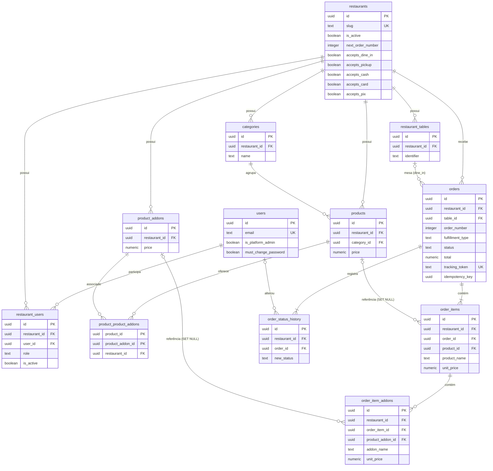

# ROADMAP — MVP do Cardápio Digital

> Status: **decisões de produto aprovadas em 2026-11-15**. Restam duas questões em aberto (seção 11.2): validação jurídica da retenção de dados e escolha do provedor de object storage.
> Documento de planejamento: nenhum código, migration ou configuração foi criado.
> Referência principal: [`CLAUDE.md`](../CLAUDE.md). Em caso de conflito, o `CLAUDE.md` prevalece.

## Sumário

1. Visão e controle de escopo
2. Perfis e funcionalidades
3. Arquitetura
4. Modelo de dados
5. Regras de negócio
6. Segurança e isolamento
7. Dados pessoais
8. API
9. Frontend
10. Fases e tarefas
11. Decisões registradas e questões em aberto

---

## 1. Visão e controle de escopo

Sistema multi-tenant de cardápio digital e pedidos simples para restaurantes de pequeno porte. Princípios do `CLAUDE.md`: só o necessário, menor solução que preserve segurança e manutenção, evolução incremental, uma fase validada antes da próxima.

**Fora do MVP** (só com necessidade funcional comprovada, decisão explícita do usuário e ADR curto): **entrega (delivery)**, pagamento online e gateways, planos, assinaturas e cobrança, recuperação de senha por e-mail, Redis, filas e workers, Outbox, RLS, microsserviços, GraphQL, Kubernetes, relatórios avançados, fidelidade, integrações externas de delivery, notificações externas.

**Regra de dependências:** antes de adicionar dependência, camada ou tecnologia, verificar se a stack existente resolve. Cada dependência nova exige justificativa em ADR curto (`docs/decisions/`). Dependências já aprovadas além da stack base: `big.js` (cálculo monetário no backend) e `qrcode` (QR Code no frontend), além do driver S3 para imagens em produção.

## 2. Perfis e funcionalidades

| Perfil | Funcionalidades |
| --- | --- |
| Administrador da plataforma (`platform_admin`) | Autenticar-se; cadastrar, editar, consultar e ativar/desativar restaurantes; criar o `owner` inicial ou vincular um usuário existente como `owner`. Sem planos, assinaturas ou cobrança. **Sem acesso a pedidos nem a dados pessoais dos clientes.** |
| Dono do restaurante (`owner`) | Tudo que o `staff` faz, mais: editar dados e configurações do restaurante; criar e desativar `staff`; gerenciar mesas e QR Codes; excluir ou desativar categorias, produtos e adicionais. |
| Equipe (`staff`) | Consultar cardápio e pedidos; atualizar o status dos pedidos; criar e editar categorias, produtos e adicionais (sem excluir nem desativar). |
| Cliente (sem conta) | Acessar o cardápio por URL; ver categorias, produtos, imagens, descrições e preços; escolher produtos, adicionais e quantidade; montar o carrinho; informar nome e, quando exigido, telefone; escolher modalidade e forma de pagamento habilitadas; enviar o pedido; acompanhar o próprio pedido pelo token. Não cancela pedido. Não acessa pedidos de terceiros. |

## 3. Arquitetura

- Stack do `CLAUDE.md`: TypeScript, pnpm workspaces, Next.js (App Router), Tailwind, shadcn/ui, AdonisJS, Lucid, PostgreSQL, Japa, Playwright, Docker Compose.
- O frontend consome a API diretamente. Não há BFF com regras de negócio. Toda regra e persistência ficam na API.
- Módulos da API: `auth`, `restaurants`, `menu`, `orders`. Nenhum outro módulo sem funcionalidade prevista.
- Estrutura: `apps/web`, `apps/api`, `docs/decisions`, `docker-compose.yml`. `packages/` só se duas apps compartilharem código.
- **Mesma origem (decidido):** em produção, Nginx serve a web e encaminha `/api` ao AdonisJS no mesmo domínio. Em desenvolvimento, o Next.js usa proxy/rewrite para `/api`. Sem CORS no fluxo normal.
- **PostgreSQL 15 ou superior (decidido)**, padronizado em Docker Compose, desenvolvimento, testes, produção e documentação de implantação (necessário para `ON DELETE SET NULL (coluna)`).
- **Imagens (decidido):** disco local em desenvolvimento e object storage compatível com S3 em produção. O banco guarda somente a chave ou o caminho relativo. A integração com o storage só é criada na Fase 3.
- **Rate limit (decidido):** em memória do processo, com uma única instância da API na primeira implantação. O contador reinicia com o processo. Se houver mais de uma instância, a estratégia deve ser revista antes de escalar. O Nginx aplica limites de conexão e requisição como defesa complementar, sem substituir a aplicação.

---

## 4. Modelo de dados

### 4.1 Convenções

- PK `uuid` (`gen_random_uuid()`), exceto a tabela de junção `product_product_addons`.
- Datas `timestamptz`; `created_at` e `updated_at` com `default now()` (`order_status_history`, `order_items` e `order_item_addons` só têm `created_at`).
- Dinheiro: `NUMERIC(10,2)` e `CHECK (>= 0)`. No backend, **`big.js`** para todos os cálculos. Valores trafegam como string decimal. Nunca `float` nem `number` em cálculos.
- Domínios fechados (`role`, `status`, modalidades, métodos) usam `text` + `CHECK`, mais simples de evoluir que enum nativo.
- Toda tabela de dados de restaurante tem `restaurant_id NOT NULL`. Tabelas que são alvo de FK composta têm `UNIQUE (id, restaurant_id)`.
- Sem `deleted_at`: usa-se `is_active` ou `is_available`, onde há histórico a preservar.
- Limites de tamanho de texto: seção 4.5, aplicados por `varchar(n)` ou `CHECK (char_length(...) <= n)` e pela validação da API.

### 4.2 Diagrama ER

### 4.3 Fichas das tabelas

Legenda: **NN** = `NOT NULL`. Toda FK "composta" inclui `restaurant_id`. Sem `ON UPDATE` explícito (chaves são imutáveis; `NO ACTION`).

#### `users` — identidade de quem administra (plataforma ou restaurante)

| Campo | Tipo | Regra |
| --- | --- | --- |
| id | uuid | PK |
| name | text | NN |
| email | text | NN; índice único em `lower(email)` |
| password | text | NN; somente hash (padrão do AdonisJS) |
| is_platform_admin | boolean | NN, default `false` |
| must_change_password | boolean | NN, default `false`; `true` para usuários criados com senha temporária |
| created_at, updated_at | timestamptz | NN |

O papel `platform_admin` não pertence a restaurante, então fica em `users` e evita `restaurant_id` nulo em `restaurant_users`. Não há tabela de papéis nem de permissões: os papéis são fixos.

#### `restaurants` — tenant

| Campo | Tipo | Regra |
| --- | --- | --- |
| id | uuid | PK |
| name | text | NN |
| slug | text | NN; `UNIQUE`; `CHECK (slug ~ '^[a-z0-9]+(-[a-z0-9]+)*$')`, de 3 a 60 caracteres; lista de slugs reservados validada na API |
| description | text | nulo |
| phone | text | nulo |
| logo | text | nulo; chave ou caminho relativo no storage |
| is_active | boolean | NN, default `true` |
| accepts_dine_in | boolean | NN, default `true`; modalidade `dine_in` habilitada |
| accepts_pickup | boolean | NN, default `true`; modalidade `pickup` habilitada |
| accepts_cash | boolean | NN, default `true`; pagamento em dinheiro habilitado |
| accepts_card | boolean | NN, default `true`; pagamento em cartão habilitado |
| accepts_pix | boolean | NN, default `true`; Pix presencial habilitado |
| next_order_number | integer | NN, default `1001`; **próximo número de pedido disponível** |
| created_at, updated_at | timestamptz | NN |

Restrições: `CHECK (accepts_dine_in OR accepts_pickup)` e `CHECK (accepts_cash OR accepts_card OR accepts_pix)`. As configurações ficam em colunas booleanas (sem tabela de configuração). Restaurante não é excluído fisicamente no MVP: usa-se `is_active`.

#### `restaurant_users` — vínculo entre usuário e restaurante

| Campo | Tipo | Regra |
| --- | --- | --- |
| id | uuid | PK |
| restaurant_id | uuid | NN; FK → `restaurants(id)` `ON DELETE RESTRICT` |
| user_id | uuid | NN; FK → `users(id)` `ON DELETE RESTRICT` |
| role | text | NN; `CHECK (role IN ('owner','staff'))` |
| is_active | boolean | NN, default `true`; desativa o vínculo sem excluir o registro |
| created_at, updated_at | timestamptz | NN |

Restrições: `UNIQUE (restaurant_id, user_id)`; índice em `user_id`. Um usuário pode ter vínculo com vários restaurantes. Vínculo inativo não concede nenhum acesso.

#### `categories`

| Campo | Tipo | Regra |
| --- | --- | --- |
| id | uuid | PK |
| restaurant_id | uuid | NN; FK → `restaurants(id)` `RESTRICT` |
| name | varchar(80) | NN |
| description | text | nulo |
| sort_order | integer | NN, default 0 |
| is_active | boolean | NN, default `true` |
| created_at, updated_at | timestamptz | NN |

Restrições: `UNIQUE (id, restaurant_id)`; `UNIQUE (restaurant_id, name)`. Exclusão física só sem produtos (FK de `products` é `RESTRICT`); caso contrário, desativar. Excluir e desativar são ações do `owner`.

#### `products`

| Campo | Tipo | Regra |
| --- | --- | --- |
| id | uuid | PK |
| restaurant_id | uuid | NN; FK → `restaurants(id)` `RESTRICT` |
| category_id | uuid | NN; FK **composta** `(category_id, restaurant_id)` → `categories(id, restaurant_id)` `RESTRICT` |
| name | varchar(120) | NN |
| description | varchar(1000) | nulo |
| price | numeric(10,2) | NN; `CHECK (price >= 0)` |
| image | text | nulo; chave ou caminho relativo gerado pelo servidor |
| is_available | boolean | NN, default `true` |
| sort_order | integer | NN, default 0 |
| created_at, updated_at | timestamptz | NN |

Restrições: `UNIQUE (id, restaurant_id)`; índice `(restaurant_id, category_id, sort_order)`. Produto indisponível não aparece no cardápio público nem entra em novos pedidos. Alterar `is_available` é ação do `owner`.

#### `product_addons` — adicionais simples e opcionais

| Campo | Tipo | Regra |
| --- | --- | --- |
| id | uuid | PK |
| restaurant_id | uuid | NN; FK → `restaurants(id)` `RESTRICT` |
| name | varchar(80) | NN |
| description | varchar(500) | nulo |
| price | numeric(10,2) | NN; `CHECK (price >= 0)` |
| is_available | boolean | NN, default `true` |
| created_at, updated_at | timestamptz | NN |

Restrições: `UNIQUE (id, restaurant_id)`; `UNIQUE (restaurant_id, name)`.

**Decisão de modelagem:** só adicionais **opcionais e simples**. O cliente marca ou não cada adicional, e cada adicional marcado vale **para cada unidade** do item. Não há quantidade mínima ou máxima, grupos, escolhas obrigatórias nem quantidade por adicional.

#### `product_product_addons` — quais adicionais cada produto oferece

| Campo | Tipo | Regra |
| --- | --- | --- |
| product_id | uuid | NN; parte da PK |
| product_addon_id | uuid | NN; parte da PK |
| restaurant_id | uuid | NN |
| created_at | timestamptz | NN |

PK `(product_id, product_addon_id)`, sem `id` próprio. FKs **compostas**: `(product_id, restaurant_id)` → `products(id, restaurant_id)` e `(product_addon_id, restaurant_id)` → `product_addons(id, restaurant_id)`, ambas `ON DELETE CASCADE` (a associação é só configuração; o histórico está nos snapshots). Índice em `product_addon_id`. Limite de 10 adicionais por produto (validado na API).

#### `restaurant_tables` — mesas (modalidade `dine_in`)

| Campo | Tipo | Regra |
| --- | --- | --- |
| id | uuid | PK |
| restaurant_id | uuid | NN; FK → `restaurants(id)` `RESTRICT` |
| name | varchar(60) | NN (ex.: "Mesa 5") |
| identifier | text | NN; código curto aleatório, não sequencial, usado no QR Code |
| is_active | boolean | NN, default `true` |
| created_at, updated_at | timestamptz | NN |

Restrições: `UNIQUE (id, restaurant_id)`; `UNIQUE (restaurant_id, identifier)`. Gerenciada pelo `owner`. **O identificador não é autenticação**: só dá contexto ao pedido.

#### `orders`

| Campo | Tipo | Regra |
| --- | --- | --- |
| id | uuid | PK |
| restaurant_id | uuid | NN; FK → `restaurants(id)` `RESTRICT` |
| order_number | integer | NN; número sequencial por restaurante, atribuído na criação |
| table_id | uuid | nulo; FK **composta** `(table_id, restaurant_id)` → `restaurant_tables(id, restaurant_id)` `ON DELETE SET NULL (table_id)` |
| table_name | varchar(60) | nulo; snapshot do nome da mesa (`dine_in`) |
| customer_name | varchar(120) | NN |
| customer_phone | varchar(20) | nulo; obrigatório em `pickup` |
| fulfillment_type | text | NN; `CHECK (fulfillment_type IN ('dine_in','pickup'))` |
| payment_method | text | NN; `CHECK (payment_method IN ('cash','card','pix'))` |
| status | text | NN, default `'pending'`; `CHECK` com os estados da seção 5.3 |
| total | numeric(10,2) | NN; `CHECK (total >= 0)`; soma de `order_items.subtotal`, calculada no backend com `big.js` |
| notes | varchar(500) | nulo; observação do cliente |
| tracking_token | text | NN; `UNIQUE`; aleatório, não previsível |
| idempotency_key | uuid | NN; chave enviada pelo cliente no header `Idempotency-Key` |
| idempotency_hash | text | NN; SHA-256 do payload normalizado recebido do cliente |
| created_at, updated_at | timestamptz | NN |

Restrições:
- `UNIQUE (id, restaurant_id)`; `UNIQUE (restaurant_id, order_number)`; `UNIQUE (restaurant_id, idempotency_key)`.
- `CHECK (fulfillment_type = 'dine_in' OR customer_phone IS NOT NULL)`: telefone obrigatório em `pickup`.
- `CHECK ((fulfillment_type = 'dine_in' AND table_name IS NOT NULL) OR (fulfillment_type = 'pickup' AND table_id IS NULL AND table_name IS NULL))`: `pickup` não pode ter mesa e `dine_in` precisa do snapshot da mesa. `table_id` de `dine_in` é obrigatório na criação (validado pela API) e pode virar nulo depois por `SET NULL`; por isso o `CHECK` não exige `table_id` em `dine_in`.
- Índice `(restaurant_id, status, created_at DESC)`.

Não há `subtotal`, `delivery_address`, taxa nem desconto no MVP: `total` é a soma dos itens. `table_name` é um acréscimo ao rascunho, necessário para o snapshot sobreviver à exclusão da mesa (seção 5.6).

#### `order_items` — snapshot dos itens

| Campo | Tipo | Regra |
| --- | --- | --- |
| id | uuid | PK |
| restaurant_id | uuid | NN |
| order_id | uuid | NN; FK **composta** `(order_id, restaurant_id)` → `orders(id, restaurant_id)` `ON DELETE RESTRICT` |
| product_id | uuid | nulo; FK **composta** `(product_id, restaurant_id)` → `products(id, restaurant_id)` `ON DELETE SET NULL (product_id)` |
| product_name | varchar(120) | NN; cópia do nome no momento do pedido |
| unit_price | numeric(10,2) | NN; cópia do preço unitário do produto |
| quantity | integer | NN; `CHECK (quantity BETWEEN 1 AND 20)` |
| subtotal | numeric(10,2) | NN; **(unit_price + soma dos preços dos adicionais) × quantity** |
| created_at | timestamptz | NN |

Restrições: `UNIQUE (id, restaurant_id)`; índice em `order_id`.

#### `order_item_addons` — snapshot dos adicionais

| Campo | Tipo | Regra |
| --- | --- | --- |
| id | uuid | PK |
| restaurant_id | uuid | NN |
| order_item_id | uuid | NN; FK **composta** `(order_item_id, restaurant_id)` → `order_items(id, restaurant_id)` `RESTRICT` |
| product_addon_id | uuid | nulo; FK **composta** `(product_addon_id, restaurant_id)` → `product_addons(id, restaurant_id)` `ON DELETE SET NULL (product_addon_id)` |
| addon_name | varchar(80) | NN; cópia do nome |
| unit_price | numeric(10,2) | NN; cópia do preço do adicional, por unidade do item |
| subtotal | numeric(10,2) | NN; `unit_price` × `quantity` do item pai |
| created_at | timestamptz | NN |

Não há `quantity` nesta tabela: o cálculo usa a quantidade de `order_items`. Exemplo: 3 unidades de um produto com um adicional de R$ 2,00 geram R$ 6,00 em adicionais. Restrição: `UNIQUE (order_item_id, product_addon_id)`.

#### `order_status_history` — histórico de status

| Campo | Tipo | Regra |
| --- | --- | --- |
| id | uuid | PK |
| restaurant_id | uuid | NN |
| order_id | uuid | NN; FK **composta** `(order_id, restaurant_id)` → `orders(id, restaurant_id)` `RESTRICT` |
| previous_status | text | nulo no registro de criação |
| new_status | text | NN; mesmo `CHECK` de `orders.status` |
| changed_by_user_id | uuid | nulo; FK → `users(id)` `ON DELETE SET NULL`; nulo na criação feita pelo cliente |
| created_at | timestamptz | NN |

Índice `(order_id, created_at)`. O campo `changed_by_user_id` é a auditoria mínima de quem alterou o pedido.

### 4.4 Matriz de FKs compostas (integridade por restaurante)

Cada relação exige um teste de integração que **tenta criar ou atualizar** a linha apontando para um registro de outro restaurante e espera falha por violação de FK. Os testes são independentes da API (defesa em profundidade).

| ID | Relação | Teste esperado |
| --- | --- | --- |
| FK-01 | `products` → `categories` | Produto do restaurante A com categoria do B é rejeitado |
| FK-02 | `product_product_addons` → `products` | Associação com produto de outro restaurante é rejeitada |
| FK-03 | `product_product_addons` → `product_addons` | Associação com adicional de outro restaurante é rejeitada |
| FK-04 | `orders` → `restaurant_tables` | Pedido do restaurante A com mesa do B é rejeitado |
| FK-05 | `order_items` → `orders` | Item com `restaurant_id` diferente do pedido é rejeitado |
| FK-06 | `order_items` → `products` | Item referenciando produto de outro restaurante é rejeitado |
| FK-07 | `order_item_addons` → `order_items` | Adicional de item com `restaurant_id` diferente é rejeitado |
| FK-08 | `order_item_addons` → `product_addons` | Referência a adicional de outro restaurante é rejeitada |
| FK-09 | `order_status_history` → `orders` | Histórico com `restaurant_id` diferente do pedido é rejeitado |

Testes de `SET NULL`: excluir produto, adicional ou mesa anula somente a coluna de referência, preserva `restaurant_id` e mantém os snapshots.

Testes de restrições (CT):

| ID | Restrição | Teste esperado |
| --- | --- | --- |
| CT-01 | `UNIQUE (restaurant_id, order_number)` | Número repetido no mesmo restaurante é rejeitado; mesmo número em restaurantes diferentes é aceito |
| CT-02 | `UNIQUE (restaurant_id, idempotency_key)` | Chave repetida no mesmo restaurante é rejeitada; em restaurantes diferentes é aceita |
| CT-03 | `CHECK` de telefone | `pickup` sem telefone é rejeitado; `dine_in` sem telefone é aceito |
| CT-04 | `CHECK` de mesa | `pickup` com mesa é rejeitado; `dine_in` sem `table_name` é rejeitado |
| CT-05 | `CHECK` de configuração | Restaurante sem nenhuma modalidade ou sem nenhum método de pagamento é rejeitado |
| CT-06 | `CHECK` de quantidade e preços | Quantidade fora de 1 a 20 e valores negativos são rejeitados |

### 4.5 Limites de tamanho (decididos)

| Campo | Limite |
| --- | --- |
| Produtos distintos por pedido | 30 |
| Quantidade por produto | 1 a 20 |
| Adicionais por produto | 10 |
| Nome do cliente | 120 caracteres |
| Telefone | 20 caracteres |
| Observação do pedido | 500 caracteres |
| Nome de categoria | 80 caracteres |
| Nome de produto | 120 caracteres |
| Descrição de produto | 1.000 caracteres |
| Nome de adicional | 80 caracteres |
| Descrição de adicional | 500 caracteres |
| Imagem | 5 MB; JPEG, PNG e WebP |

Os limites de itens por pedido e de adicionais por produto são validados na API (e testados). Nome de mesa (60) e dos demais campos não listados seguem o mesmo critério e valem como proposta de implementação.

---

## 5. Regras de negócio

### 5.1 Restaurantes, usuários e permissões

- Cada restaurante tem `slug` único. O slug do cardápio público é a única identificação pública.
- Restaurante inativo: o cardápio público responde `404` e novos pedidos são rejeitados. Pedidos já existentes continuam consultáveis e atualizáveis pelo painel.
- O usuário só administra restaurantes aos quais tem vínculo **ativo**. Um usuário pode participar de mais de um restaurante.
- Papéis: `platform_admin` (campo em `users`), `owner` e `staff` (em `restaurant_users`).

| Operação | owner | staff |
| --- | :-: | :-: |
| Consultar pedidos | sim | sim |
| Alterar status dos pedidos | sim | sim |
| Consultar o cardápio | sim | sim |
| Criar e editar categorias | sim | sim |
| Criar e editar produtos | sim | sim |
| Criar e editar adicionais | sim | sim |
| Excluir ou desativar categorias, produtos e adicionais (`DELETE`, `is_active`, `is_available`) | sim | **não** |
| Gerenciar usuários (`staff`) | sim | não |
| Editar dados e configurações do restaurante | sim | não |
| Gerenciar mesas e QR Code | sim | não |
| Alterar a própria senha | sim | sim |

Consequência registrada: como a alteração de `is_available` é restrita ao `owner`, o `staff` **não consegue marcar um produto como esgotado** durante o atendimento. Se isso for necessário, a matriz deve ser alterada por decisão explícita.

O `platform_admin` administra restaurantes (cadastro, edição, ativação), mas **não consulta pedidos nem dados pessoais dos clientes**.

### 5.2 Senhas e primeiro acesso

- **Primeiro `platform_admin`:** criado por comando CLI (Ace) executado no ambiente da API, de forma interativa; a senha é solicitada sem eco, gravada somente como hash e nunca registrada em log. Não há senha padrão no repositório.
- **`owner` inicial:** criado junto com o restaurante pelo `platform_admin`. A API gera uma **senha temporária** aleatória (fonte criptográfica), grava só o hash, define `must_change_password = true` e devolve a senha **uma única vez** na resposta da criação (`Cache-Control: no-store`). A senha nunca aparece em log, nunca é reexibida e nunca é enviada por e-mail.
- **`staff`:** criado pelo `owner` pelo mesmo mecanismo (senha temporária exibida uma única vez, `must_change_password = true`). O `owner` pode gerar nova senha temporária para o `staff`, pelo mesmo procedimento. O `owner` pode desativar o vínculo (`is_active = false`).
- **Troca obrigatória:** enquanto `must_change_password = true`, toda rota autenticada, exceto troca de senha e logout, responde `403 PASSWORD_CHANGE_REQUIRED`. A troca (`PATCH /auth/password`) exige a senha atual e valida a política mínima de senha; ao concluir, a flag vira `false`.
- **E-mail já existente:** a API **não cria outro usuário nem redefine a senha**. Ao cadastrar um restaurante, o `platform_admin` autenticado pode vincular o usuário existente como `owner`, enviando `confirm_link_existing_user: true`. A flag só tem efeito dentro de uma requisição de `platform_admin` autenticado e autorizado, nunca altera senha nem dados do usuário e gera log de auditoria. Sem a flag, a API responde `409 EMAIL_TAKEN`.
- **`owner` criando `staff` com e-mail existente:** responde `409 EMAIL_TAKEN` (o `owner` não vincula usuários existentes, para não revelar contas de outros restaurantes). Vínculo de usuário existente é operação exclusiva do `platform_admin`.
- **Recuperação de senha por e-mail:** fora da v1. A única forma de recuperar acesso é o `owner` gerar nova senha temporária para o `staff` ou o `platform_admin` fazer o mesmo para o `owner` (mecanismo equivalente, mesmo procedimento seguro).

### 5.3 Pedidos: estados e transições

Estados: `pending`, `confirmed`, `preparing`, `ready`, `completed`, `cancelled`.

| De | Para | Quem |
| --- | --- | --- |
| `pending` | `confirmed` | restaurante (`owner` ou `staff`) |
| `confirmed` | `preparing` | restaurante |
| `preparing` | `ready` | restaurante |
| `ready` | `completed` | restaurante |
| `pending`, `confirmed`, `preparing` | `cancelled` | restaurante |

- `completed` e `cancelled` são finais. Qualquer outra transição responde `409 INVALID_TRANSITION`.
- **Cancelamento:** somente pelo restaurante, em `pending`, `confirmed` ou `preparing`. Pedidos `ready` não podem ser cancelados. O cliente **não cancela** na v1: não existe rota pública que altere o pedido. O cliente só consulta o status pelo token.
- Não há reembolso, pois não há pagamento online.
- As transições ficam em uma única tabela no módulo `orders`, sem máquina de estados genérica.
- Cada mudança grava uma linha em `order_status_history` na mesma transação da atualização. A criação grava a linha inicial (`previous_status` nulo, `new_status = 'pending'`, `changed_by_user_id` nulo).

### 5.4 Modalidades, pagamento e configuração por restaurante

| Modalidade | Nome | Telefone | Mesa |
| --- | --- | --- | --- |
| `dine_in` (consumo no local) | obrigatório | opcional | obrigatória: `table_identifier` de uma mesa **ativa do mesmo restaurante** |
| `pickup` (retirada) | obrigatório | obrigatório | proibida |

- **Sem entrega na v1.** Não existe endereço, taxa, zona nem logística de entrega. `delivery` não é aceito em `fulfillment_type`. Incluir entrega no futuro exige alteração explícita do escopo.
- **Pagamento presencial:** `cash`, `card` ou `pix`, informado pelo cliente. É só um registro da preferência: não há processamento, confirmação financeira, integração com gateway nem estado de pagamento.
- **Configuração por restaurante:** o `owner` habilita ou desabilita cada modalidade e cada método (colunas `accepts_*` de `restaurants`). A API rejeita (`422`) pedido com modalidade ou método desabilitado, e o cardápio público informa apenas as opções habilitadas. Pelo menos uma modalidade e um método devem permanecer habilitados.
- Modalidade `dine_in` desabilitada: restaurantes que não atendem no salão não precisam cadastrar mesas.

### 5.5 Criação do pedido (transação única, idempotente)

O cliente envia o header `Idempotency-Key` (UUID gerado pelo frontend para cada tentativa lógica de checkout, reutilizado em reenvios da mesma tentativa; nova tentativa intencional usa nova chave).

1. Resolver o restaurante pelo `slug` (ativo) e validar o formato do payload, os limites (seção 4.5), a modalidade e o método habilitados, e os dados obrigatórios da modalidade.
2. **Normalizar o payload recebido** (textos aparados, itens ordenados por `product_id`, adicionais ordenados, campos em ordem canônica, sem a chave) e calcular `idempotency_hash` = SHA-256 desse conteúdo, **antes de consultar preços**. Assim, uma repetição idêntica não vira "diferente" porque o preço do catálogo mudou.
3. Procurar pedido existente por `(restaurant_id, idempotency_key)`. Se existir: hash igual devolve o pedido já criado, com o mesmo `tracking_token` e sem criar outro; hash diferente responde `409 CONFLICT`.
4. Iniciar **uma transação**.
5. Atribuir o número: `UPDATE restaurants SET next_order_number = next_order_number + 1 WHERE id = :id RETURNING next_order_number - 1`, de forma atômica. O valor lido é o `order_number` do pedido. Se a transação falhar, o rollback desfaz o incremento. `UNIQUE (restaurant_id, order_number)` é proteção adicional.
6. Ler produtos, adicionais e (se `dine_in`) a mesa **filtrando por `restaurant_id`** e travando as linhas (`FOR SHARE`) até o commit.
7. **Revalidar disponibilidade:** produto e adicional existem, pertencem ao restaurante, estão disponíveis, o adicional está associado ao produto, e a mesa está ativa. Falhou: rollback e `422`.
8. Recalcular, com `big.js`, o subtotal de cada item = (preço do produto + soma dos adicionais) × quantidade, e `total` = soma dos subtotais. Qualquer valor monetário vindo do cliente é ignorado.
9. Gravar `orders` (com `idempotency_key`, `idempotency_hash`, `order_number`, `table_name`), `order_items`, `order_item_addons` (snapshots de nome e preço) e a primeira linha de `order_status_history`.
10. **Commit.** Somente depois do commit a API responde `201` com o `tracking_token`.
11. **Corrida de requisições idênticas:** se duas requisições com a mesma chave chegarem juntas, a restrição `UNIQUE (restaurant_id, idempotency_key)` faz uma delas falhar no insert; ela reverte, relê o pedido vencedor, compara o hash e responde conforme o passo 3.
12. Qualquer erro antes do commit faz rollback completo: nunca existe pedido sem itens, nem itens sem pedido, nem token entregue sem pedido gravado.

Sem filas, jobs, Outbox, Redis ou notificações externas: o restaurante vê o pedido ao consultar o painel.

### 5.6 Snapshots e histórico

- Nome, preço unitário, quantidade, adicionais e nome da mesa são copiados no momento do pedido. Alterar o preço, renomear, desativar ou excluir produto, adicional ou mesa **nunca** altera pedidos existentes, independentemente do estado do registro original.
- As referências (`product_id`, `product_addon_id`, `table_id`) são opcionais e usam `ON DELETE SET NULL (coluna)`: o vínculo se perde, o snapshot permanece e `restaurant_id` não é anulado.
- Pedidos e histórico não têm exclusão física pela aplicação.
- O painel exibe pedido antigo apenas com os dados do snapshot.

### 5.7 Acompanhamento do pedido

- O `tracking_token` identifica o pedido para o cliente que o criou: 32 bytes aleatórios de fonte criptográfica, em base64url (`crypto.randomBytes`). Não deriva de ID, data ou dados do cliente.
- Dá acesso de leitura somente a dados mínimos (seção 8.4). Não permite alterar o pedido nem acessar o painel.
- Token inexistente ou inválido responde `404`, sem diferenciar.

### 5.8 Cardápio, categorias, produtos e adicionais

- Categoria e produto pertencem a um restaurante; produto pertence a uma categoria do mesmo restaurante (FK composta e validação na API).
- Produtos indisponíveis não entram em novos pedidos nem aparecem no cardápio público. Categorias inativas somem do cardápio público.
- Preços e adicionais são validados no backend (decimal, não negativo, até duas casas). Adicional só se associa a produto do mesmo restaurante.
- Excluir categoria com produtos é bloqueado (`409 CATEGORY_HAS_PRODUCTS`). Excluir produto, adicional ou mesa é permitido ao `owner`; pedidos antigos preservam o snapshot.
- O `staff` não pode excluir nem alterar `is_active` ou `is_available`: a API responde `403`.

---

## 6. Segurança e isolamento

| Controle | Implementação no MVP |
| --- | --- |
| Autenticação | Sessão por cookie (guard de sessão do AdonisJS). Login, logout e expiração. Senha com hash forte padrão do AdonisJS. Troca obrigatória no primeiro acesso (seção 5.2). |
| Sessão, CORS e CSRF | Mesma origem (Nginx em produção, proxy em desenvolvimento): sem CORS no fluxo normal. Cookie `HttpOnly`, `Secure`, `SameSite`. `HttpOnly` não substitui CSRF: rotas com cookie que alteram estado exigem proteção CSRF (token e/ou validação de `Origin`). ADR na tarefa F0-T6. |
| Autorização por perfil | Verificada no backend em toda rota (`platform_admin`, `owner`, `staff`), com vínculo ativo. Esconder botão não é autorização. |
| Isolamento por restaurante | Em cada operação (leitura, criação, alteração, exclusão) a API valida o vínculo ativo do usuário com o restaurante e aplica explicitamente `restaurant_id` na consulta. Um helper simples pode reduzir repetição, mas não substitui a validação. FKs compostas reforçam no banco. O `:restaurantId` da URL indica o contexto pedido, mas **não concede autorização**. |
| IDOR | Todo recurso é buscado por `id` **e** `restaurant_id` validado. Recurso de outro restaurante responde `404`. |
| Slug público | Dá acesso somente ao cardápio público do restaurante ativo. |
| Identificador da mesa | Não é autenticação. Só contexto do pedido. |
| Rate limit | Em memória do processo (uma instância da API), limites configuráveis por ambiente. Valores iniciais: **login** 5 tentativas por minuto por IP e identificador de usuário; **criação de pedido** 5 pedidos por minuto por IP e restaurante; **acompanhamento** 30 consultas por minuto por IP (compatível com a recarga periódica da tela). Nginx aplica limites complementares. |
| Validação de entrada | VineJS (validator do AdonisJS) em toda rota; rejeita campos desconhecidos; limites da seção 4.5. |
| Idempotência | `Idempotency-Key` + `idempotency_hash` (seção 5.5). A chave não substitui validação do payload nem a transação. |
| Upload de imagem | Tipo detectado pelo conteúdo (JPEG, PNG, WebP), extensão coerente, máximo 5 MB, nome gerado pelo servidor, caminho isolado por restaurante, nunca executável. |
| Token de acompanhamento | Seção 7.3 e 5.7. |
| Senhas temporárias | Exibidas uma única vez, nunca em log, texto puro persistido ou e-mail. |
| Logs | Estruturados, sem senha, cookie, token, telefone, nome ou corpo de requisição de pedido. |
| Auditoria | Log estruturado de ações administrativas relevantes (criar, editar, ativar ou desativar restaurante; criar ou vincular usuário; criar, desativar ou redefinir senha de `staff`; alterar configurações do restaurante; alterar status de pedido), com usuário, ação e recurso, **sem** tokens, senhas, telefones, endereços ou payloads pessoais. Sem tabela genérica de auditoria. |
| Segredos | Variáveis de ambiente; `.env.example` sem valores reais. |
| Erros | Mensagens sem detalhes internos. |

**Testes de isolamento obrigatórios (Japa):** para cada recurso do restaurante (restaurante, categoria, produto, adicional, associação, mesa, staff, pedido), um usuário do restaurante A **consulta (GET), edita (PATCH/PUT) e exclui (DELETE)** o recurso do restaurante B conhecendo o ID, e recebe `404` ou `403` sem alterar dados. Incluem-se: usuário com vínculo em dois restaurantes (acessa só o informado e autorizado), usuário sem vínculo, vínculo inativo e `platform_admin` tentando acessar pedidos.

---

## 7. Dados pessoais

Dados pessoais tratados: nome e telefone do cliente, observações livres, e nome, e-mail e senha (hash) dos usuários administrativos. Esta seção é um requisito técnico de boas práticas; a adequação jurídica deve ser validada pelo responsável legal e do negócio.

### 7.1 Coleta mínima

- Nome do cliente sempre; telefone obrigatório em `pickup` e opcional em `dine_in`. **Sem endereço**, pois entrega não faz parte da v1.
- Sem cadastro de cliente, CPF, e-mail do cliente, localização ou dados de pagamento ou cartão.
- Campo de observações limitado a 500 caracteres, com aviso para não incluir dados sensíveis.

### 7.2 Acesso restrito

- Dados do pedido: somente usuários com vínculo ativo ao restaurante dono do pedido e, de forma limitada, o cliente via token.
- O `platform_admin` **não** acessa dados pessoais dos pedidos (não há endpoint para isso).
- Em produção, o acesso direto ao banco e aos backups é restrito a quem administra o servidor.

### 7.3 Proteção

- HTTPS obrigatório em produção (Nginx); cookies `Secure`.
- Dados pessoais nunca em URL, em logs ou em mensagens de erro. O `tracking_token` na URL (`/r/:slug/pedido/:token`, `/public/orders/:token`) é tratado como segredo:
  - o Nginx e a aplicação **não registram** esse caminho em log de acesso (caminho redigido);
  - páginas e respostas com o token usam `Cache-Control: no-store` e `Referrer-Policy: no-referrer`;
  - a consulta é por igualdade exata na coluna única, sem listagem nem busca parcial;
  - o frontend não envia o token a terceiros (sem analytics ou scripts externos nessas páginas).
- O endpoint público devolve só o necessário (seção 8.4): **sem** telefone, observações, IDs internos nem dados de outros pedidos.
- Backups com acesso restrito, fora de pasta pública; restauração testada (F6).

### 7.4 Retenção e anonimização (proposta, sujeita à validação jurídica)

- **Proposta:** reter nome e telefone por **180 dias** após a conclusão (`completed`) ou o cancelamento (`cancelled`) do pedido; depois, anonimizar nome e telefone (e as observações, que podem conter dados pessoais), preservando os dados comerciais (itens, valores, status, datas).
- **O prazo de 180 dias e o procedimento de anonimização precisam ser validados pelo responsável jurídico e do negócio, inclusive quanto a obrigações legais ou fiscais de retenção, antes da produção.**
- **Até essa validação, é proibido implementar exclusão ou anonimização, manual ou automática.** A tarefa F6-T6 só é executada depois dela.
- Depois da validação, começar por procedimento manual documentado. Rotina agendada só com necessidade comprovada e aprovação.
- Solicitações de titulares (acesso, correção, exclusão): procedimento a definir junto com a validação jurídica.

---

## 8. API

Prefixo `/api/v1`. Sucesso: `{ "data": ..., "meta"?: ... }`. Erro: `{ "code", "message", "details"? }`.

**Códigos de erro comuns:**

| HTTP | code | Quando |
| --- | --- | --- |
| 401 | `UNAUTHENTICATED` | Sem sessão válida |
| 403 | `FORBIDDEN` | Perfil sem permissão ou falha de CSRF |
| 403 | `PASSWORD_CHANGE_REQUIRED` | `must_change_password = true` e rota diferente de troca de senha ou logout |
| 404 | `NOT_FOUND` | Recurso inexistente ou de outro restaurante |
| 409 | `CONFLICT` | Duplicidade, exclusão bloqueada, transição inválida, chave de idempotência com conteúdo diferente |
| 422 | `VALIDATION_ERROR` | Entrada inválida, item indisponível, modalidade ou método desabilitado |
| 429 | `RATE_LIMITED` | Limite excedido |

"Erros" lista apenas os específicos, além dos comuns aplicáveis. As rotas do painel usam `:restaurantId`; a API valida o vínculo ativo e o perfil do usuário em cada chamada. O ID da URL **nunca** é aceito sem essa validação.

### 8.1 Autenticação e senha

| Endpoint | Detalhes |
| --- | --- |
| `POST /auth/login` | Inicia a sessão. **Auth:** não. **Entrada:** `{ email, password }`. **Resposta:** `200 { data: { user: { id, name, email, is_platform_admin, must_change_password }, restaurants: [{ id, name, slug, role }] } }` (somente vínculos ativos). **Erros:** `401 INVALID_CREDENTIALS` (mensagem única), `429`. Rate limit: 5/min por IP e identificador. |
| `POST /auth/logout` | Encerra e invalida a sessão. **Auth:** sessão. `204`. |
| `GET /auth/me` | Usuário e restaurantes vinculados. **Auth:** sessão. |
| `PATCH /auth/password` | Troca a própria senha (também no primeiro acesso). **Auth:** sessão (permitido com `must_change_password`). **Entrada:** `{ current_password, new_password }`. **Validações:** senha atual correta; nova senha atende à política mínima e difere da atual. **Resposta:** `204`; zera `must_change_password`. **Erros:** `422`, `429`. |

### 8.2 Administração da plataforma (`is_platform_admin`)

| Endpoint | Detalhes |
| --- | --- |
| `GET /platform/restaurants` | Lista. **Parâmetros:** `page`, `per_page`, `search`, `is_active`. **Resposta:** `200 { data: [{ id, name, slug, is_active, created_at }], meta: { page, per_page, total } }`. Sem dados de pedidos nem de clientes. |
| `POST /platform/restaurants` | Cadastra restaurante e seu `owner`. **Entrada:** `{ name, slug, description?, phone?, owner: { name, email }, confirm_link_existing_user?: boolean }`. **Comportamento:** e-mail novo cria usuário com senha temporária e `must_change_password = true`; e-mail existente só vincula se `confirm_link_existing_user = true`, sem alterar senha nem dados do usuário. Tudo em uma transação. **Resposta:** `201 { data: { restaurant, owner: { id, name, email, temporary_password? } } }`; `temporary_password` só existe para usuário novo, aparece **somente nesta resposta** e com `Cache-Control: no-store`. **Erros:** `409 SLUG_TAKEN`, `409 EMAIL_TAKEN` (e-mail existente sem confirmação), `422`. Gera log de auditoria sem a senha. |
| `GET /platform/restaurants/:id` | Detalhe. **Erros:** `404`. |
| `PATCH /platform/restaurants/:id` | Edita nome, slug, descrição e telefone. Alterar o slug invalida links e QR Codes já impressos: exige `confirm_slug_change: true`. **Erros:** `409 SLUG_TAKEN`. |
| `PATCH /platform/restaurants/:id/status` | Ativa ou desativa. **Entrada:** `{ is_active: boolean }`. `200`. |
| `POST /platform/restaurants/:id/owner/reset-password` | Gera nova senha temporária para o `owner` informado, pelo mesmo mecanismo da seção 5.2 (`must_change_password = true`, exibição única). **Entrada:** `{ user_id }`. Não há recuperação de senha por e-mail. |

### 8.3 Administração do restaurante (`/tenant/:restaurantId`)

Perfis: **O** = `owner`; **S** = `staff` (e `owner`). Em endpoints de edição, o `staff` não pode enviar `is_active` nem `is_available` (`403`).

| Endpoint | Perfil | Detalhes |
| --- | --- | --- |
| `GET /tenant/:restaurantId/restaurant` | S | Dados e configurações do restaurante. |
| `PATCH /tenant/:restaurantId/restaurant` | O | Edita `name`, `description`, `phone`. Não altera `slug` nem `is_active`. |
| `PATCH /tenant/:restaurantId/restaurant/settings` | O | Habilita ou desabilita modalidades e métodos. **Entrada:** `{ accepts_dine_in?, accepts_pickup?, accepts_cash?, accepts_card?, accepts_pix? }`. **Validação:** ao menos uma modalidade e um método habilitados. **Erros:** `422`. Log de auditoria. |
| `PUT /tenant/:restaurantId/restaurant/logo` | O | Upload (`multipart/form-data`, campo `file`). Validação da seção 6. **Erros:** `422 INVALID_IMAGE`. |
| `GET /tenant/:restaurantId/staff` | O | Lista usuários do restaurante com `role` e `is_active` (sem hash nem senha). |
| `POST /tenant/:restaurantId/staff` | O | Cria `staff`. **Entrada:** `{ name, email }`. **Resposta:** `201` com `temporary_password` exibida só nesta resposta (`no-store`). **Erros:** `409 EMAIL_TAKEN`. Log de auditoria sem a senha. |
| `PATCH /tenant/:restaurantId/staff/:userId` | O | Ativa ou desativa o vínculo (`{ is_active }`). Não altera `owner`. |
| `POST /tenant/:restaurantId/staff/:userId/reset-password` | O | Gera nova senha temporária para o `staff`. |
| `GET /tenant/:restaurantId/categories` | S | Lista ordenada por `sort_order`. |
| `POST /tenant/:restaurantId/categories` | S | **Entrada:** `{ name, description?, sort_order? }`. **Erros:** `409` nome duplicado. |
| `PATCH /tenant/:restaurantId/categories/:id` | S (`is_active`: O) | Campos parciais. |
| `DELETE /tenant/:restaurantId/categories/:id` | O | **Erros:** `409 CATEGORY_HAS_PRODUCTS`. |
| `GET /tenant/:restaurantId/products` | S | **Parâmetros:** `category_id?`, `page`, `per_page`. Inclui adicionais associados. |
| `POST /tenant/:restaurantId/products` | S | **Entrada:** `{ category_id, name, description?, price, sort_order? }`. Nasce disponível. **Validações:** `price` string decimal, até 2 casas, `>= 0`; categoria do mesmo restaurante; limites de tamanho. |
| `PATCH /tenant/:restaurantId/products/:id` | S (`is_available`: O) | Campos parciais. |
| `DELETE /tenant/:restaurantId/products/:id` | O | `204`; pedidos antigos preservam o snapshot. |
| `PUT /tenant/:restaurantId/products/:id/image` | S | Upload (campo `file`). `DELETE` no mesmo caminho: O. |
| `PUT /tenant/:restaurantId/products/:id/addons` | S | Substitui os adicionais associados. **Entrada:** `{ addon_ids: [uuid] }`. **Validações:** máximo 10, do mesmo restaurante, sem repetição. |
| `GET /tenant/:restaurantId/addons` | S | Lista. |
| `POST /tenant/:restaurantId/addons` | S | **Entrada:** `{ name, description?, price }`. |
| `PATCH /tenant/:restaurantId/addons/:id` | S (`is_available`: O) | Campos parciais. |
| `DELETE /tenant/:restaurantId/addons/:id` | O | `204`. |
| `GET /tenant/:restaurantId/tables` | O | Lista mesas. |
| `POST /tenant/:restaurantId/tables` | O | **Entrada:** `{ name }`; o `identifier` é gerado pelo servidor. |
| `PATCH /tenant/:restaurantId/tables/:id` | O | Edita `name` e `is_active`. |
| `DELETE /tenant/:restaurantId/tables/:id` | O | Exclui; pedidos antigos preservam `table_name`. |

O QR Code é gerado no frontend (`qrcode`) a partir da URL pública (`/r/:slug` ou `/r/:slug?mesa=:identifier`). Não há endpoint de QR Code.

### 8.4 Cardápio e pedidos públicos (sem autenticação)

| Endpoint | Detalhes |
| --- | --- |
| `GET /public/restaurants/:slug` | Cardápio completo em uma resposta, sem endpoint de produto isolado. **Parâmetros:** `mesa?` (identificador; se válido, ativo e de modalidade habilitada, devolve o nome da mesa). **Resposta:** `200 { data: { restaurant: { name, slug, description, phone, logo_url }, fulfillment_types: ["dine_in"?, "pickup"?], payment_methods: ["cash"?, "card"?, "pix"?], table?: { name }, categories: [{ id, name, description, products: [{ id, name, description, price, image_url, addons: [{ id, name, description, price }] }] }] } }`. Só categorias ativas, produtos e adicionais disponíveis, opções habilitadas. **Erros:** `404` slug inexistente ou restaurante inativo. Sem `restaurant_id`, e-mails ou vínculos. |
| `POST /public/restaurants/:slug/orders` | Cria o pedido. **Header obrigatório:** `Idempotency-Key` (UUID). **Entrada:** `{ customer: { name, phone? }, fulfillment_type, payment_method, table_identifier?, notes?, items: [{ product_id, quantity, addon_ids: [uuid] }] }`. Qualquer campo de valor monetário é rejeitado. **Resposta:** `201 { data: { order_number, tracking_token, status, total, items: [...] } }` somente após o commit; repetição idêntica devolve `200` com o mesmo corpo e o mesmo token. **Validações:** modalidade e método habilitados; `table_identifier` obrigatório em `dine_in` e proibido em `pickup`; telefone obrigatório em `pickup`; até 30 itens distintos, quantidade de 1 a 20, `addon_ids` sem repetição e associados ao produto; textos dentro dos limites. **Erros:** `404` restaurante inativo ou inexistente; `409 CONFLICT` chave de idempotência reutilizada com conteúdo diferente; `422 ITEM_UNAVAILABLE` (com os ids afetados); `422 VALIDATION_ERROR`; `429` (5/min por IP e restaurante). |
| `GET /public/orders/:trackingToken` | Acompanhamento. **Resposta mínima:** `200 { data: { restaurant_name, order_number, status, fulfillment_type, created_at, updated_at, items: [{ name, quantity, addons: [name], subtotal }], total } }`. **Nunca** devolve telefone, nome do cliente, observações, IDs internos, `restaurant_id` nem o token. Cabeçalhos `Cache-Control: no-store`, `Referrer-Policy: no-referrer`. **Erros:** `404` uniforme, `429` (30/min por IP). |

Não existe rota pública de cancelamento nem de listagem de pedidos.

### 8.5 Pedidos no painel do restaurante

| Endpoint | Detalhes |
| --- | --- |
| `GET /tenant/:restaurantId/orders` | **Perfil:** S. **Parâmetros:** `status?`, `date?`, `page`, `per_page`. **Resposta:** lista com `{ id, order_number, status, customer_name, fulfillment_type, total, created_at }`, mais recentes primeiro. |
| `GET /tenant/:restaurantId/orders/:id` | **Perfil:** S. Detalhe completo: número, dados do cliente, mesa, forma de pagamento, itens e adicionais (snapshot), histórico de status. Não devolve o `tracking_token`. **Erros:** `404`. |
| `PATCH /tenant/:restaurantId/orders/:id/status` | **Perfil:** S. **Entrada:** `{ status }`. **Validações:** transição da seção 5.3. Atualiza `orders` e grava `order_status_history` na mesma transação. **Erros:** `409 INVALID_TRANSITION`, `404`. |

---

## 9. Frontend

### 9.1 Área pública (mobile-first)

| Página | Conteúdo e fluxo |
| --- | --- |
| `/r/:slug` | Cabeçalho do restaurante, navegação por categorias, lista de produtos com imagem, descrição e preço. Aceita `?mesa=`. Restaurante inativo ou inexistente: página 404. |
| Detalhe do produto (modal) | Descrição, adicionais opcionais, quantidade, botão de adicionar ao carrinho. |
| Carrinho | Estado local (sem conta). Mostra itens, adicionais, quantidade e total **apenas informativo** (o oficial vem do backend). Edição e remoção de itens. |
| Checkout | Nome; telefone (obrigatório em retirada); modalidade e forma de pagamento entre as **habilitadas**; mesa (preenchida pelo QR, em `dine_in`); observações. Gera um `Idempotency-Key` por tentativa de checkout, reutiliza-o em reenvios da mesma tentativa e usa nova chave apenas em nova tentativa intencional. O botão de envio fica desabilitado durante a requisição (reduz cliques duplos, não substitui a chave). |
| Confirmação e acompanhamento `/r/:slug/pedido/:token` | Mostra número do pedido, status, itens e total devolvidos pela API. Atualização manual por botão e recarga periódica simples (compatível com 30 consultas/min). Orienta o cliente a guardar o link. Sem scripts de terceiros. Sem botão de cancelar. |

### 9.2 Painel do restaurante

| Página | Perfil | Conteúdo |
| --- | --- | --- |
| Login e troca obrigatória de senha | todos | E-mail e senha; seleção de restaurante, se houver mais de um; tela de troca de senha no primeiro acesso. |
| Visão geral | S | Contagem simples de pedidos por status e atalho para novos pedidos. Sem gráficos. |
| Categorias, Produtos, Adicionais | S (ações de excluir/desativar/disponibilidade: O) | Listas e formulários; upload de imagem; associação de adicionais; controles de exclusão e disponibilidade visíveis só ao `owner`. |
| Pedidos | S | Lista por status, detalhe com itens e dados do cliente, botões das transições permitidas e do cancelamento (até `preparing`); recarga manual e periódica simples. |
| Equipe | O | Cadastro de `staff` (senha temporária exibida uma vez), ativar/desativar, nova senha temporária. |
| Mesas e QR Codes | O | Cadastro de mesas e exibição do QR Code para impressão (só se `dine_in` habilitada). |
| Configurações | O | Dados do restaurante, logo, habilitação de modalidades e formas de pagamento, link público e QR Code do restaurante. |
| Minha conta | todos | Troca da própria senha. |

### 9.3 Painel da plataforma

Login administrativo, lista de restaurantes (busca e filtro por situação), cadastro (com criação do `owner` ou vínculo de usuário existente após confirmação explícita), edição, ativação ou desativação e geração de nova senha temporária do `owner`. Sem indicadores nem gráficos e sem acesso a pedidos.

---

## 10. Fases e tarefas

**Regras de execução:** uma fase só começa depois de a anterior ser validada. Cada tarefa tem testes e critérios objetivos; sem estimativas de prazo. "Dep." indica tarefas que precisam estar concluídas antes.

### Fase 0 — Planejamento e decisões

**Entregas:** modelo de dados revisado, diagrama ER, regras de negócio, fluxos principais, contrato inicial da API, decisões técnicas indispensáveis.
**Critério de conclusão:** modelo e escopo aprovados; decisões registradas (seção 11.1); as duas questões em aberto (seção 11.2) têm responsável e a fase em que bloqueiam.

| ID | Objetivo | Dep. | Módulos | Implementação | Regras | Testes | Aceite |
| --- | --- | --- | --- | --- | --- | --- | --- |
| F0-T1 | Aprovar escopo e este roadmap | — | `docs/ROADMAP.md` | Revisão pelo usuário | `CLAUDE.md` prevalece | — | Aprovação registrada |
| F0-T2 | Registrar as decisões de produto | F0-T1 | `docs/ROADMAP.md` | Seção 11.1 preenchida e coerente com modelo, API e telas | Sem entrega, sem pagamento online | — | Nenhuma pendência de produto além da seção 11.2 |
| F0-T3 | Fechar o modelo de dados | F0-T2 | seção 4 | Revisar tabelas, constraints e ER | Isolamento por FK composta; snapshots | — | ER e fichas coerentes; todo campo justificado |
| F0-T4 | Fechar o contrato da API | F0-T3 | seção 8 | Revisar endpoints, entradas, saídas e erros | Sem endpoint especulativo | — | Cada tela tem endpoints; cada endpoint tem tela ou teste |
| F0-T5 | ADR da biblioteca decimal | F0-T2 | `docs/decisions` | Registrar `big.js`, `NUMERIC(10,2)`, valores como string decimal | Nunca `number` em dinheiro | — | ADR aprovado |
| F0-T6 | ADR de sessão, CORS e CSRF | F0-T2 | `docs/decisions` | Mesma origem, cookie, CSRF, `Origin`, rate limit em memória e seus limites | `HttpOnly` não resolve CSRF | — | ADR aprovado antes de F2-T3 |
| F0-T7 | ADR de imagens e QR Code | F0-T2 | `docs/decisions` | Driver local em dev e S3 em produção; `qrcode` no frontend | Sem integração antes da Fase 3 | — | ADR aprovado antes de F3-T5 |

### Fase 1 — Fundação

**Entregas:** monorepo pnpm, aplicação Next.js, aplicação AdonisJS, PostgreSQL 15+, Docker Compose, configuração de ambiente, conexão API ↔ banco.
**Critério de conclusão:** web e API iniciam localmente; a API consulta o banco; TypeScript e lint funcionam; o ambiente sobe conforme instruções documentadas.

| ID | Objetivo | Dep. | Módulos | Implementação | Regras | Testes | Aceite |
| --- | --- | --- | --- | --- | --- | --- | --- |
| F1-T1 | Criar o monorepo | F0 | raiz, `pnpm-workspace.yaml` | Workspaces `apps/*`, scripts comuns | Sem Turborepo e sem `packages/` | — | `pnpm install` na raiz funciona |
| F1-T2 | Criar `apps/api` | F1-T1 | `apps/api` | AdonisJS com TypeScript; módulos só quando houver código | Só o que for usado | Teste Japa de exemplo | API inicia e responde |
| F1-T3 | Criar `apps/web` | F1-T1 | `apps/web` | Next.js App Router, Tailwind, shadcn/ui, rewrite `/api` para a API | Sem BFF com regras; sem CORS | Build da web | Web inicia e acessa a API pelo mesmo caminho |
| F1-T4 | Banco e Docker Compose | F1-T2 | `docker-compose.yml` | PostgreSQL **15+** fixado na imagem; containers de web e API opcionais | Sem Redis, fila ou worker; versão mínima igual em dev e testes | Verificar `SHOW server_version` | `docker compose up` sobe o banco na versão 15+ |
| F1-T5 | Configuração de ambiente | F1-T2, F1-T3 | `.env.example` | Variáveis documentadas, sem segredos reais; `.env` ignorado no git | Segredos só em variáveis | — | Copiar o `.env.example` basta para rodar |
| F1-T6 | Lint, formatação e typecheck | F1-T2, F1-T3 | raiz | Scripts `lint` e `typecheck` por app e na raiz | — | Execução dos scripts | Scripts passam sem erros |
| F1-T7 | Rota de saúde com banco | F1-T4 | `apps/api` | `GET /api/v1/health` consulta o banco | Sem expor detalhes internos | Teste Japa | `200` com banco ativo e `503` sem banco |
| F1-T8 | Instruções de execução | F1-T7 | `README.md` | Instalação e execução; comandos registrados no `CLAUDE.md` | Documento curto | — | Pessoa nova sobe o ambiente seguindo o texto |

### Fase 2 — Autenticação e restaurantes

**Entregas:** usuários administrativos, login e logout, sessão segura, troca de senha, cadastro e administração de restaurantes, vínculos, perfis `platform_admin`, `owner` e `staff`, gestão de `staff`, isolamento entre restaurantes.
**Critério de conclusão:** usuário autentica e encerra a sessão; a plataforma administra restaurantes; `owner` gerencia `staff`; usuário só acessa restaurantes com vínculo ativo; testes de isolamento passam.

| ID | Objetivo | Dep. | Módulos | Implementação | Regras | Testes | Aceite |
| --- | --- | --- | --- | --- | --- | --- | --- |
| F2-T1 | Migrations de identidade | F1 | `database` | `users` (com `must_change_password`), `restaurants` (com `accepts_*` e `next_order_number`), `restaurant_users` (com `is_active`) | Índice único em `lower(email)`; slug com `CHECK`; `CHECK` de configuração | Migration sobe e desfaz; CT-05 | Constraints verificadas em teste |
| F2-T2 | Comando do primeiro `platform_admin` | F2-T1 | `auth` | Comando Ace interativo, senha sem eco, hash | Sem senha padrão; nada em log | Executa o comando em banco de teste | Administrador criado fora do código versionado, senha só como hash |
| F2-T3 | Login, logout, `me` e troca de senha | F2-T1, F0-T6 | `auth` | Sessão por cookie; `PATCH /auth/password`; bloqueio `PASSWORD_CHANGE_REQUIRED`; rate limit de login | Mensagem única de credencial inválida; vínculo inativo não loga no restaurante | Login válido e inválido; logout; rate limit; flags do cookie; bloqueio com `must_change_password`; troca libera as rotas | Sessão encerrada não acessa rotas protegidas |
| F2-T4 | Proteção CSRF e origem | F2-T3 | `auth`, middleware | CSRF em rotas autenticadas por cookie; validação de `Origin` | Todo método que altera estado | Sem token ou origem errada falha | Requisições legítimas passam |
| F2-T5 | Contexto de restaurante e autorização | F2-T3 | `restaurants`, `auth` | Validação de vínculo ativo e perfil em toda rota `/tenant/:restaurantId`; helper simples de filtro por `restaurant_id` | Validar a cada operação; recurso alheio responde `404`; `:restaurantId` não concede acesso | Sem vínculo, vínculo inativo, perfil insuficiente, usuário em dois restaurantes | Usuário só acessa restaurante com vínculo ativo |
| F2-T6 | Restaurantes pela plataforma | F2-T3, F2-T5 | `restaurants` | `/platform/restaurants`: listar, criar com `owner`, detalhar, editar, ativar/desativar, nova senha temporária do `owner` | Slug único e reservado; transação na criação; senha temporária exibida uma vez, sem log; vínculo de e-mail existente só com `confirm_link_existing_user` e `platform_admin` autenticado; log de auditoria | CRUD; slug e e-mail duplicados; vínculo com e confirmação, sem alterar senha; senha ausente de logs; acesso por não administrador | Plataforma gerencia restaurantes; `owner` não acessa a plataforma |
| F2-T7 | Dados e configurações do restaurante | F2-T5 | `restaurants` | `GET/PATCH /restaurant` e `PATCH /restaurant/settings` | `slug` e `is_active` só pela plataforma; `staff` sem acesso de escrita; ao menos uma modalidade e um método | Edição por `owner`; `staff` recusado; desabilitar tudo falha | Configurações salvas e isoladas |
| F2-T8 | Gestão de `staff` | F2-T5, F2-T3 | `restaurants`, `auth` | `/staff`: listar, criar, ativar/desativar, nova senha temporária | Apenas `owner`; senha temporária exibida uma vez e `must_change_password`; e-mail existente responde `409`; log sem senha | Criação, desativação (acesso negado em seguida), troca obrigatória, `staff` tentando gerenciar equipe, isolamento A × B | `owner` opera a equipe sem expor senhas |
| F2-T9 | Telas de login, conta e plataforma | F2-T3, F2-T6, F2-T8 | `apps/web` | Login, troca de senha, lista/cadastro/edição de restaurantes, equipe, configurações | Sem lógica de negócio no front | Fluxo manual e teste de fluxo de login | Administrador cadastra restaurante e `owner` troca a senha pela interface |
| F2-T10 | Testes de isolamento da fase | F2-T5, F2-T7, F2-T8 | `apps/api/tests` | Suíte A × B de leitura, alteração e exclusão | Seção 6 | A suíte | Todos os cenários passam |

### Fase 3 — Gestão do cardápio

**Entregas:** categorias, produtos e adicionais com CRUD; upload de imagens; disponibilidade; associação de adicionais aos produtos; permissões de `owner` e `staff`.
**Critério de conclusão:** o restaurante monta e administra o cardápio; dados de restaurantes diferentes permanecem isolados; produtos e adicionais têm validação no backend; `staff` não exclui nem desativa.

| ID | Objetivo | Dep. | Módulos | Implementação | Regras | Testes | Aceite |
| --- | --- | --- | --- | --- | --- | --- | --- |
| F3-T1 | Migrations do cardápio | F2, F0-T5 | `database` | `categories`, `products`, `product_addons`, `product_product_addons`, FKs compostas, limites de tamanho | `NUMERIC(10,2)`; `UNIQUE (id, restaurant_id)` | FK-01 a FK-03; CT-06 | Violações cruzadas rejeitadas pelo banco |
| F3-T2 | Categorias | F3-T1 | `menu` | CRUD `/categories` | Nome único por restaurante; exclusão bloqueada com produtos; `is_active` e `DELETE` só `owner` | CRUD; duplicidade; exclusão bloqueada; `staff` recusado em `DELETE` e `is_active`; isolamento (GET, PATCH, DELETE) | Cada operação restrita ao restaurante e ao perfil |
| F3-T3 | Produtos | F3-T2 | `menu` | CRUD `/products` | Categoria do mesmo restaurante; preço decimal com `big.js`; `is_available` e `DELETE` só `owner` | Criação válida; preço inválido; categoria de outro restaurante; `staff` recusado em `DELETE` e `is_available`; isolamento | Valores preservados com precisão decimal |
| F3-T4 | Adicionais e associação | F3-T3 | `menu` | CRUD `/addons` e `PUT /products/:id/addons` | Só do mesmo restaurante; até 10 por produto; apenas opcionais simples | Associação válida e cruzada; limite de 10; isolamento | Produto lista seus adicionais |
| F3-T5 | Upload de imagens | F3-T3, F0-T7 | `menu`, `restaurants` | Imagem de produto e logo; disco local em dev e S3 em produção (provedor da seção 11.2) | JPEG/PNG/WebP, até 5 MB; validação por conteúdo; nome gerado; caminho por restaurante; banco guarda só a chave | Arquivo inválido, grande demais, extensão falsa; `staff` pode enviar imagem de produto, mas não o logo | Imagem válida salva e servida; inválida rejeitada |
| F3-T6 | Disponibilidade | F3-T3, F3-T4 | `menu` | `is_available` de produtos e adicionais (`owner`) | Indisponível fora de novos pedidos | Alterar e consultar; `staff` recusado | Estado refletido nas listagens |
| F3-T7 | Telas de cardápio | F3-T2 a F3-T6 | `apps/web` | Categorias, produtos, adicionais, upload | Controles de excluir e disponibilidade só para `owner`; sem lógica de preço no front | Fluxo manual e teste de fluxo | Restaurante monta cardápio completo |
| F3-T8 | Testes de isolamento do cardápio | F3-T2 a F3-T4 | `tests` | Suíte A × B por recurso | Seção 6 | A suíte | Todos os cenários passam |

### Fase 4 — Cardápio público

**Entregas:** página pública por slug, categorias, produtos, adicionais, layout mobile-first, mesas e QR Code.
**Critério de conclusão:** o cliente acessa o cardápio sem login; só itens disponíveis são oferecidos, com as modalidades e métodos habilitados; o QR Code leva ao restaurante ou à mesa correta.

| ID | Objetivo | Dep. | Módulos | Implementação | Regras | Testes | Aceite |
| --- | --- | --- | --- | --- | --- | --- | --- |
| F4-T1 | Endpoint público do cardápio | F3 | `menu` | `GET /public/restaurants/:slug` com modalidades e métodos habilitados | Só ativo e disponível; sem dados internos | Slug válido, inexistente, restaurante inativo, itens indisponíveis ocultos, opções desabilitadas ausentes, ausência de campos internos | Resposta apenas com dados públicos |
| F4-T2 | Página `/r/:slug` | F4-T1 | `apps/web` | Categorias, produtos, detalhe com adicionais, mobile-first | Preço vem da API | Teste de fluxo: abrir cardápio; verificação manual em celular | Navegação por categorias sem login |
| F4-T3 | Mesas | F3 | `restaurants` | Migration de `restaurant_tables`; CRUD `/tables` (`owner`) | `identifier` aleatório e não sequencial; mesa não é autenticação | Isolamento A × B; `staff` recusado; identificador não sequencial | Mesas isoladas por restaurante |
| F4-T4 | QR Code | F4-T2, F4-T3, F0-T7 | `apps/web` | Gerar QR (`qrcode`) do restaurante e da mesa no painel | QR só contém a URL pública | Leitura do QR leva à URL correta | QR imprimível aponta para o restaurante ou mesa |
| F4-T5 | Metadados e SEO básico | F4-T2 | `apps/web` | Título, descrição e metadados do restaurante | Sem dados pessoais | Verificar as tags | Página com metadados corretos |

### Fase 5 — Pedidos

**Entregas:** carrinho, identificação do cliente, modalidade e forma de pagamento, envio do pedido com idempotência, número do pedido, cálculo no backend, snapshot, token de acompanhamento, painel de pedidos, atualização e histórico de status.
**Critério de conclusão:** cliente envia pedido completo, sem duplicidade em reenvios; restaurante recebe e atualiza; valores persistidos calculados no backend; o cliente acompanha só o próprio pedido; pedidos de restaurantes diferentes isolados.

| ID | Objetivo | Dep. | Módulos | Implementação | Regras | Testes | Aceite |
| --- | --- | --- | --- | --- | --- | --- | --- |
| F5-T1 | Migrations de pedidos | F4 | `database` | `orders` (com `order_number`, `table_name`, `idempotency_key`, `idempotency_hash`), `order_items`, `order_item_addons`, `order_status_history` | FKs compostas; `SET NULL (coluna)`; snapshots; sem `subtotal` em `orders` | FK-04 a FK-09; CT-01 a CT-04, CT-06; `SET NULL` preserva `restaurant_id` | Constraints verificadas em teste |
| F5-T2 | Criação do pedido | F5-T1 | `orders` | `POST /public/restaurants/:slug/orders` conforme a seção 5.5 | Transação única; número atômico; `FOR SHARE`; recálculo com `big.js`; resposta só após commit; idempotência | Totais corretos (inclusive adicional por unidade); total do cliente ignorado; item indisponível; adicional não associado; produto de outro restaurante; modalidade/método desabilitado; telefone por modalidade; mesa por modalidade (`pickup` com mesa, `dine_in` sem mesa, mesa inativa ou de outro restaurante); restaurante inativo; limites; rollback em falha; produto tornado indisponível durante o pedido | Nunca existe pedido parcial; valores iguais aos calculados no backend |
| F5-T3 | Idempotência e numeração sob concorrência | F5-T2 | `orders` | Comparação de hash e tratamento de corrida (seção 5.5, passos 2, 3 e 11) | Hash sobre payload normalizado antes dos preços; mesma chave e mesmo conteúdo devolve o mesmo token | Repetição idêntica (mesmo pedido, mesmo token); conteúdo diferente (`409`); repetição após mudança de preço do catálogo (continua igual); requisições idênticas simultâneas (um pedido); pedidos simultâneos em um restaurante (números únicos e sem lacunas por sucesso); numeração independente entre restaurantes | Sem pedido duplicado e sem número repetido |
| F5-T4 | Token de acompanhamento | F5-T2 | `orders` | `crypto.randomBytes`; `GET /public/orders/:trackingToken` | Dados mínimos; `no-store` e `no-referrer`; `404` uniforme; rate limit | Token válido e inválido; resposta sem telefone, nome, observações, IDs ou outros pedidos; rate limit | Cliente só vê o próprio pedido |
| F5-T5 | Logs sem token e sem dados pessoais | F5-T4 | `apps/api`, Nginx | Redação do caminho e do corpo nos logs | Seção 7.3 | Requisições de pedido e de token não gravam os dados | Nenhum token, nome ou telefone nos logs |
| F5-T6 | Painel: listar e detalhar | F5-T2, F2-T5 | `orders` | `GET /orders` e `/orders/:id` | Filtro por restaurante em cada consulta; sem token no detalhe; `platform_admin` sem acesso | Isolamento (GET) A × B; `platform_admin` recusado | Restaurante vê só seus pedidos |
| F5-T7 | Painel: atualizar status | F5-T6 | `orders` | `PATCH /orders/:id/status` com tabela de transições | Seção 5.3; histórico na mesma transação; cancelamento só até `preparing`; `staff` pode alterar status | Todas as transições válidas e inválidas; cancelamento em cada estado; histórico gravado; isolamento (PATCH); inexistência de rota pública de cancelamento | Estados finais bloqueados; histórico completo |
| F5-T8 | Carrinho, checkout e acompanhamento | F5-T2, F5-T4 | `apps/web` | Telas públicas da seção 9.1 | Total exibido informativo; `Idempotency-Key` por tentativa; sem scripts de terceiros; sem botão de cancelar | Teste de fluxo (Playwright) até a confirmação, incluindo reenvio | Cliente envia pedido e acompanha |
| F5-T9 | Telas de pedidos | F5-T6, F5-T7 | `apps/web` | Lista, detalhe e transições | Sem lógica de negócio no front | Teste de fluxo: restaurante atualiza status | Mudança de status aparece no acompanhamento |
| F5-T10 | Testes de isolamento de pedidos | F5-T6, F5-T7 | `tests` | Suíte A × B: leitura, alteração e exclusão (exclusão inexistente: `404` ou `405`) | Seção 6 | A suíte | Todos os cenários passam |

### Fase 6 — Qualidade e publicação

**Entregas:** testes automatizados, teste do fluxo completo de pedido, revisão de segurança, configuração de produção, Nginx, backup e restauração, documentação de implantação, validação jurídica da retenção.
**Critério de conclusão:** fluxo principal funciona em homologação; testes obrigatórios passam; backup e restauração testados; validação jurídica concluída; aplicação pronta para publicação.

| ID | Objetivo | Dep. | Módulos | Implementação | Regras | Testes | Aceite |
| --- | --- | --- | --- | --- | --- | --- | --- |
| F6-T1 | Fechar a suíte de testes | F5 | `tests` | Conferir cobertura: isolamento, FKs compostas e constraints, cálculo, transações, snapshots, transições, idempotência, permissões `owner`/`staff`, autenticação | `CLAUDE.md` seção 12 | Execução completa | Todos passam |
| F6-T2 | Fluxo E2E principal | F5-T8, F5-T9 | `apps/web` | Playwright: abrir cardápio, montar carrinho, enviar pedido, restaurante atualiza status, cliente vê o status | Só o fluxo principal | O próprio teste | Passa em ambiente limpo |
| F6-T3 | Revisão de segurança | F6-T1 | todos | Checklist das seções 6 e 7: cookies, CSRF, uploads, headers, logs (sem token, senha, telefone), segredos, dependências | — | Itens verificados um a um | Checklist sem pendências abertas |
| F6-T4 | Configuração de produção | F6-T3 | Docker, Nginx | Compose de produção, Nginx com HTTPS, mesma origem, headers, limites complementares, redação de log de tokens | Sem Redis, worker ou serviços extras; uma instância da API | Verificação em homologação | Aplicação acessível por HTTPS |
| F6-T5 | Backup e restauração | F6-T4 | infraestrutura | Backup do PostgreSQL e das imagens; acesso restrito | Backup contém dados pessoais | Restaurar em ambiente limpo e conferir | Restauração bem-sucedida e documentada |
| F6-T6 | Retenção e anonimização | F6-T5, validação jurídica (11.2) | docs, API | **Somente após a validação**, procedimento manual documentado de anonimização | Proibido implementar antes da validação; sem automação | Executar em base de teste e conferir que dados comerciais permanecem | Procedimento validado pelo responsável |
| F6-T7 | Documentação de implantação | F6-T4, F6-T5 | `README.md`/docs | Deploy, variáveis, backup, restauração, atualização, limitação do rate limit em memória | — | Seguir o documento em ambiente limpo | Deploy reproduzível |
| F6-T8 | Homologação | F6-T2 a F6-T6 | — | Rodar o fluxo completo em homologação | Publicação exige validação jurídica concluída | E2E em homologação | Aprovação do usuário para publicação |

---

## 11. Decisões registradas e questões em aberto

### 11.1 Decisões registradas (2026-11-15)

| ID | Decisão |
| --- | --- |
| PEND-01 | Modalidades `dine_in` e `pickup`, habilitáveis individualmente por restaurante (`accepts_dine_in`, `accepts_pickup`). Sem entrega. |
| PEND-02 | Entrega fora da v1: sem `delivery_address`, sem taxa, zonas ou logística. Inclusão futura exige alteração explícita do escopo. |
| PEND-03 | Pagamento presencial `cash`, `card`, `pix`, habilitáveis por restaurante. Registro informativo, sem estado de pagamento nem gateway. |
| PEND-04 | Cliente não cancela. O restaurante cancela em `pending`, `confirmed` ou `preparing`. O cliente só consulta o status pelo token. |
| PEND-05 | `owner` cria e desativa `staff`. Permissões conforme a matriz da seção 5.1 (staff sem excluir/desativar, sem usuários, sem configurações, sem mesas). |
| PEND-06 | Primeiro `platform_admin` por comando CLI interativo. `owner` inicial com senha temporária e troca obrigatória. E-mail existente: não duplica nem redefine; vínculo como `owner` só pelo `platform_admin` com confirmação explícita. Sem recuperação por e-mail na v1. Owner e `staff` trocam a própria senha. |
| PEND-07 | Número sequencial por restaurante em `restaurants.next_order_number` (próximo disponível, início em 1001), atribuído atomicamente na transação. UUID continua como PK. |
| PEND-08 | Limites da seção 4.5 e rate limits iniciais: login 5/min por IP e usuário; pedido 5/min por IP e restaurante; acompanhamento 30/min por IP. Configuráveis por ambiente. |
| PEND-09 | Mesma origem via Nginx em produção; proxy/rewrite do Next.js em desenvolvimento; sem CORS no fluxo normal; CSRF e `Origin` continuam. |
| PEND-10 | `big.js` no backend; `NUMERIC(10,2)` no banco; sem `number` em cálculos monetários. |
| PEND-11 | `qrcode` no frontend, a partir da URL pública. O QR Code não é credencial. |
| PEND-12 | Object storage compatível com S3 em produção; disco local em desenvolvimento; só a chave no banco; integração a partir da Fase 3. Provedor: ver 11.2. |
| PEND-13 | Nome obrigatório; telefone opcional em `dine_in` e obrigatório em `pickup`; sem endereço. Retenção proposta de 180 dias com anonimização, **sujeita à validação jurídica** (11.2). |
| PEND-14 | Idempotência por `Idempotency-Key` (UUID do frontend), `UNIQUE (restaurant_id, idempotency_key)` e `idempotency_hash` do payload normalizado. Mesmo conteúdo devolve o mesmo pedido e token; conteúdo diferente devolve `409`. |
| PEND-15 | Rate limit em memória do processo, uma instância da API; reinicia com o processo; revisar antes de escalar; Nginx como defesa complementar. |
| PEND-16 | PostgreSQL 15 ou superior em Compose, desenvolvimento, testes, produção e documentação. |

**Aprovações registradas:**

| ID | Aprovação |
| --- | --- |
| APR-01 | Fluxo `pending → confirmed → preparing → ready → completed`; cancelamento do restaurante até `preparing`; `completed` e `cancelled` finais; cliente não cancela. |
| APR-02 | Revisões do modelo aprovadas: `is_platform_admin` em `users`; `orders.subtotal` removido (`orders.total` = soma dos `order_items.subtotal`, que incluem os adicionais); `order_item_addons.quantity` removido; `product_product_addons.id` removido; `order_status_history.changed_by_user_id`; `orders.order_number`. |
| APR-03 | Rotas `:restaurantId`: o ID indica o contexto, mas não concede autorização; vínculo validado em toda operação. |
| APR-04 | `platform_admin` administra restaurantes, sem acesso a pedidos nem a dados pessoais dos clientes. |
| APR-05 | Cardápio público em uma resposta agregada, sem endpoint de produto isolado. |
| APR-06 | Auditoria por log estruturado, sem tabela genérica e sem tokens, senhas, telefones ou payloads pessoais. |
| APR-07 | Seção de dados pessoais aprovada como regra técnica, condicionada à validação jurídica e do negócio da retenção e da anonimização. |
| APR-08 | PostgreSQL 15 ou superior. |

**Acréscimos de implementação decorrentes das decisões** (registrados para conferência): `users.must_change_password`; `restaurant_users.is_active`; `restaurants.accepts_*`; `orders.idempotency_hash`; `orders.table_name` (snapshot da mesa); `PATCH /auth/password`, `/tenant/:restaurantId/staff` e `/restaurant/settings`; `POST /platform/restaurants/:id/owner/reset-password`.

### 11.2 Questões em aberto

| ID | Questão | Responsável | Bloqueia |
| --- | --- | --- | --- |
| ABERTO-01 | Validação jurídica e do responsável do negócio do prazo de retenção (180 dias), do procedimento de anonimização e de eventuais obrigações legais ou fiscais. | Responsável jurídico e do negócio | F6-T6, F6-T8 (publicação) |
| ABERTO-02 | Escolha do provedor de object storage compatível com S3 para produção. | Usuário, na configuração de implantação | Produção (F6-T4); desenvolvimento usa disco local |

### 11.3 Controle de mudanças

Qualquer funcionalidade fora da seção 2 ou listada como fora do MVP na seção 1 só entra com necessidade funcional comprovada, decisão explícita do usuário e ADR curto, e este documento é atualizado antes da implementação.
